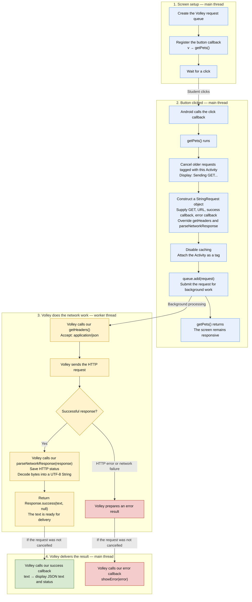

<div markdown="1" class="english">

## Callback walkthrough: who calls our code, and when?

**Runnable checkpoint:** the code edits above are complete. Build and run the app, press **GET available pets**, and check that the response text appears. Now use this walkthrough to explain the code you have just run. The annotated excerpt below is a reading aid for that existing code; keep it in its existing method locations.

This chunk contains **three callbacks and two overridden methods**. A callback means:

> Here is code to run when something happens. I am giving you that code now; you will call it later.

There are two different Java mechanisms here:

| Code | How we supply it | Who calls it? |
|:---|:---|:---|
| `v -> getPets()` | Button-click callback | Android, when the button is clicked |
| `text -> { ... }` | Success callback passed to the constructor | Volley, when the result is ready |
| `this::showError` | Error callback passed to the constructor | Volley, when the request fails |
| `getHeaders()` | Overridden method in an anonymous subclass | Volley, while preparing the request |
| `parseNetworkResponse(...)` | Overridden method in that same subclass | Volley, while processing a successful response |

The overridden methods are also hooks through which Volley calls our code. **They are defined differently from the two constructor callback arguments.**

### The complete flow



The first and last sections use **the same main thread**. Network work and response parsing happen on a worker thread; Volley delivers the callbacks on the main thread so they can update the screen. See [Volley's execution model](https://google.github.io/volley/simple.html).

### The same code, heavily commented

The comments explain both the syntax and the timing. The first two statements belong at the end of the existing `onCreate` method.

```java
// Create a queue that manages network work in the background.
// Creating the queue does not send our GET request yet.
queue = Volley.newRequestQueue(getApplicationContext());

// Give Android a callback to remember.
// Android calls it when the button is clicked.
// v is the clicked View; this callback does not need to use it.
binding.getPets.setOnClickListener(v -> getPets());
} // End of the existing onCreate method.

/**
 * Creates and submits a GET request.
 *
 * The response arrives later through a callback.
 * This method does not wait for the server or return its response.
 */
private void getPets() {

    // Cancel older requests carrying this Activity's tag.
    // Their response callbacks should no longer update this screen.
    queue.cancelAll(this);

    // This runs immediately, before the response arrives.
    binding.status.setText("Sending GET...");

    // Construct a request object.
    // The constructor receives FOUR arguments:
    StringRequest request = new StringRequest(

            // Argument 1: which HTTP operation?
            Request.Method.GET,

            // Argument 2: where should the request go?
            BASE_URL + "/pet/findByStatus?status=available",

            // Argument 3: SUCCESS CALLBACK.
            // We give Volley this code now.
            // Later, Volley supplies the String named text and calls it.
            text -> {
                // text contains the decoded HTTP response body.
                // It is still JSON TEXT, not Pet objects.
                binding.responseJson.setText(text);
                binding.status.setText("GET HTTP " + httpStatus);
            },

            // Argument 4: ERROR CALLBACK.
            // Pass a reference to this Activity's showError method.
            // Equivalent to: error -> showError(error)
            this::showError

    ) {
        // The constructor arguments have ended at the ")" above.
        //
        // These braces define an ANONYMOUS SUBCLASS of StringRequest:
        // a subclass created here without giving it a separate class name.
        //
        // Its methods below are NOT additional constructor arguments.
        // They replace inherited behavior for this request object.

        /**
         * Volley calls this while preparing the HTTP request.
         *
         * @return request headers asking for a JSON response
         */
        @Override
        public Map<String, String> getHeaders() {
            // A Map containing one header name/value pair.
            return Collections.singletonMap("Accept", "application/json");
        }

        /**
         * Volley calls this on a worker thread after receiving
         * a successful network response.
         *
         * @param response HTTP status, headers, and raw body bytes
         * @return a successful Volley result containing decoded text
         */
        @Override
        protected Response<String> parseNetworkResponse(
                NetworkResponse response) {

            // Save the HTTP status for the success callback to display.
            httpStatus = response.statusCode;

            // response.data is a byte array.
            // Decode those bytes using UTF-8 to create a Java String.
            //
            // Response.success wraps that String as a Volley result.
            // null means there is no cache entry attached to this result.
            //
            // Returning this result does NOT directly execute our callback.
            // Volley schedules its delivery on the main thread.
            return Response.success(
                    new String(
                            response.data,
                            java.nio.charset.StandardCharsets.UTF_8),
                    null);
        }
    };

    // Finish configuring the request before submitting it.
    request.setShouldCache(false);

    // Tag it with this Activity so cancelAll(this) can identify it.
    request.setTag(this);

    // Submit the request. Volley can now process it asynchronously.
    queue.add(request);

    // The method ends without waiting for the response.
    // Volley will call the appropriate callback later,
    // unless the request has been cancelled.
}
```

Volley's source confirms that `parseNetworkResponse` runs during background processing, and that the returned result is subsequently delivered through its response-delivery mechanism: [network processing](https://github.com/google/volley/blob/master/core/src/main/java/com/android/volley/NetworkDispatcher.java), [callback delivery](https://github.com/google/volley/blob/master/core/src/main/java/com/android/volley/ExecutorDelivery.java).

### Small Q&A

1. **Does writing `text -> { ... }` execute that code immediately?**  
   No. It supplies a callback. Volley calls it later when a successful result is ready.
2. **Where does `text` get its value?**  
   Our `parseNetworkResponse` creates a String from the response bytes. Volley delivers that String as the success callback's argument.
3. **Why write `this::showError` instead of `showError()`?**  
   We are giving Volley a method to call later. Volley will supply the error argument when it calls that method.
4. **Are `getHeaders` and `parseNetworkResponse` inside the success callback?**  
   No. The success callback ends before `this::showError`. The methods belong to the anonymous subclass that starts **after the constructor's closing `)`**.
5. **Have we deserialized any animals yet?**  
   No. `new String(...)` converts bytes into text. A later `gson.fromJson(...)` converts that JSON text into animal objects.

</div>
