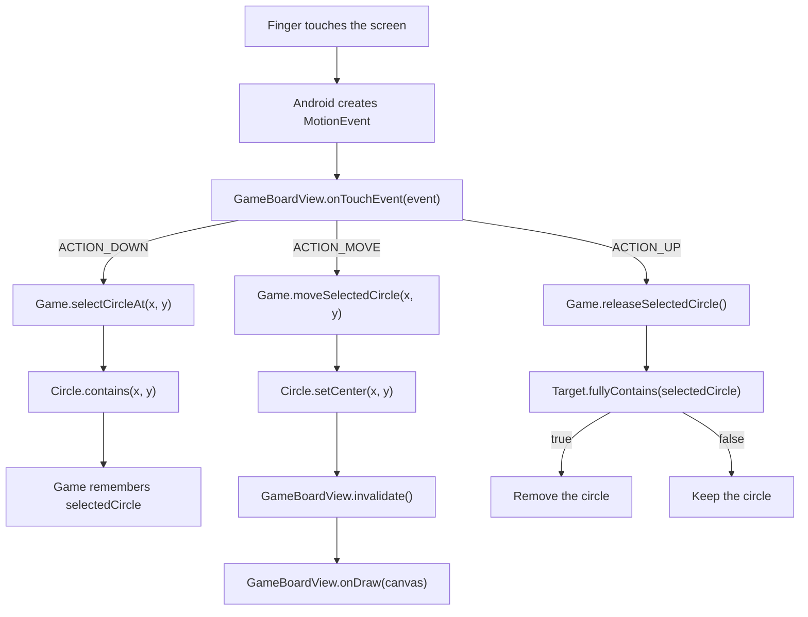

<style>
main {
  direction: ltr !important;
  text-align: left !important;
}
</style>

[Hebrew version]({{ '/android/CollectCircles/02.collect-circles-game' | relative_url }}) · [English chapter index]({{ '/android/CollectCircles/en/' | relative_url }})


[Previous chapter]({{ '/android/CollectCircles/en/01.collect-circles-drawing' | relative_url }}){: data-sequence-nav="prev"} · [Next chapter]({{ '/android/CollectCircles/en/03.collect-circles-finish' | relative_url }}){: data-sequence-nav="next"}

On a touch screen, swipe right for the next chapter and left for the previous chapter.

{: .box-note}
This lesson continues directly from the static version of [CollectCircles 1]({{ '/android/CollectCircles/en/01.collect-circles-drawing' | relative_url }}). By the end, the board will contain five random circles you can drag into the target. The timer, best time, and active button are not part of this step yet.


## What changes at this point

In the previous step, `GameBoardView` created a target and three circles at fixed positions. Now:

1. The `Game` class will hold the target, the list of circles, and the game rules.
2. `GameBoardView` will remain responsible for Android-specific work:
   drawing and receiving touch events.
3. Once the board knows its size, it automatically creates a game. This makes the app playable,
   even though the Start button will not be enabled until the next lesson.

The key transition is from an image to a system with **state**. Previously, we had a preview array and fixed positions; now the list in `Game` is the source of truth. Drawing, selecting, moving, and removing circles do not use four separate copies of the data: they all act on the same `Circle` objects.

## 1. Create the `Game` class

In the **Android** window, under `app > kotlin+java > com.example.collectcircles`, create a **Java Class** named `Game`:

```java
package com.example.collectcircles;

import android.graphics.Canvas;
import android.graphics.Paint;

import java.util.ArrayList;
import java.util.List;
import java.util.Random;

public class Game {
    private static final int CIRCLE_COUNT = 5;

    private final Random random = new Random();
    private final Target target;
    private final List<Circle> circles = new ArrayList<>();
    private Circle selectedCircle;

    /**
     * Creates a new game and places a target and random circles in it.
     *
     * @param boardWidth The width of the game board in pixels
     * @param boardHeight The height of the game board in pixels
     * @param targetRadius The radius of the target
     * @param targetColor The target color
     * @param crossColor The color of the cross in the center of the target
     * @param crossStrokeWidth The thickness of the cross strokes
     * @param circleColor The color of the circles being collected
     */
    public Game(float boardWidth, float boardHeight, float targetRadius,
                int targetColor, int crossColor, float crossStrokeWidth,
                int circleColor) {
        target = new Target(
                boardWidth / 2f,
                boardHeight / 2f,
                targetRadius,
                targetColor,
                crossColor,
                crossStrokeWidth
        );

        createCircles(boardWidth, boardHeight, circleColor);
    }

    /**
     * Draws the target and all circles still in play.
     *
     * @param canvas the canvas
     * @param paint the color and style settings used for drawing
     */
    public void draw(Canvas canvas, Paint paint) {
        target.draw(canvas, paint);
        for (Circle circle : circles) {
            circle.draw(canvas, paint);
        }
    }

    /**
     * Selects the topmost circle containing the touch point.
     *
     * @param x the touch point’s horizontal position
     * @param y the touch point’s vertical position
     * @return {@code true} if a circle is found and selected at the point
     */
    public boolean selectCircleAt(float x, float y) {
        for (int i = circles.size() - 1; i >= 0; i--) {
            Circle circle = circles.get(i);
            if (circle.contains(x, y)) {
                selectedCircle = circle;
                return true;
            }
        }

        selectedCircle = null;
        return false;
    }

    /**
     * Moves the selected circle to a new point, if one is selected.
     *
     * @param x The position of the new center on the horizontal axis
     * @param y The position of the new center on the vertical axis
     */
    public void moveSelectedCircle(float x, float y) {
        if (selectedCircle != null) {
            selectedCircle.setCenter(x, y);
        }
    }

    /**
     * Releases the selected circle and collects it if it is fully contained in the target.
     *
     * @return {@code true} if the circle is collected; {@code false} if no circle is collected or selected
     */
    public boolean releaseSelectedCircle() {
        if (selectedCircle == null) {
            return false;
        }

        boolean collected = target.fullyContains(selectedCircle);
        if (collected) {
            circles.remove(selectedCircle);
        }
        selectedCircle = null;
        return collected;
    }

    /**
     * Deselects the current circle without collecting it.
     */
    public void cancelSelection() {
        selectedCircle = null;
    }

    /**
     * @return {@code true} if all circles have been collected
     */
    public boolean isFinished() {
        return circles.isEmpty();
    }

    /**
     * Creates the game’s circles at valid random positions.
     *
     * @param boardWidth The width of the game board in pixels
     * @param boardHeight The height of the game board in pixels
     * @param circleColor the color of the circles
     */
    private void createCircles(float boardWidth, float boardHeight,
                               int circleColor) {
        float circleRadius = target.getRadius() / 2f;

        while (circles.size() < CIRCLE_COUNT) {
            float x = randomCoordinate(
                    circleRadius,
                    boardWidth - circleRadius
            );
            float y = randomCoordinate(
                    circleRadius,
                    boardHeight - circleRadius
            );
            Circle candidate =
                    new Circle(x, y, circleRadius, circleColor);

            if (!overlapsExistingCircle(candidate)) {
                circles.add(candidate);
            }
        }
    }

    /**
     * Checks if a candidate circle overlaps a target or an existing circle.
     *
     * @param candidate The circle whose position is checked
     * @return {@code true} if the candidate overlaps with an object already in the game
     */
    private boolean overlapsExistingCircle(Circle candidate) {
        if (candidate.overlaps(target)) {
            return true;
        }

        for (Circle circle : circles) {
            if (candidate.overlaps(circle)) {
                return true;
            }
        }
        return false;
    }

    /**
     * Chooses a random coordinate within the given range.
     *
     * @param minimum The lower limit of the range
     * @param maximum The upper limit of the range
     * @return A random coordinate between the bounds
     */
    private float randomCoordinate(float minimum, float maximum) {
        return minimum + random.nextFloat() * (maximum - minimum);
    }
}
```

### How do we create five circles in valid positions?

The radius of each green circle is half the radius of the target:

```java
float circleRadius = target.getRadius() / 2f;
```

In each loop iteration, random values are chosen for `x` and `y`. The bounds start at the radius and end at the width or height minus the radius, keeping the whole circle inside the board.

The reason is that the coordinates describe the **center**, not the corner of the circle. If the center of a circle with radius `r` is at `x = 0`, half of it will be clipped outside the board. The range `r <= x <= width - r` leaves a distance of a whole radius from each edge; the same logic applies to `y`.

The candidate is accepted only if:

- It does not overlap the target;
- It does not overlap any green circle already accepted.

Both tests use the method from the previous lesson:

```text
distance < r1 + r2
```


Here, `d` measures the distance between the candidate’s center and the existing object’s center. If `d < r1 + r2`, the line segment between the centers is too short to fit both radii, so the areas overlap. We reject that candidate and generate another. If `d == r1 + r2`, the circles only touch; under our chosen rule, this is a valid position.

We deliberately keep the code short. With the board and circle sizes we chose, there is enough room, so the loop continues until it finds five circles. We do not add handling for a board that is too small.

A simple invariant always holds: every circle already in the list is fully inside the board and overlaps neither the target nor any earlier circle. Only candidates satisfying this rule are added. If we greatly increase the number of circles or their radius, there may be no valid space left and the loop may never finish. In this teaching version, the fixed sizes are part of the algorithm’s assumptions.

## 2. Select, move, and release

`selectCircleAt` searches the list from the end to the beginning. The last circle is drawn last, so it appears "above" the others if they overlap during play.

`moveSelectedCircle` updates the center of the circle according to the position of the finger.

This selection means that the center of the circle "jumps" to the finger even if the student touched near its edge. This is simple and clear behavior for a first step. To preserve the original grab point, you would store the offset between the finger and the center during `ACTION_DOWN` and add it to each movement.

On release, use the stricter test we created in `Target`:

```java
boolean collected = target.fullyContains(selectedCircle);
```

Only if:

```text
distance + smallRadius <= targetRadius
```

do we remove the circle. A circle that merely touches the target or is only partly inside it remains on the board.

You can understand the formula without memorizing it: `distance` takes us from the target’s center to the circle’s center, and `smallRadius` takes us from there to its farthest edge. If the total distance does not exceed the target’s radius, the whole circle is inside. Equality is allowed because a circle touching the rim **from inside** still does not extend beyond the target.

{: .box-warning}
Do not use `target.overlaps(selectedCircle)` here. That would remove a circle even if it had only slightly entered the target, contradicting the game’s instruction to "put the whole circle inside".

## 3. Replace the sample view with `Game`

In `GameBoardView` add:

```java
import android.view.MotionEvent;
```

Replace the preview fields:

```diff
 private final Paint paint = new Paint(Paint.ANTI_ALIAS_FLAG);

-private Target target;
-private Circle[] previewCircles = new Circle[0];
+private Game game;
```

Replace `onSizeChanged`. Now the actual board size is passed to `Game`:

```java
/**
 * Creates a new game that fits the board’s new dimensions.
 *
 * @param width the new board width in pixels
 * @param height the new board height in pixels
 * @param oldWidth the previous board width in pixels
 * @param oldHeight the previous board height in pixels
 */
@Override
protected void onSizeChanged(int width, int height,
                             int oldWidth, int oldHeight) {
    super.onSizeChanged(width, height, oldWidth, oldHeight);

    float targetRadius = Math.min(
            dp(TARGET_RADIUS_DP),
            Math.min(width, height) / 5f
    );
    game = new Game(
            width,
            height,
            targetRadius,
            color(R.color.target_red),
            color(R.color.target_cross),
            dp(2f),
            color(R.color.circle_green)
    );
}
```

The target stays in the center. `Math.min` keeps its radius at `64dp` on a normal screen, but reduces it if the board is particularly narrow or short.

`onDraw` also becomes shorter:

```java
/**
 * Draws the current game state on the board.
 *
 * @param canvas The drawing surface provided by the Android system
 */
@Override
protected void onDraw(Canvas canvas) {
    super.onDraw(canvas);

    if (game == null) {
        return;
    }

    game.draw(canvas, paint);
}
```

## 4. Handle touch events

Add to `GameBoardView`:

```java
/**
 * Handles selecting, dragging, and releasing a circle through touch events.
 *
 * @param event The touch event provided by the Android system
 * @return {@code true} if the board handled the event
 */
@Override
public boolean onTouchEvent(MotionEvent event) {
    if (game == null) {
        return false;
    }

    switch (event.getActionMasked()) {
        case MotionEvent.ACTION_DOWN:
            boolean selected =
                    game.selectCircleAt(event.getX(), event.getY());
            if (selected) {
                getParent().requestDisallowInterceptTouchEvent(true);
            }
            return selected;

        case MotionEvent.ACTION_MOVE:
            game.moveSelectedCircle(event.getX(), event.getY());
            invalidate();
            return true;

        case MotionEvent.ACTION_UP:
            game.moveSelectedCircle(event.getX(), event.getY());
            game.releaseSelectedCircle();
            getParent().requestDisallowInterceptTouchEvent(false);
            invalidate();
            performClick();
            return true;

        case MotionEvent.ACTION_CANCEL:
            game.cancelSelection();
            getParent().requestDisallowInterceptTouchEvent(false);
            invalidate();
            return true;

        default:
            return super.onTouchEvent(event);
    }
}
```

`MotionEvent` describes a touch sequence:

- `ACTION_DOWN` — the finger touches the screen; look for a circle containing the touch point.
- `ACTION_MOVE` — the finger moves; the circle’s center follows it.
- `ACTION_UP` — the finger is lifted; check whether the circle is collected.
- `ACTION_CANCEL` — Android cancels the sequence; clear the selection without collecting.

This is one sequence with a beginning, zero or more moves, and an end. We therefore keep `selectedCircle` between calls: we do not need to search again on every `ACTION_MOVE`, and we cannot accidentally switch to another circle the finger passes over.

| Event | Model change | Why redraw? |
|---|---|---|
| `ACTION_DOWN` | The selection is stored | The position has not changed yet |
| `ACTION_MOVE` | The circle’s center changes | To show its new position |
| `ACTION_UP` | The circle is removed or remains | To show the release result |
| `ACTION_CANCEL` | The selection is cleared | To finish the sequence in a clean state |

`invalidate()` asks Android to call `onDraw` again. No need for a drawing loop that runs all the time: redraw only when the circle moves or changes.

`requestDisallowInterceptTouchEvent(true)` asks the parent not to intercept subsequent events while dragging.

`ACTION_CANCEL` is not a "rare failure" that can be ignored. It may arrive when a parent component takes over the gesture or when the system interrupts it. Resetting the selection there prevents a situation where an old circle remains marked and moves on the next touch.

### Who gets the touch?

`Circle` does not inherit from `View`, so Android does not send touch events to it directly. This is intentional: we have one `GameBoardView` that represents the entire game board, and it draws all the circles inside it. When touch arrives, the board asks `Game` which `Circle` contains the touch point.



This division keeps roles simple:

- `GameBoardView` knows the touch and drawing mechanism of Android.
- `Game` manages the list of circles and the selected circle.
- `Circle` knows how to calculate if a point is inside it and update its center.
- `Target` knows how to check if a circle is completely inside it.

It was possible to create a separate `View` for each circle, but then we would have to manage five separate UI elements, locations, and listeners. In a small game drawn on `Canvas`, a single board is the shorter and more natural solution.

Also add:

```java
/**
 * Reports the completed board click to accessibility tools.
 *
 * @return always {@code true}, because the click was handled
 */
@Override
public boolean performClick() {
    super.performClick();
    return true;
}
```

Calling this from `ACTION_UP` also preserves the `View` contract for accessibility tools.

## 5. Running and testing

Run the application and check:

1. Launch the app. Five circles should appear immediately.
2. Make sure no circle starts on the target or another circle.
3. Drag a circle and notice that it follows the finger.
4. Release it when it overlaps only part of the target - it should stay.
5. Drag it so that it is all inside the target - it should disappear.
6. Collect all five. At this point the board remains blank; the end message will be added in the next lesson.

{: .box-success}
This version is now playable. We still need to add restarting, timing, a saved best time, and a completion message.

---

## Continue

- [CollectCircles 3 - time, best time and the end of the game ](/android/CollectCircles/en/03.collect-circles-finish){: data-sequence-nav="next"}

<!-- gemini-tutor-links:start -->
<div markdown="1" class="english">

## Gemini tutor

{: .box-note}
[Open Gem: CollectCircles Studio: Drawing and Playing](https://gemini.google.com/gem/1tCWfmWXHC-7lgnR3U4GgZ84wB_-Zs8A5?usp=sharing) to get hints, diagnostic questions and explanations appropriate to the stage you are at.

</div>
<!-- gemini-tutor-links:end -->
