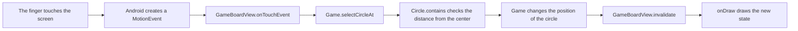

<style>
main {
  direction: ltr !important;
  text-align: left !important;
}
</style>

[Hebrew version]({{ '/android/CollectCircles/04.collect-circles-oop-afterthought' | relative_url }}) · [English chapter index]({{ '/android/CollectCircles/en/' | relative_url }})


[Previous chapter]({{ '/android/CollectCircles/en/03.collect-circles-finish' | relative_url }}){: data-sequence-nav="prev"} · [Next chapter]({{ '/android/CollectCircles/en/05.collect-circles-local-notification' | relative_url }}){: data-sequence-nav="next"}

On a touch screen, swipe right for the next chapter and left for the previous chapter.

{: .box-note}
This chapter invites reflection after completing the game. It requires no code changes. Its purpose is to examine our choices critically rather than turn them into rigid rules.


## A good question: Why doesn’t `Circle` inherit from `View`?

In our game, only `GameBoardView` is an Android UI component. It receives touch events and draws the whole game. `Circle` and `Target` are ordinary objects outside the View hierarchy.

This is intentional. Android sends a touch event to a `View` in the View hierarchy, rather than to any object that has been drawn. A circle drawn on `Canvas` is just pixels; the operating system does not know that a "clickable circle" has been created there. `GameBoardView` therefore receives the event and turns it into an action in the game world:



So `Circle` does help handle touch, through **delegation**, rather than receiving the event directly.

## Is it similar to Blobby?

In [pygameBlobby](https://github.com/3strategy/pygameBlobby), the inheritance chain looks like this:

```text
pygame.sprite.Sprite ← SharedSprite ← Player
```

This is a reasonable choice in Pygame: `pygame.sprite.Sprite` is part of its game machinery, integrating with sprite groups, updates, and drawing. You can see this in [`Shared.py`](https://github.com/3strategy/pygameBlobby/blob/master/Shared.py) and [`player.py`](https://github.com/3strategy/pygameBlobby/blob/master/player.py).

However, `pygame.sprite.Sprite` is not an exact equivalent of Android’s `View`. It is closer to an "object in the game scene". A `View` belongs to a complete interface system, with measurement, layout, focus, accessibility, a parent–child hierarchy, and event dispatch.

The idea behind Blobby applies here too: a game object should fit into the game’s machinery. This does not mean every circle must inherit from `View`. In our project, that machinery is `Game` together with `GameBoardView`.

## Three correct ways, for different purposes


| Design | Advantage | Cost | When it fits |
|---|---|---|---|
| `Circle extends View` | Each circle gets View events, positioning, and accessibility | More code, coordinate conversions, layering, and layout | A few independent UI components |
| One `GameBoardView` with ordinary game objects | Drawing, layering, and dragging stay simple | We must implement hit testing and accessibility ourselves | A Canvas game with moving objects |
| Pure model + separate renderer | Easy to test game rules without Android | More classes and data passing | A larger game or code needing extensive tests |

For our small game, I would keep a single `GameBoardView`. Five `CircleView` objects would be possible, but would not necessarily teach better OOP; they would mainly add Android-specific details. A View also has rectangular bounds, so we would still need a special test to determine whether the finger is inside the circle itself.

{: .box-warning}
In a real app where each circle is an independent control—for example, one that must be reachable by keyboard or screen reader—a separate View may be a better choice. In a Canvas game, accessibility must be implemented explicitly.

## An important criticism of the current code

`Circle` is a **regular Java class**, but it is not a **pure model**. It imports `Canvas` and `Paint` and knows how to draw itself. `Game` also accepts `Canvas` and `Paint`. That's why the sentence "All the drawing remains in `GameBoardView`" is not completely accurate.

The current code is an educational compromise:

- Position, radius, and geometry calculations are kept with the circle.
- The circle knows how to draw itself.
- The View handles the Android lifecycle and events.
- `Game` manages the objects and collection rules.

For a small high-school project, this is a reasonable compromise: few classes, little code, and a visible division of responsibilities. If we wanted a pure model, `Circle` would contain only data and geometry, with drawing moved to a `Renderer` class or `GameBoardView`. That would be architecturally cleaner, but would add a layer we do not need yet.

## And what about `Target extends Circle`?

Right now the inheritance is useful: a target is geometrically a circle, so it uses the center, radius, `distanceTo` and the base drawing. It adds a cross and checks if another circle is entirely within it.

However, saying "a target is a circle" is not enough. We should ask whether a `Target` can be used wherever a `Circle` is expected, without surprising behavior. In the current game, the answer is almost always yes, making inheritance reasonable.

If draggable circles later gain speed, scoring, and touch behavior while the target follows entirely different rules, it may be better for both to **contain** shared circle geometry rather than inherit from one another. This is composition over inheritance: sharing capabilities without forcing an inheritance relationship.

## OOP does not mean "everything you see must inherit a UI component"

Inheritance should express a true **is-a** relationship and match the behavior of the parent class. It is not a reward you get for creating a class.

- `Player is a pygame Sprite` — suitable, because it participates in the Sprites mechanism.
- `GameBoardView is an Android View` — suitable, because it participates in measurement, drawing and touch distribution.
- `Circle is an Android View` — sometimes suitable, but not when it's just an object inside a Canvas drawing.
- `Target is a Circle` — fits right now geometrically, but worth checking again if their responsibilities diverge.

Good OOP design is guided by responsibilities and expected changes, not by the number of parent classes.

## And what did we learn from TicTacMenu?

In `TicTacMenu`, separating `TicTacToeModel` has a more natural justification. A tic-tac-toe board and its rules are independent of Android: legal moves, turns, wins, and draws should work the same whether the display uses nine buttons, Canvas, a website, or a network game. The buttons really are UI components, while the board represents game state.

But just creating a folder named `models` does not prove that the separation is good. In the current code:

- `checkWin()` and `isTie()` are not yet implemented, so the model does not yet really hold all the rules of the game.
- The activity checks for legality, performs a move, updates a button and switches players in several separate steps.
- `makeMove()` and `setMove()` perform similar functions.
- The game flow is duplicated between `MainActivity` and `Main2Activity`.
- `"X"` and `"O"` are unrestricted strings rather than a type that limits the possible values.

You do not need to fix all of this at the first stage. Instead, treat it as a prompt for the next question: when adding wins, draws, and network play, which responsibilities start being duplicated or leaking out of the model?

In a more mature version, I would ask the model to perform one operation, such as "try to make a move", and receive a result: illegal move, game continues, win, or draw. The Activity would turn that result into a display update. This lets the model enforce its own rules, without the UI needing to know their execution order.

## Rule of thumb for students

Before introducing inheritance or a Model class, ask:

1. What changes when the rules of the game change?
2. What changes when only the design or Android changes?
3. Who receives the event, and who just decides what it means?
4. Can the child class really replace the parent class?
5. Does the separation save duplication or enable testing, or does it just add files?

{: .box-success}
The conclusion is that CollectCircles uses a small solution suited to this learning stage, rather than one universally "right solution". Describe it accurately as **game objects inside a View that draws them**, rather than a "pure model". In TicTacMenu, keep a separate model, but require it to contain the game rules as well as the array of cells.

## Continue

- [Roadmap to Chapters 5–7: From Local Alert to Firebase](/android/CollectCircles/en/05-07.student-roadmap)
- [link to guide 5: notification](/android/CollectCircles/en/05.collect-circles-local-notification){: data-sequence-nav="next"}

<!-- gemini-tutor-links:start -->
<div markdown="1" class="english">

## Gemini tutor

{: .box-note}
[Open Gem: CollectCircles Studio: Drawing and Playing](https://gemini.google.com/gem/1tCWfmWXHC-7lgnR3U4GgZ84wB_-Zs8A5?usp=sharing) to get hints, diagnostic questions and explanations appropriate to the stage you are at.

</div>
<!-- gemini-tutor-links:end -->
