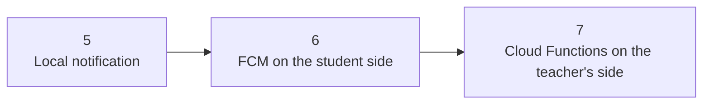

[Hebrew version]({{ '/android/CollectCircles/05-07.student-roadmap' | relative_url }}) · [English chapter index]({{ '/android/CollectCircles/en/' | relative_url }})

[Previous chapter]({{ '/android/CollectCircles/en/03.collect-circles-finish' | relative_url }}){: data-sequence-nav="prev"} · [Next chapter]({{ '/android/CollectCircles/en/05.collect-circles-local-notification' | relative_url }}){: data-sequence-nav="next"}

On the touch screen, you can swipe right to the next chapter and left to the previous chapter.

{: .box-note}
The game is complete by the end of chapter 3. In chapters 5–7, we use it to learn three layers of notifications without changing its rules. Each chapter adds one step to the flow, letting you run and check the result before continuing.

## The big picture

- In chapter 5 the application displays a notification **on the same phone**.
- In chapter 6, a message travels through FCM and can reach **other phones**.
- In chapter 7 we will learn who activates the process in the cloud and how the teacher deploys the functions.

## [Chapter 5 — Local notification](/android/CollectCircles/en/05.collect-circles-local-notification)

Let's start with the shortest route: clicking in the application creates a notification and delivers it directly to Android on the same device. We will add notification permission, `NotificationChannel` and a test button.

**What will you see at the end?** Press `LocalNotif` and immediately receive a notification on your phone.

{: .box-success}
This is a standalone checkpoint: a working local notification demonstrates permission, channels, and display. Firebase and a network connection are not needed yet.

## [Chapter 6 — Notifications through FCM](/android/CollectCircles/en/06.collect-circles-fcm-invitations)

We will connect the application to Firebase, subscribe to topics and receive messages that arrive via Firebase Cloud Messaging. We will learn the difference between the `notification` message and the `data` message, and see what happens when the application is in the foreground or background.

**What will you see at the end?** One device can initiate an invitation, and FCM forwards it to the registered devices - including the sending device for testing.

For most students this is the end of the practical track:

- The Android side is connected and working.
- It is possible to send and receive messages through the infrastructure that the teacher has deployed.
- Firebase project permissions or server access details are not required.

## [Chapter 7 — Cloud infrastructure](/android/CollectCircles/en/07.collect-circles-cloud-infrastructure)

This chapter is intended for the teacher or student managing the Firebase project. We will create and deploy Cloud Functions that receive a request, build a secure message and ask FCM to distribute it.

**What will you see at the end?** The full flow works: an app or external request calls the function, the function contacts FCM, and the notification reaches the devices.

{: .box-warning}
It is not necessary for every student to deploy a function. You should understand the route and the division of responsibility, but keys, permissions, billing and text sent to everyone remain under the control of the Firebase project owner.

## Who is responsible for what?

| Layer | Responsibility |
|---|---|
| Android | Permission, channel, topic subscription, and receiving messages |
| Cloud Function | Validating the request and deciding what content may be sent |
| FCM | Routing and delivering messages to subscribed devices |

{: .box-note}
After chapter 6 you can choose: continue to chapter 7 to understand and manage the cloud side, or go to [the roadmap for chapters 8–18](/android/CollectCircles/en/08-18.student-roadmap) and start turning the game into an Idle game.

## Continue

[Link to guide 5: Notification](/android/CollectCircles/en/05.collect-circles-local-notification){: data-sequence-nav="next"}

<!-- gemini-tutor-links:start -->

## Gemini tutor

{: .box-note}
[Open Gem: CollectCircles](https://gemini.google.com/gem/1gjXRaD60MfNq2FDXVuZxsud9-8bjKDrE?usp=sharing) notifications lab to get hints, diagnostic questions and explanations appropriate to the stage you are on.

<!-- gemini-tutor-links:end -->
