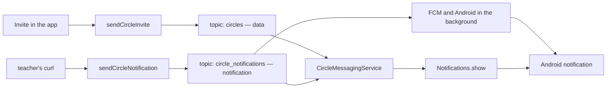

<style>
main {
  direction: ltr !important;
  text-align: left !important;
}
</style>

[Hebrew version]({{ '/android/CollectCircles/06.collect-circles-fcm-invitations' | relative_url }}) · [English chapter index]({{ '/android/CollectCircles/en/' | relative_url }})


[Previous chapter]({{ '/android/CollectCircles/en/05.collect-circles-local-notification' | relative_url }}){: data-sequence-nav="prev"} · [Next chapter]({{ '/android/CollectCircles/en/08.collect-circles-persistent-economy' | relative_url }}){: data-sequence-nav="next"}

On a touch screen, swipe right for the next chapter and left for the previous chapter.

{: .box-note}
In [chapter 5]({{ '/android/CollectCircles/en/05.collect-circles-local-notification' | relative_url }}) we created a channel, requested permission, and displayed a local notification. This chapter completes **the entire student side**: connecting the app to Firebase, subscribing to two FCM topics, and receiving both message types that the teacher’s server already sends. Students do not create, modify, or deploy serverless functions.


[Continue to Chapter 7: Teacher's Cloud Infrastructure](/android/CollectCircles/en/07.collect-circles-cloud-infrastructure)

[Roadmap to Chapters 8–18: From Short Game to Idle Game](/android/CollectCircles/en/08-18.student-roadmap)



{: .box-error}
The project must be called **`CollectCircles`**, and the package must be exactly **`com.example.collectcircles`**. Here "package" mainly means Gradle `applicationId`: this is the **Android package name** registered in Firebase. This is the app registered with the teacher; a different `applicationId` will not match the client settings and endpoint limits. If you started from a project with a different name, first follow the [guide to renaming the project and package]({{ '/android/projectSteps/191renameProject' | relative_url }}).

## Before starting: what the teacher gives and what the student does

The teacher has already prepared:

- A Firebase project with an Android app registered as `com.example.collectcircles`.
- Two callable functions: `sendCircleInvite` and `sendCircleNotification`.
- Two fixed topics: `circles` and `circle_notifications`.
- Four client configuration values per student.

Students only make the changes in this chapter and copy the four values supplied by the teacher. Do not put a service-account key, Admin SDK credential, or any other server secret in the app.

{: .box-note}
As in chapter 5, each change shows its exact location and a small diff against the code from the end of the previous chapter. `-` marks a removed line, `+` marks an added line, and unmarked lines provide existing context.

## 1. Prepare the local Firebase configuration

### A. Keep local values out of Git

Open the root `.gitignore` using **Search Everywhere** (press `Shift` twice). It sits beside `settings.gradle.kts`, so you can also reach it using right-click > Show in Explorer. Alternatively, switch to Project view. After part 2, return to Android view.

**Add:**

```diff
 /local.properties
+/firebase.properties
 /.idea/caches
```

### B. Create the student file

Beside `settings.gradle.kts`, create a new file named:

`firebase.properties`

{: .box-warning}
Create the file **at the project root, again using Project view**. Right-click the top row and choose New > File. This is inconvenient, but it is the clearest way to create a file there. You can also use File Explorer. Return to Android view after creating and editing it.

Copy the following structure to it and replace the four values with the values you received from the teacher:

```properties
FIREBASE_APPLICATION_ID=<mobilesdk_app_id>
FIREBASE_API_KEY=<firebase_api_key>
FIREBASE_PROJECT_ID=<firebase_project_id>
FIREBASE_SENDER_ID=<project_number>
```

If configured correctly, the file will be ignored by Git.

{: .box-warning}
`firebase.properties` contains only the **Firebase client configuration values**; the Firebase SDK itself is not in this file, and we will add the SDK libraries in the next section. The name `mobilesdk_app_id` in angle brackets is the name of the value you received from the teacher: copy its value after `FIREBASE_APPLICATION_ID=`. These values do not grant Admin permissions, but still keep them outside of Git: whoever obtains them can build a rogue application with the same `applicationId` of `CollectCircles`, connect it to the teacher's Firebase project, use FCM and abuse the teacher's callable functions. Therefore, `google-services.json`, which contains the same connection information, should not be published either, and such a file should not be copied from another Android application.

## 2. Add the Firebase libraries to the version catalog

{: .box-success}
Return to Android view now.

In the **Android** window, open:

`Gradle Scripts > libs.versions.toml (Version Catalog)`

Add the BoM version under `[versions]`:

```diff
 constraintlayout = "2.2.1"
+firebaseBom = "34.17.0"

 [libraries]
```

Under `[libraries]` add the three definitions:

```diff
 constraintlayout = { group = "androidx.constraintlayout", name = "constraintlayout", version.ref = "constraintlayout" }
+firebase-bom = { group = "com.google.firebase", name = "firebase-bom", version.ref = "firebaseBom" }
+firebase-messaging = { group = "com.google.firebase", name = "firebase-messaging" }
+firebase-functions = { group = "com.google.firebase", name = "firebase-functions" }

 [plugins]
```

The BoM selects compatible versions for Messaging and Functions, so the two libraries do not have a separate version number.

## 3. Teach Gradle to read the four values

In the **Android** window, open:

`Gradle Scripts > build.gradle.kts (Module :app)`

### A. Read the properties file

At the top of the file, before `plugins`, add the following code:

```diff
+import java.util.Properties
+
 plugins {
     alias(libs.plugins.android.application)
 }
+
+// firebase.properties contains only the four client values provided by the teacher.
+val firebaseProperties = Properties().apply {
+    val localFile = rootProject.file("firebase.properties")
+    localFile.inputStream().use(::load)
+}
+
+fun firebaseValue(name: String): String =
+    firebaseProperties.getProperty(name)
+        ?: error("Missing $name in firebase.properties")
```

### B. Convert the values to Android resources

In the same file, inside `buildFeatures`, also enable the creation of Android resources:

```diff
     buildFeatures {
         viewBinding = true
+        resValues = true
     }
```

As of Android Gradle Plugin 9 creating custom resources using `resValue` is not enabled by default in a Java-only project. Without this line Gradle cannot create the four string resources we will add using `resValue`.

Now, inside `defaultConfig`, after `testInstrumentationRunner`, add:

```diff
         testInstrumentationRunner = "androidx.test.runner.AndroidJUnitRunner"
+
+        resValue("string", "google_app_id", firebaseValue("FIREBASE_APPLICATION_ID"))
+        resValue("string", "google_api_key", firebaseValue("FIREBASE_API_KEY"))
+        resValue("string", "project_id", firebaseValue("FIREBASE_PROJECT_ID"))
+        resValue("string", "gcm_defaultSenderId", firebaseValue("FIREBASE_SENDER_ID"))
     }
```

These are the resource names the Firebase SDK expects. We therefore do not need to enable the Google Services plugin or add `google-services.json`. The library adds `FirebaseInitProvider` to the app, which reads these resources before `MainActivity` opens. We do not need to call `FirebaseApp.initializeApp` ourselves.

### C. Add the dependencies

Inside `dependencies`, after the existing Android libraries, add:

```diff
     implementation(libs.activity)
     implementation(libs.constraintlayout)
+    implementation(platform(libs.firebase.bom))
+    implementation(libs.firebase.messaging)
+    implementation(libs.firebase.functions)
     testImplementation(libs.junit)
```

Click **Sync Now** and wait for Gradle Sync to finish before continuing.

## 5. Create `CircleMessagingService` and subscribe to two topics

<div markdown="1" class="box-note">

### Why subscribe to topics?

An FCM message is not automatically sent to everyone who installed the game. The sender targets a **topic**, a kind of broadcast channel, and only installations subscribed to it receive the message. Our project has two paths, so each installation will subscribe to two topics:

- `circles` carries invitations between players. `sendCircleInvite` sends a **data** message to it;
  our code receives the data and decides whether to display a notification.
- `circle_notifications` carries the teacher’s messages. `sendCircleNotification` sends a
  **notification** message to it. FCM and Android can display this notification even
  when the Activity is closed or the app process is not running.

There are not two parallel handlers here, nor an `intercept`. For a **notification** message, FCM chooses a path based on the app’s state when the message arrives:

- **In the background:** FCM and Android deliver the message directly to the notification tray. Our `onMessageReceived()`
  is not called, and app code does not handle the message before the user presses it.
- **In the foreground:** FCM does not display the message automatically. It passes it to `onMessageReceived()`.
  This invokes a callback named `onMessageReceived()`, which we will implement in the new class. In this chapter,
  that callback displays the notification using `Notifications.show(this)`.

`onMessageReceived()` does not distribute the message to other users. FCM’s servers already send it to all installations subscribed to the topic, and each installation handles its copy according to its app state. If we left the callback empty, `circle_notifications` messages would still appear for subscribed users whose apps are in the background; only users with the app in the foreground would miss the notification. In contrast, **data** messages on `circles` need our `onMessageReceived()` code to display a notification. They depend more on our code, but **not** on the app already running in the background: FCM can start the app process and `FirebaseMessagingService` to deliver a data message. The difference is that there is no automatic display as a fallback. If our code does not display a notification, the user will not see one.

Topic subscriptions persist after registration. Later, when the game supports offline mode, users can receive messages even if they have not opened CollectCircles since reboot, provided the app previously subscribed, has not been **Force stopped**, still has notification permission, and has a network connection.

</div>

{: .box-success}
Now create a class extending `FirebaseMessagingService`. It will subscribe the game installation to both broadcast channels and handle messages delivered to our code, including notification messages received in the foreground.

In the **Android** window, go to:

`app > kotlin+java > com.example.collectcircles`

Right click on the package **`com.example.collectcircles`**, select **New > Java Class**, type `CircleMessagingService` and select **Class**. The new class will appear in the same package named `CircleMessagingService`.

Replace its content with the following code:

```java
package com.example.collectcircles;

import com.google.firebase.messaging.FirebaseMessaging;
import com.google.firebase.messaging.FirebaseMessagingService;
import com.google.firebase.messaging.RemoteMessage;

public class CircleMessagingService extends FirebaseMessagingService {

    static final String DATA_TOPIC = "circles";
    static final String NOTIFICATION_TOPIC = "circle_notifications";

    @Override
    public void onMessageReceived(RemoteMessage message) {
        super.onMessageReceived(message);

        // First endpoint: a data message. Our service decides whether to display it.
        if ("circle_invite".equals(message.getData().get("event"))) {
            Notifications.show(this);
        }

        // Second endpoint: a notification payload. In the background, FCM displays it itself;
        // in the foreground, it arrives here and we display the same fixed notification.
        if (message.getNotification() != null) {
            Notifications.show(this);
        }
    }

    @Override
    public void onRegistered(String installationId) {
        super.onRegistered(installationId);

        // The Firebase Installation ID can change. Resubscribe to both topics;
        // this is safe to repeat, and we do not need to store or print the ID itself.
        FirebaseMessaging.getInstance().subscribeToTopic(DATA_TOPIC);
        FirebaseMessaging.getInstance().subscribeToTopic(NOTIFICATION_TOPIC);
    }
}
```

{: .box-success}
This is where **both** topics are first defined: `DATA_TOPIC = "circles"` for `sendCircleInvite`, and `NOTIFICATION_TOPIC = "circle_notifications"` for `sendCircleNotification`. In `onRegistered`, subscribe to **both together** whenever the installation registers with FCM or its Firebase Installation ID changes.

At this point, the app should run, with no visible change yet.

## 6. Register the service and registration mode in the Manifest

Only after the class exists, open:

`app > manifests > AndroidManifest.xml`

Inside `application`, immediately after the theme line, add two metadata values:

- The first tells FCM which channel to use for notification messages in the background.
- The second enables the current FCM registration mechanism based on Firebase Installation ID, which we used
  in `onRegistered`.

After the `activity` tag, register the service we already created:

```diff
         android:roundIcon="@mipmap/ic_launcher_round"
         android:supportsRtl="true"
         android:theme="@style/Theme.CollectCircles">
+        <!-- Lesson 5 created this channel for Notifications.show(). -->
+        <!-- Without this default, background FCM uses its own fallback channel. -->
+        <!-- Our channel's name, sound, and importance settings would not apply. -->
+        <meta-data
+            android:name="com.google.firebase.messaging.default_notification_channel_id"
+            android:value="circle_invitations" />
+
+        <!-- Enable registration callbacks based on Firebase Installation ID. -->
+        <meta-data
+            android:name="firebase_messaging_installation_id_enabled"
+            android:value="true" />
+
         <activity
             android:name=".MainActivity"
             android:exported="true">
             <intent-filter>
                 <action android:name="android.intent.action.MAIN" />

                 <category android:name="android.intent.category.LAUNCHER" />
             </intent-filter>
         </activity>
+
+        <!-- Register our service for messages that FCM delivers to app code. -->
+        <!-- exported=false prevents other apps from starting it directly. -->
+        <service
+            android:name=".CircleMessagingService"
+            android:exported="false">
+            <intent-filter>
+                <!-- Route incoming FCM messages to this service. -->
+                <action android:name="com.google.firebase.MESSAGING_EVENT" />
+            </intent-filter>
+        </service>
     </application>
```

`android:exported="false"` prevents ordinary apps from starting the service. The intent filter allows FCM to deliver messages to it.

## 7. Subscribe to both topics when the app opens

`onRegistered` handles registration and changes to the Firebase Installation ID, but does not replace an explicit topic subscription request when the app opens. We therefore subscribe to both topics in `MainActivity` too.

Open:

`app > kotlin+java > com.example.collectcircles > MainActivity`

### A. Add imports

 ```diff
 import com.example.collectcircles.databinding.ActivityMainBinding;
+import com.google.firebase.messaging.FirebaseMessaging;
 import com.google.android.material.dialog.MaterialAlertDialogBuilder;
```

### B. Subscribe to both topics

In `onCreate`, immediately after registering `notificationPermissionLauncher` and before `getSharedPreferences`, add the entire following section:

```diff
         notificationPermissionLauncher = registerForActivityResult(
                 new ActivityResultContracts.RequestPermission(),
                 permissionGranted -> {
                     if (permissionGranted) {
                         Notifications.show(this);
                     } else {
                         Toast.makeText(
                                 this,
                                 R.string.notification_permission_denied,
                                 Toast.LENGTH_SHORT
                         ).show();
                     }
                 }
         );

+        // First registration for both topics. Resubscribing does not create a duplicate subscription.
+        FirebaseMessaging.getInstance().subscribeToTopic(
+                CircleMessagingService.DATA_TOPIC
+        );
+        FirebaseMessaging.getInstance().subscribeToTopic(
+                CircleMessagingService.NOTIFICATION_TOPIC
+        );
+
         preferences = getSharedPreferences(PREFERENCES_NAME, MODE_PRIVATE);
```

{: .box-note}
Here, both subscriptions are requested without opening a permission dialog or creating a channel. Before testing an external message, each receiving device must complete the chapter 5 `LocalNotif` test once: this button requests permission, then `Notifications.show` creates the channel after approval. `Invite` only sends an invitation, so it does not request permission. See [where and when to request notification permission]({{ '/android/CollectCircles/en/05.collect-circles-local-notification' | relative_url }}#id-notification-permission).

`subscribeToTopic` is asynchronous. FCM saves the subscription and retries after a temporary failure. We do not need to store our own boolean. Requesting the same topic again does not create a duplicate subscription.

## 8. Add an Invite button for the data message

### A. Updating the screen

Open:

`app > res > layout > activity_main.xml`

Add `inviteButton` after `localNotifButton` and update the board’s constraint:

```diff
     <com.example.collectcircles.GameBoardView
         android:id="@+id/gameBoard"
         android:layout_width="0dp"
         android:layout_height="0dp"
         android:layout_marginTop="16dp"
         android:layout_marginBottom="20dp"
         android:minHeight="320dp"
         app:layout_constraintBottom_toBottomOf="parent"
         app:layout_constraintEnd_toEndOf="parent"
         app:layout_constraintStart_toStartOf="parent"
-        app:layout_constraintTop_toBottomOf="@id/localNotifButton"
+        app:layout_constraintTop_toBottomOf="@id/inviteButton"
         tools:background="@color/board_background" />

     <com.google.android.material.button.MaterialButton
         android:id="@+id/localNotifButton"
         android:layout_width="0dp"
         android:layout_height="wrap_content"
         android:layout_marginTop="8dp"
         android:text="@string/local_notification"
         app:cornerRadius="14dp"
         app:layout_constraintEnd_toEndOf="parent"
         app:layout_constraintStart_toStartOf="parent"
         app:layout_constraintTop_toBottomOf="@id/startButton" />
+
+    <com.google.android.material.button.MaterialButton
+        android:id="@+id/inviteButton"
+        android:layout_width="0dp"
+        android:layout_height="wrap_content"
+        android:layout_marginTop="8dp"
+        android:text="@string/invite"
+        app:cornerRadius="14dp"
+        app:layout_constraintEnd_toEndOf="parent"
+        app:layout_constraintStart_toStartOf="parent"
+        app:layout_constraintTop_toBottomOf="@id/localNotifButton" />

 </androidx.constraintlayout.widget.ConstraintLayout>
```

### B. Add texts

Open `app > res > values > strings.xml` and add:

```diff
     <string name="local_notification">LocalNotif</string>
+    <string name="invite">Invite</string>
     <string name="restart">Restart</string>
```

Further down in the same file, before `</resources>`:

```diff
     <string name="notification_permission_denied">Notification permission is required</string>
+    <string name="invite_sent">Invitation sent</string>
+    <string name="invite_failed">Invitation could not be sent</string>
 </resources>
```

### C. Add the import and connect the button to the teacher’s deployed function

Now that you will use Functions, add this import at the top of `MainActivity`:

```diff
 import com.example.collectcircles.databinding.ActivityMainBinding;
+import com.google.firebase.functions.FirebaseFunctions;
 import com.google.firebase.messaging.FirebaseMessaging;
```

In `MainActivity`, after the listener of `localNotifButton`, add:

```diff
         binding.localNotifButton.setOnClickListener(
                 view -> requestPermissionAndShowNotification()
         );
+        binding.inviteButton.setOnClickListener(view -> sendInvite());
         binding.gameBoard.setOnGameFinishedListener(this::finishGame);
```

Immediately after `onCreate` and before `requestPermissionAndShowNotification`, add:

```diff
     }

+    private void sendInvite() {
+        binding.inviteButton.setEnabled(false);
+
+        FirebaseFunctions.getInstance()
+                .getHttpsCallable("sendCircleInvite")
+                .call()
+                .addOnCompleteListener(task -> {
+                    binding.inviteButton.setEnabled(true);
+                    int message = task.isSuccessful()
+                            ? R.string.invite_sent
+                            : R.string.invite_failed;
+                    Toast.makeText(this, message, Toast.LENGTH_SHORT).show();
+                });
+    }
+
     private void requestPermissionAndShowNotification() {
```

The button is disabled during the call to prevent parallel clicks from the same screen. It is the server that chooses the topic and the content of the message; the client does not send a topic or free text.

## 10. The difference between the two paths

| Endpoint | Topic | Payload | App in the foreground | App in the background |
| --- | --- | --- | --- | --- |
| `sendCircleInvite` | `circles` | `data` |The service calls `Notifications.show`|The service calls `Notifications.show`|
| `sendCircleNotification` | `circle_notifications` | `notification` |The service receives the message and calls `Notifications.show`|FCM and Android display directly on the configured channel|

The second path is the reason for three details that are easy to miss:

- Subscribe to `circle_notifications` as well as `circles`.
- Complete the chapter 5 `LocalNotif` test once to create the channel after permission is granted.
- Define `default_notification_channel_id` in the Manifest with the same channel ID.

Closing normally or removing the app from the recent-apps screen is not Force stop. Notifications can appear while `MainActivity` is closed, provided the app has run and subscribed at least once. After **Force stop**, however, Android blocks delivery until the user opens the app again. After reboot, delivery may be delayed while Google Play services and the system finish initializing.

## 11. Test the student side

### Test A - preparation and registration

1. Do **Build > Make Project**.
2. Install and run the application on a device with Google Play services and a network connection.
3. Press `LocalNotif`, allow notifications, and check that the local notification appears.
4. Wait a few seconds for both `subscribeToTopic` calls to complete.

### Test B — data through the button

1. Run the application on two devices and complete Test A on both.
2. Click `Invite` on one device.
3. Check that a Toast says **Invitation sent**.
4. Make sure both devices receive notification via `circles`.

### Test C — notification through the teacher's curl

Leave the application in the background, but do not force stop it. The teacher runs the curl command provided for `sendCircleNotification`. Do not copy teacher credentials or serverless code to the Android project.

Make sure the notification comes through `circle_notifications` even when the CollectCircles screen is not open. Then open the application and ask the teacher to run the command again; In the foreground, the message should reach `CircleMessagingService`, which calls `Notifications.show`.

## If the test fails

- **Invite failure toast:** Check that all four `firebase.properties` values belong to the application
  `com.example.collectcircles` and that Gradle Sync has finished.
- **The server reports success but no notification appears:** Check notification permission in the app settings and
  the settings for the **Circle invitations** channel.
- **Only the data path works:** Check the `NOTIFICATION_TOPIC` subscription and the Manifest metadata,
  and make sure you completed the `LocalNotif` test once to create the notification channel.
- **Only the notification path works in the background:** Check `onMessageReceived`, the value
  `circle_invite` and the service registration in Manifest.
- **After Force stop there is nothing:** This is expected Android behavior. Open the application again.

{: .box-success}
By the end of this chapter, every installation subscribes to both `circles` and `circle_notifications` **when the app opens and whenever the Firebase Installation ID is registered or changes**. It can receive data messages displayed by our code and notification messages displayed directly by FCM and Android in the background. Both depend on the same user-granted notification permission.

## Message delivery using curl

The second notification path supports messages from a completely external source, rather than a phone. Imagine a decision made on a server.

Paste the following command to try it. Ask the teacher for the complete command, including the full URI.

```powershell
'{"data":{}}' | curl.exe -sS --fail-with-body `
  -H "Content-Type: application/json" `
  --data-binary "@-" `
  "https://teachers-firebase-name.cloudfunctions.net/the-function-name"
```

Notice that the request is empty. The serverless functions (Cloud Functions) fully control the message content.

## Official sources

- [FirebaseMessaging.subscribeToTopic](https://firebase.google.com/docs/reference/android/com/google/firebase/messaging/FirebaseMessaging)
- [Receiving Android messages](https://firebase.google.com/docs/cloud-messaging/android/receive)
- [Notification runtime permission](https://developer.android.com/develop/ui/views/notifications/notification-permission)
- [Callable Functions from Android](https://firebase.google.com/docs/functions/callable)

## Continue

- [Roadmap for chapters 8–18 — idle gameplay and WorkManager](/android/CollectCircles/en/08-18.student-roadmap)
- [Continue to Tutorial-8 (Student): A Persistent Circle Balance ](/android/CollectCircles/en/08.collect-circles-persistent-economy){: data-sequence-nav="next"}
- [To the teacher: Continue to tutorial 7: The serverless infrastructure](/android/CollectCircles/en/07.collect-circles-cloud-infrastructure)

<!-- gemini-tutor-links:start -->
<div markdown="1" class="english">

## Gemini tutor

{: .box-note}
[Open Gem: CollectCircles Notifications Lab](https://gemini.google.com/gem/1gjXRaD60MfNq2FDXVuZxsud9-8bjKDrE?usp=sharing) to get hints, diagnostic questions and explanations appropriate to the stage you are on.

</div>
<!-- gemini-tutor-links:end -->
