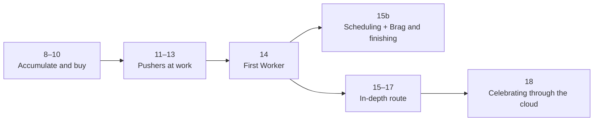

[Hebrew version]({{ '/android/CollectCircles/08-18.student-roadmap' | relative_url }}) · [English chapter index]({{ '/android/CollectCircles/en/' | relative_url }})

[Previous chapter]({{ '/android/CollectCircles/en/06.collect-circles-fcm-invitations' | relative_url }}){: data-sequence-nav="prev"} · [Next chapter]({{ '/android/CollectCircles/en/08.collect-circles-persistent-economy' | relative_url }}){: data-sequence-nav="next"}

On a touch screen, swipe right for the next chapter and left for the previous chapter.

{: .box-note}
In chapters 8–14, we will gradually turn CollectCircles from a short five-circle game into a small idle game: accumulate resources, buy Pushers, watch them work, and gain progress while the app is closed. After chapter 14, choose either a short route ending with a periodic notification or an in-depth route covering scheduling, JSON, and synchronization. **You do not need to complete both routes.**

## Where are we going?

By the end of the sequence, the game will have:

- Two modes: a short game and endless Auto mode;
- A circle balance, a Lifetime counter, and a Pushers shop;
- Small characters that walk up to circles and push them into the target;
- Progress calculated for time spent with the app closed;
- Background checks that account for battery and charging conditions;
- A simple class-wide Brag message after buying a Pusher;
- In the in-depth route only: a timetable, coordinated writes, and a richer Brag message with a player name.

We do not have to wait until chapter 18 to see a working result:

- After chapter 10 there is already an economy and a shop.
- After chapter 12, several Pushers visibly work alongside the player.
- After chapter 13, a basic idle game supports closing and reopening the app.
- After chapter 15b, a periodic Worker, eligibility notification, and group Brag are in place, so you can finish there.
- Chapters 15–18 provide optional material for the longer route.

## First stop: accumulate and buy

### [Chapter 8 — a persistent circle balance ](/android/CollectCircles/en/08.collect-circles-persistent-economy)

We will add `Circles`, `Lifetime` and `Pushers`. We will learn why a balance that can be spent is different from a counter that never goes down, and we will keep both even after closing the application.

**What will you see at the end?** Each circle you collect updates the status bar, and the numbers remain after reopening.

### [Chapter 9 — autonomous mode ](/android/CollectCircles/en/09.collect-circles-autonomous-mode)

We will add a saved Auto switch. In this mode, circles continue to appear, but their number on the board is limited so that the game remains comfortable and stable.

**What will you see at the end?** An endless board that you can continue playing without pressing Start again.

### [Chapter 10 — The Pushers shop ](/android/CollectCircles/en/10.collect-circles-pusher-shop)

We will put the balance to use. The first Pusher costs 64 circles, the next 128, then 256, and so on. A purchase reduces the balance but leaves Lifetime unchanged.

**What will you see at the end?** Shop dialog, price increasing in powers of 2 and purchase being saved.

{: .box-success}
A good stopping point: at this stage we have already built the game's economic loop - play, earn and buy an upgrade.

## Second stop: the workers come to life

### [Chapter 11 — drawing a walking Pusher ](/android/CollectCircles/en/11.collect-circles-draw-pusher)

We will draw a small figure directly on the Canvas and move its arms and legs. We will use elapsed time so that the movement does not depend on the speed of the device.

**What will you see at the end?** Every Pusher we bought turns into a walking character on the board.

### [Chapter 12 — The Pushers start working](/android/CollectCircles/en/12.collect-circles-pushers-work)

Each Pusher will select an unassigned circle, walk up to it, move into position, and push it into the target. Several Pushers can be at different stages of their work within the same frame, while the user can still drag circles manually.

**What will you see at the end?** The player and Pushers collect circles together without two workers choosing the same circle.

### [Chapter 13 — progress while the application is closed ](/android/CollectCircles/en/13.collect-circles-offline-progress)

We will not leave the game and animation running all night. Instead, save a timestamp and calculate how many circles the workers could have collected when the app next opens. Keep fractional circles too, so small amounts of progress are not lost.

**What will you see at the end?** Close the application, wait, open — and receive the accumulated work.

{: .box-success}
Major achievement: at the end of chapter 13 we already have a complete and simple Idle game. From here we use it to learn how Android manages real background jobs.

## Third stop: Android checks in at the right time

### [Chapter 14 — First Worker ](/android/CollectCircles/en/14.collect-circles-first-worker)

We will create a short eligibility check: are there enough circles to buy another Pusher? At first we will activate it by clicking to see a result immediately and get to know `Worker` and `WorkRequest` without waiting.

**What will you see at the end?** A check run by WorkManager that can display a purchase notification.

## After chapter 14 choose one route

### [The short track — chapter 15b: periodic notification, Brag and finishing ](/android/CollectCircles/en/15b.collect-circles-notification-only)

In one chapter, make the existing check periodic: a normal check respecting battery conditions and a more frequent check while charging. `canBuyPusher()` will calculate how many circles would exist if the user opened the application now, and the same Worker from chapter 14 will remain unchanged.

**What will you see at the end?** Periodic scheduling can notify users when they become eligible for a purchase while the app is closed, and buying a Pusher sends an anonymous Brag to the whole group — no JSON and no Worker writing offline progress.

This is the recommended ending track when the goal is to complete a working game without adding too many topics.

 Optional deepening track: chapters 15–18

### [Chapter 15 — Periodic work ](/android/CollectCircles/en/15.collect-circles-periodic-work)

We will schedule the check along two paths: a normal path respecting battery conditions and a more frequent path while charging. We will learn that WorkManager schedules suitable work without promising an exact execution time.

**What will you see at the end?** Two requests with different names and constraints in the Background Task Inspector.

### [Chapter 16 — timetable in JSON](/android/CollectCircles/en/16.collect-circles-json-schedule)

Add a time gate to the Worker. Without a charging requirement, check only during computer science lessons; while charging, allow checks every 15 minutes within the wider 08:00–24:00 window. Save the timetable as replaceable JSON.

**What will you see at the end?** The notification appears only when eligibility, battery conditions, and the time window all allow it.

### [Chapter 17 — Safe updates from the Worker](/android/CollectCircles/en/17.collect-circles-worker-settlement)

Now both the game screen and a Worker may update the same progress. Learn how `synchronized`, a fresh snapshot, and `volatile` prevent double counting and lost updates when UI and background work interact.

**What will you see at the end?** The Worker can settle offline progress before checking eligibility without overwriting the user’s actions.

{: .box-warning}
Chapters 15–17 explore background work and scheduling in depth, so they are less visual and add considerably more code. Choose them if you specifically want to study timetables, multiple writers, and synchronization. They are not required for the short route.

## Last stop: sharing the achievement

### [Chapter 18 — Brag after buying ](/android/CollectCircles/en/18.collect-circles-pusher-brag)

After a successful purchase, send the name, Pusher count, and Lifetime to a Cloud Function. The teacher’s code validates the data, constructs the message, and sends it to everyone in the group, including the sending device for easy testing.

**What will you see at the end?** Buy a Pusher and receive an achievement message whose text is controlled by the server.

## How to work without losing patience

1. Run the application at the end of each chapter and see the change before continuing.
2. Only the new feature is tested at a time; It is not necessary to repeat all the game tests in each lesson.
3. Save a working checkpoint. If the next chapter becomes difficult, you can return to a result that already worked.
4. In the background chapters, use the test buttons and the Background Task Inspector instead of waiting for hours.
5. After chapter 14, choose one route. You do not need to complete the regular chapter 15 before 15b.
6. When thread-related or asynchronous code appears, stop and ask: **Who runs the code, when does it end, and what data does it share with the UI?**

{: .box-note}
The goal is not just to finish a game. In the short track, the game demonstrates state saving, animation, a state machine, offline calculation and periodic work in the background. Coordinating multiple writers and adding more server communication remain optional topics for the longer route.

## Continue

[chapter 8 — a persistent circle balance ](/android/CollectCircles/en/08.collect-circles-persistent-economy){: data-sequence-nav="next"}

<!-- gemini-tutor-links:start -->

## Gemini tutors

Choose the appropriate teacher for the chapter you are in:

- [Gem: Idle Lab CollectCircles](https://gemini.google.com/gem/1xIrpd_3BdKX5rEl9cuvSjfqKCJ3GYnzV?usp=sharing)
- [Gem: Background Trainer CollectCircles](https://gemini.google.com/gem/1QiC7WZPzbDpNaSbBjiX_Y8JqusBIXwQG?usp=sharing)

<!-- gemini-tutor-links:end -->
