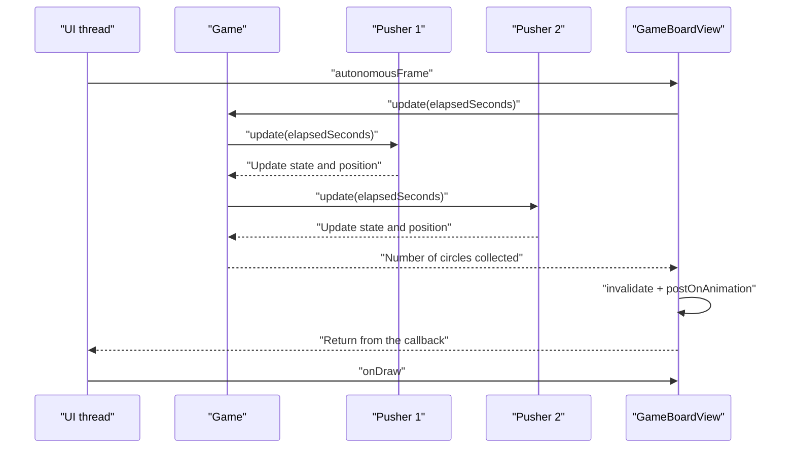

<style>
main {
  direction: ltr !important;
  text-align: left !important;
}
.two-columns.before-after { direction: rtl; }
.two-columns.before-after > .column { direction: ltr; }
</style>

[Hebrew version]({{ '/android/CollectCircles/12.collect-circles-pushers-work' | relative_url }}) · [English chapter index]({{ '/android/CollectCircles/en/' | relative_url }})


[Previous chapter]({{ '/android/CollectCircles/en/11.collect-circles-draw-pusher' | relative_url }}){: data-sequence-nav="prev"} · [Next chapter]({{ '/android/CollectCircles/en/13.collect-circles-offline-progress' | relative_url }}){: data-sequence-nav="next"}

On a touch screen, swipe right for the next chapter and left for the previous chapter.

{: .box-note}
Pushers already walk, but do not yet contribute to the economy. Now each one will select an unassigned circle, walk to it, position itself behind it, and push it to the target’s center. The user can still collect any circle manually. If the user takes one already assigned to a Pusher, that Pusher releases it and looks for another task.


## A fixed work cycle

One cycle lasts five seconds:

1. Spend two seconds walking from the current position to a position behind the circle.
2. Spend three seconds pushing the circle from its starting position to the target’s center.

Each Pusher’s known production rate is therefore:

```text
1 circle / 5 seconds = 0.20 circles per second
```

The actual rate can be lower only when no unassigned circle is available. We will spawn circles slightly faster than Pushers can collect them, so they do not run out of work.

## 1. Replace free roaming with a state machine

Open `Pusher.java`. Add the constants and the states:

```java
/** Known production rate of one Pusher while work is available. */
static final double CIRCLES_PER_SECOND = 0.20;

// A complete task lasts five seconds: two walking and three pushing.
private static final double TASK_DURATION_SECONDS = 1.0 / CIRCLES_PER_SECOND;
private static final double WALK_DURATION_SECONDS = 2.0;

/** Phases of one Pusher's work cycle. */
private enum State {
    IDLE,
    WALKING,
    PUSHING
}
```

Make `centerY` mutable and add the task data:

```java
private float centerY;
private State state = State.IDLE;
private Circle assignedCircle;
private double taskElapsedSeconds;

// Positions captured at assignment time and reused throughout the task.
private float pusherStartX;
private float pusherStartY;
private float circleStartX;
private float circleStartY;
private float targetX;
private float targetY;
private float attachX;
private float attachY;
private float finishX;
private float finishY;
```

<div class="two-columns">
<div markdown="1" class="column">

### Before: roaming

```java
/**
 * Advances the old patrol movement by one frame.
 *
 * @param elapsedSeconds seconds since the previous frame
 * @param boardWidth current width of the board
 */
public void update(double elapsedSeconds,
                   float boardWidth) {
    centerX += direction * speed * elapsedSeconds;

    if (centerX > rightEdge) {
        centerX = rightEdge;
        direction = -1;
    } else if (centerX < leftEdge) {
        centerX = leftEdge;
        direction = 1;
    }
}
```

The destination is simply the board’s edge.

</div>
<div markdown="1" class="column">

### After: an assignment

```java
/**
 * Advances the current work assignment by one frame.
 *
 * @param elapsedSeconds seconds since the previous frame
 * @return the completed circle, or null while the task is still running
 */
public Circle update(double elapsedSeconds) {
    if (assignedCircle == null) {
        return null;
    }

    taskElapsedSeconds += elapsedSeconds;
    if (taskElapsedSeconds < WALK_DURATION_SECONDS) {
        updateWalkingPosition();
        return null;
    }

    state = State.PUSHING;
    updatePushingPosition();
    if (taskElapsedSeconds < TASK_DURATION_SECONDS) {
        return null;
    }

    return finishTask();
}
```

The destination is determined by the circle and the collection target.

</div>
</div>

{: .box-warning}
After replacing `Pusher.update`, the project is expected **not to compile** until **step 6** is complete. At this intermediate point, `Game.java` still calls the old version, `pusher.update(elapsedSeconds, boardWidth)`, while the new method takes only `elapsedSeconds`. Step 6 updates the call in `Game` and restores compilation.

## 2. Accept a task and move into position behind the circle

Add:

```java
/**
 * Assigns a circle and calculates the path from the Pusher to the target.
 *
 * @param circle circle to push
 * @param target destination target
 * @return true when the assignment is accepted; false when already busy
 */
public boolean assign(Circle circle, Target target) {
    if (assignedCircle != null) {
        return false;
    }

    assignedCircle = circle;
    state = State.WALKING;
    pusherStartX = centerX;
    pusherStartY = centerY;
    circleStartX = circle.getCenterX();
    circleStartY = circle.getCenterY();
    targetX = target.getCenterX();
    targetY = target.getCenterY();

    // Normalize the direction from the circle to the target.
    float dx = targetX - circleStartX;
    float dy = targetY - circleStartY;
    float distance = (float) Math.sqrt(dx * dx + dy * dy);
    // Use a stable default direction when the circle is already at the target.
    float unitX = distance == 0 ? 1f : dx / distance;
    float unitY = distance == 0 ? 0f : dy / distance;
    float behindDistance = circle.getRadius() + height * 0.15f;

    attachX = circleStartX - unitX * behindDistance;
    attachY = circleStartY - unitY * behindDistance;
    finishX = targetX - unitX * behindDistance;
    finishY = targetY - unitY * behindDistance;
    updateDirection(attachX - centerX);
    return true;
}
```

The vector `(unitX, unitY)` points from the circle to the target and has length 1. To position the character **behind** the circle, move in the opposite direction by the circle’s radius, plus a small gap for the body.

Add helper methods:

```java
/**
 * Updates the direction only when horizontal movement is meaningful.
 *
 * @param horizontalMovement signed horizontal movement; positive means right
 */
private void updateDirection(float horizontalMovement) {
    if (horizontalMovement > 0.001f) {
        direction = 1;
    } else if (horizontalMovement < -0.001f) {
        direction = -1;
    }
}

/**
 * Finds a position between two endpoints.
 *
 * @param start position at progress 0
 * @param end position at progress 1
 * @param progress fraction of the movement already completed
 * @return interpolated position
 */
private float interpolate(float start, float end, float progress) {
    return start + (end - start) * progress;
}
```

## 3. Walk, push, and finish

Add `update()` from the previous comparison and the following methods:

```java
/** Moves the Pusher from its starting point to the attachment point. */
private void updateWalkingPosition() {
    float progress = (float) (taskElapsedSeconds / WALK_DURATION_SECONDS);
    centerX = interpolate(pusherStartX, attachX, progress);
    centerY = interpolate(pusherStartY, attachY, progress);
}

/** Moves the assigned circle and its Pusher toward the target together. */
private void updatePushingPosition() {
    double pushingSeconds = taskElapsedSeconds - WALK_DURATION_SECONDS;
    double pushingDuration = TASK_DURATION_SECONDS - WALK_DURATION_SECONDS;
    float progress = (float) Math.min(1.0, pushingSeconds / pushingDuration);

    assignedCircle.setCenter(
            interpolate(circleStartX, targetX, progress),
            interpolate(circleStartY, targetY, progress)
    );
    centerX = interpolate(attachX, finishX, progress);
    centerY = interpolate(attachY, finishY, progress);
    updateDirection(targetX - circleStartX);
}

/**
 * Releases the completed assignment while preserving fractional extra time.
 *
 * @return circle that reached the target
 */
private Circle finishTask() {
    Circle completedCircle = assignedCircle;
    assignedCircle = null;
    state = State.IDLE;
    taskElapsedSeconds -= TASK_DURATION_SECONDS;
    return completedCircle;
}
```

When finished, the center of the circle is exactly in the center of the target. Therefore, the old geometric condition also holds:

```text
distance + smallRadius <= targetRadius
```

Subtracting from `taskElapsedSeconds` rather than resetting it preserves leftover time when a frame takes the task slightly beyond five seconds. This prevents errors of a few milliseconds from accumulating and gradually slowing the worker.

## 4. Allow the user to take the circle

Add to `Pusher`:

```java
/**
 * Checks whether this Pusher owns a particular assignment.
 *
 * @param circle circle to check by object identity
 * @return true when this Pusher is assigned to that circle
 */
public boolean isAssignedTo(Circle circle) {
    return assignedCircle == circle;
}

/** @return true when this Pusher currently has work */
public boolean hasAssignment() {
    return assignedCircle != null;
}

/**
 * Cancels this Pusher's assignment when it matches the supplied circle.
 *
 * @param circle circle taken by the user
 */
public void cancelAssignment(Circle circle) {
    if (assignedCircle != circle) {
        return;
    }
    assignedCircle = null;
    state = State.IDLE;
    taskElapsedSeconds = 0;
}
```

A user cancellation does reset the task time: the Pusher has not completed the work, so no extra time carries over to another task.

## 5. Change the arm drawing while pushing

Inside `draw`, replace the two arm-drawing lines with this conditional code:

```java
// Pushing uses two forward arms; walking keeps the alternating swing.
if (state == State.PUSHING) {
    float handsX = centerX + direction * height * 0.32f;
    canvas.drawLine(centerX, shouldersY, handsX, centerY, paint);
    canvas.drawLine(centerX, shouldersY + height * 0.05f,
            handsX, centerY + height * 0.05f, paint);
} else {
    canvas.drawLine(centerX, shouldersY,
            centerX + direction * swing, centerY + height * 0.05f, paint);
    canvas.drawLine(centerX, shouldersY,
            centerX - direction * swing, centerY + height * 0.05f, paint);
}
```

While walking, the arms alternate. While pushing, both extend forward to touch the back of the circle.

## 6. `Game` divides work without duplication

Adjust the spawn rate to match the workforce:

```java
// Keep autonomous mode alive even before the first Pusher is purchased.
private static final double BASE_SPAWN_RATE = 0.20;

// Spawn 10% faster than the workers' known maximum production rate.
private static final double SPAWN_RATE_PER_PUSHER =
        Pusher.CIRCLES_PER_SECOND * 1.10;
```

Add a method that calculates the current circle creation rate:

```java
/** @return current circle spawn rate per second */
private double getSpawnRate() {
    return Math.max(BASE_SPAWN_RATE, pushers.size() * SPAWN_RATE_PER_PUSHER);
}
```

Now change `Game.update` to return how many circles the workers have collected in the frame:

<div class="two-columns before-after">
<div markdown="1" class="column">

### Before

    
/**
- * Updates circle spawning, then advances every Pusher on the board.
 *
 * @param elapsedSeconds time since the previous frame, in seconds
 * @param boardWidth current board width, in pixels
 * @param boardHeight current board height, in pixels
 * @param circleColor color used for newly spawned circles
 */
-public void update(double elapsedSeconds, float boardWidth,
-                   float boardHeight, int circleColor) {
    if (!autonomous) {
-        return;
    }

-    spawnProgress += elapsedSeconds * AUTONOMOUS_SPAWN_RATE;
    while (spawnProgress >= 1.0 && circles.size() < MAX_CIRCLE_COUNT) {
        createCircles(circles.size() + 1, boardWidth, boardHeight, circleColor);
        spawnProgress -= 1.0;
    }

    if (circles.size() == MAX_CIRCLE_COUNT) {
        spawnProgress = Math.min(spawnProgress, 1.0);
    }
    // Advance each Pusher by the same elapsed frame time.
    for (Pusher pusher : pushers) {
-        pusher.update(elapsedSeconds, boardWidth);
    }
}
    

</div>
<div markdown="1" class="column">

### After

    
/**
+ * Advances autonomous mode and lets every Pusher perform one frame of work.
 *
 * @param elapsedSeconds time since the previous frame, in seconds
 * @param boardWidth current board width, in pixels
 * @param boardHeight current board height, in pixels
 * @param circleColor color used for newly spawned circles
+ * @return number of circles completed by Pushers during this frame
 */
+public int update(double elapsedSeconds, float boardWidth,
+                  float boardHeight, int circleColor) {
    if (!autonomous) {
+        return 0;
    }

+    spawnProgress += elapsedSeconds * getSpawnRate();
    while (spawnProgress >= 1.0 && circles.size() < MAX_CIRCLE_COUNT) {
        createCircles(circles.size() + 1, boardWidth, boardHeight, circleColor);
        spawnProgress -= 1.0;
    }

    if (circles.size() == MAX_CIRCLE_COUNT) {
        spawnProgress = Math.min(spawnProgress, 1.0);
    }
    // Advance each Pusher by the same elapsed frame time.
+    int collectedCount = 0;
    for (Pusher pusher : pushers) {
+        assignCircleIfNeeded(pusher);
+        Circle completed = pusher.update(elapsedSeconds);
+        if (completed != null && circles.remove(completed)) {
+            collectedCount++;
+        }
    }
+    return collectedCount;
}
    

</div>
</div>

`Game.update` now calls `getSpawnRate()` instead of directly using the old constant `AUTONOMOUS_SPAWN_RATE`. This way, the creation rate adjusts itself to the number of Pushers purchased.

When the game is not autonomous, `Game.update` returns 0 because no worker has completed a collection in this frame.

Add task assignment:

```java
/**
 * Assigns the first available circle when a Pusher is idle.
 *
 * @param pusher worker that may need a new assignment
 */
private void assignCircleIfNeeded(Pusher pusher) {
    if (pusher.hasAssignment()) {
        return;
    }

    // Skip the user's circle and every circle owned by another Pusher.
    for (Circle circle : circles) {
        if (circle != selectedCircle && !isAssigned(circle)) {
            pusher.assign(circle, target);
            return;
        }
    }
}

/**
 * Checks whether another Pusher already owns a circle.
 *
 * @param circle circle being considered for assignment
 * @return true when the circle is already assigned
 */
private boolean isAssigned(Circle circle) {
    for (Pusher pusher : pushers) {
        if (pusher.isAssignedTo(circle)) {
            return true;
        }
    }
    return false;
}
```

Do not offer `selectedCircle` to Pushers while the user drags it. Every other circle can be assigned to at most one Pusher.

{: .box-success}
By the end of step 6, the project should compile and run, **with the Pusher actually pushing circles**. If an error remains, check that the new loop calls `pusher.update(elapsedSeconds)` instead of `pusher.update(elapsedSeconds, boardWidth)`.

## 7. How do several Pushers "work in parallel"? {#id-parallel-pushers}

<div markdown="1" class="box-warning">

In this project, **we do not create a Thread for each Pusher** or run a `Service` for them. All board-model changes—`Game`, `Circle`, and `Pusher`—along with touch events and drawing, happen on Android’s single UI thread.

This is the final structure of the animation loop: in each frame, `Game.update` calls each Pusher’s `Pusher.update`. Each call calculates the next state and returns immediately, then `onDraw` draws the resulting state. These methods do not call `sleep`, perform network I/O, or write to disk synchronously. The background mechanisms added later do not run or move Pushers and do not replace the frame loop. They calculate offline progress deterministically from saved data, without creating the objects used to draw the board.

</div>

`postOnAnimation(autonomousFrame)` neither runs the Runnable immediately nor creates a thread. It asks Android to queue the Runnable for the next screen frame. When its turn comes, the UI thread runs it to completion:

1. Calculates how much time has passed since the previous frame.
2. `Game.update` updates Pusher 1.
3. The same method updates Pusher 2, then Pusher 3 and so on.
4. Each completed collection’s callback updates the economy.
5. `invalidate()` requests a redraw; it **does not** call `onDraw` immediately.
6. The Runnable requests the next frame and returns control to Android.
7. Android calls `onDraw` at the appropriate time and draws everyone's new state.

{: .box-note}
For example, with 15 pushers, in each frame `Game.update` is called once and within it `Pusher.update` is called 15 times. `invalidate()` is then called once, and Android draws the entire board with a single call to `onDraw` — not a separate call to each Pusher. At a rate of about 60 frames per second we will get about 60 calls to `onDraw`, but 900 calls to `Pusher.update` every second.



Updates happen one after another, but each is very short and the screen is drawn only after they have all finished. To the eye, the characters appear to move together. This is **time sharing on one thread**, rather than true parallel execution across multiple cores.

### Each Pusher has its own state clock

The field `taskElapsedSeconds` belongs to each `Pusher` object, rather than to `Game`. For example:

- Pusher 1 starts pushing when its own clock reaches 2.0 seconds.
- Two seconds later, a circle becomes available and Pusher 2 starts walking, with its own clock starting at 0.
- In the next frame they both get the same `elapsedSeconds`, for example `0.016`, but add it to different values.
- Pusher 1 can therefore finish pushing while Pusher 2 is still walking toward its circle.

`sleep` must not be added inside `update`: it would stop the UI thread, freeze **all** Pushers and prevent the user from dragging. Instead of waiting, each object saves state and time, performs a bit of work each frame, and returns control.

### Where does the user drag come in?

`ACTION_DOWN`, `ACTION_MOVE` and `ACTION_UP` events enter the same UI thread queue between frame callbacks. Android does not run `onTouchEvent` in the middle of `Game.update`. A possible order is:

```text
frame 20: update for all Pushers → drawing
ACTION_DOWN: Unassociating and selecting the circle
ACTION_MOVE: The user moves the circle
frame 21: Workers update other circles; selectedCircle is not offered to them
ACTION_UP: Manual pickup or release
frame 22: The circle is again free for the worker if not collected
```

All methods that change `Circle`, `Pusher`, and `Game` run on the same thread, so they do not need `synchronized`, and the user’s dragging does not race with a Pusher. This remains true throughout the project. When we add `WorkManager`, its Worker will access only the economy stored in `GameProgress`, not these board objects. The thread coordination added there protects saved progress, rather than animation or the frame loop.

## 8. Release the assignment when the user selects a circle

In `selectCircleAt`, just before `selectedCircle = circle`, add:

```java
cancelPusherAssignment(circle);
```

And add:

```java
/**
 * Releases a circle from any Pusher before the user starts dragging it.
 *
 * @param circle circle selected by the user
 */
private void cancelPusherAssignment(Circle circle) {
    for (Pusher pusher : pushers) {
        pusher.cancelAssignment(circle);
    }
}
```

All the code runs in the UI thread, so there is no situation where the user and the pusher change the same circle at the same time in the middle of a frame.

## 9. Report automatic collections

In `autonomousFrame` of `GameBoardView`, replace the existing call to `game.update` with a call that receives the returned value and reports all collections. The new loop enters **before** `invalidate()`:

```diff
 // Repeats once per display frame while Auto mode is running.
 private final Runnable autonomousFrame = new Runnable() {
     /**
      * Advances the model by one frame and requests the next drawing pass.
      */
     @Override
     public void run() {
         if (!autonomousRunning || game == null) {
             return;
         }

         long nowMillis = SystemClock.elapsedRealtime();
         double elapsedSeconds = (nowMillis - previousFrameMillis) / 1000.0;
         previousFrameMillis = nowMillis;

-        game.update(elapsedSeconds, getWidth(), getHeight(), color(R.color.circle_green));
+        int collectedCount = game.update(
+                elapsedSeconds,
+                getWidth(),
+                getHeight(),
+                color(R.color.circle_green)
+        );
+
+        // Report automatic collections through the same callback as manual ones.
+        for (int i = 0; i < collectedCount; i++) {
+            if (onCircleCollected != null) {
+                onCircleCollected.run();
+            }
+        }
         invalidate();
         postOnAnimation(this);
     }
 };
```

This is the same callback that manual collection uses. It is registered in `MainActivity` using `binding.gameBoard.setOnCircleCollectedListener(this::recordCollectedCircle)`, therefore the complete call route in every automatic collection is:

```text
GameBoardView: onCircleCollected.run()
    → MainActivity.recordCollectedCircle()
    → GameProgress.recordCollectedCircle()
    → preferences.edit().putLong(...).apply()
```

The `apply()` call belongs to `recordCollectedCircle` in `GameProgress.java`, rather than `GameBoardView`. All calls in the chain up to it are performed synchronously in the UI thread before the `for` loop continues and before `invalidate()`. The call to `apply()` immediately updates the copy of `SharedPreferences` in memory and returns without waiting for the file to be written; Android completes the disk writing asynchronously. Thus, both the manual collection and the automatic collection go through the same route to update Circles and Lifetime, without blocking the frame on disk I/O.

## 10. Focused testing

Replace the old roaming test `pusherTurnsAroundAndStaysInsideTheBoard` with a work-cycle test:

```java
/** Verifies that one Pusher completes exactly one five-second task. */
@Test
public void pusherCompletesOneCircleAfterFiveSeconds() {
    Pusher pusher = new Pusher(20, 20, 40, 0, 0);
    Circle circle = new Circle(100, 100, 20, 0);
    Target target = new Target(200, 200, 50, 0, 0, 1);

    assertTrue(pusher.assign(circle, target));
    assertNull(pusher.update(4.9));
    assertSame(circle, pusher.update(0.1));
    assertEquals(target.getCenterX(), circle.getCenterX(), 0.001);
    assertEquals(target.getCenterY(), circle.getCenterY(), 0.001);
}
```

Run once:

```powershell
.\gradlew.bat testDebugUnitTest assembleDebug
```

## 11. Manual inspection

1. Activate Auto with one Pusher and watch it select a circle, go to it and push it to the target.
2. Check that the arms extend forward while pushing and the full cycle takes about five seconds.
3. Check that Circles and Lifetime increase when the Pusher finishes.
4. With two Pushers, check that they do not choose the same circle.
5. While a Pusher is walking or pushing, touch its circle and drag it. The Pusher must release it and choose another circle.
6. Collect circles manually at the same time and make sure there is no double collection.
7. Let the board reach 12 circles. Pushers should keep working, and the circle count must not exceed the limit.
8. Try to start two Pushers at different times and verbally explain why they look parallel even though both are updated in the same UI thread.

{: .box-success}
The game now works without dragging: newly spawned circles supply the Pushers, which turn them into progress at a known rate. In the next chapter, use that same rate to calculate how many circles could have been collected while the app was closed.

[Continue to Chapter 13: Progressing While the Application is Closed](/android/CollectCircles/en/13.collect-circles-offline-progress){: data-sequence-nav="next"}

<!-- gemini-tutor-links:start -->
<div markdown="1" class="english">

## Gemini tutor

{: .box-note}
[Open Gem: CollectCircles Idle Lab](https://gemini.google.com/gem/1xIrpd_3BdKX5rEl9cuvSjfqKCJ3GYnzV?usp=sharing) to get hints, diagnostic questions and explanations appropriate to the stage you are on.

</div>
<!-- gemini-tutor-links:end -->
