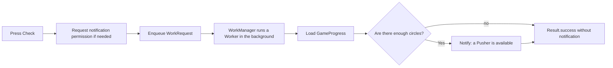
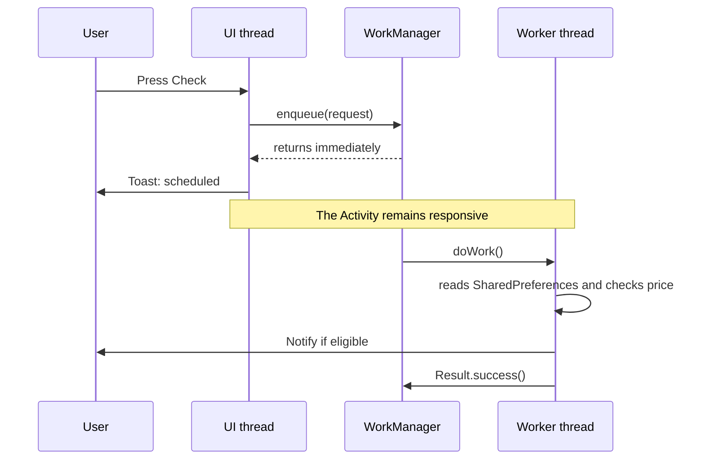

<style>
main {
  direction: ltr !important;
  text-align: left !important;
}
.two-columns.before-after { direction: rtl; }
.two-columns.before-after > .column { direction: ltr; }
</style>

[Hebrew version]({{ '/android/CollectCircles/14.collect-circles-first-worker' | relative_url }}) · [English chapter index]({{ '/android/CollectCircles/en/' | relative_url }})


[Previous chapter]({{ '/android/CollectCircles/en/13.collect-circles-offline-progress' | relative_url }}){: data-sequence-nav="prev"} · [Next chapter]({{ '/android/CollectCircles/en/15b.collect-circles-notification-only' | relative_url }}){: data-sequence-nav="next"}

On the touch screen you can swipe right to the next chapter and left to the previous chapter.

{: .box-note}
In the previous chapter we calculated progress only when the Activity returned to the screen. Now we will give Android a short unit of work: check whether the balance is enough to buy a Pusher and display a notification. First, we will trigger it with a button for a quick result; in the next chapter we will make it periodic.


{: .box-warning}
`Worker` is not a thread that we create and manage. We describe a job and submit a `WorkRequest`; WorkManager chooses when to run it and provides it with a background thread. There is no guarantee that the work will start exactly when the button is pressed.

## The flow



The Activity only creates and submits work requests. The Worker does not hold a reference to the Activity and does not touch the View.

## 1. Add WorkManager to the project

The WorkManager version we will be using is `2.11.2`. In the **Android** window, open `Gradle Scripts > libs.versions.toml (Version Catalog)` and add:

<div class="two-columns">
<div markdown="1" class="column">

### In the area `[versions]`

```toml
work = "2.11.2"
```

</div>
<div markdown="1" class="column">

### In the area `[libraries]`

```toml
work-runtime = { group = "androidx.work", name = "work-runtime", version.ref = "work"}
```

</div>
</div>

Then open `Gradle Scripts > build.gradle.kts (Module :app)` and add inside `dependencies`:

```diff
 implementation(libs.constraintlayout)
+implementation(libs.work.runtime)
 implementation(platform(libs.firebase.bom))
```

`work-runtime` is the appropriate implementation for Java. We do not add `work-runtime-ktx` here, because the project does not use Kotlin coroutines.

{: .box-warning}
After changing the Gradle files, do **File → Sync Project with Gradle Files**. If Android Studio flags `Cannot resolve symbol 'work'` or `OneTimeWorkRequest` but Gradle manages to build the application, usually the code is fine and the development environment index has not yet synced. You can also click `Ctrl+Shift+A` and search for `Sync Project with Gradle Files`.

According to the [official WorkManager documentation](https://developer.android.com/develop/background-work/background-tasks/persistent/getting-started), a regular `Worker` runs `doWork()` asynchronously on a background thread provided by WorkManager.

## 2. Let the Worker also load the progress

The preferences file name is currently a private field in `MainActivity`. Move it to `GameProgress`:

```java
static final String PREFERENCES_NAME = "collect_circles_preferences";
```

And add a shared creation method:

```java
/**
 * Loads the shared game progress used by Activities and Workers.
 *
 * @param context context used to open the SharedPreferences file
 * @return game progress backed by the shared preferences
 */
public static GameProgress load(Context context) {
    SharedPreferences preferences = context.getSharedPreferences(
            PREFERENCES_NAME,
            Context.MODE_PRIVATE
    );
    return new GameProgress(preferences);
}
```

Also add the import:

```java
import android.content.Context;
```

Now the Activity and Worker do not need to copy a string. Both open exactly the same `SharedPreferences` file.

In `MainActivity` remove `PREFERENCES_NAME` and replace the initialization:

```diff
-preferences = getSharedPreferences(PREFERENCES_NAME, MODE_PRIVATE);
-gameProgress = new GameProgress(preferences);
+preferences = getSharedPreferences(
+        GameProgress.PREFERENCES_NAME,
+        MODE_PRIVATE
+);
+gameProgress = GameProgress.load(this);
```

Keep `preferences` in the Activity because the best time of the timed game is also saved there.

## 3. Add a dedicated notification for eligibility

In `strings.xml` add:

```xml
<string name="pusher_available_title">A new pusher is available!</string>
<string name="pusher_available_text">You have enough circles for the next pusher (%1$d).</string>
<string name="pusher_check_scheduled">Pusher check scheduled</string>
<string name="check_pusher">Check</string>
```

In `Notifications` add a separate ID:

```java
private static final int PUSHER_NOTIFICATION_ID = 2;
```

<div class="two-columns">
<div markdown="1" class="column">

### The old notification

```java
public static void show(Context context) {
    createChannel(context);
    // invitation notification...
    manager.notify(NOTIFICATION_ID, notification);
}
```

</div>
<div markdown="1" class="column">

### The new notification (in addition)

```java
/**
 * Shows a notification that the player can afford the next Pusher.
 *
 * @param context application or Activity context
 * @param price price displayed in the notification
 */
public static void showPusherAvailable(
        Context context,
        long price
) {
    createChannel(context);
    NotificationManager manager = context.getSystemService(
            NotificationManager.class
    );
    Notification notification = new Notification.Builder(
            context,
            CHANNEL_ID
    )
            .setSmallIcon(R.drawable.ic_launcher_foreground)
            .setContentTitle(context.getString(
                    R.string.pusher_available_title
            ))
            .setContentText(context.getString(
                    R.string.pusher_available_text,
                    price
            ))
            .setAutoCancel(true)
            .build();

    manager.notify(PUSHER_NOTIFICATION_ID, notification);
}
```

</div>
</div>

Different IDs allow the invitation notification and the buy alert to exist separately. Reusing ID `2` replaces a previous purchase notification instead of creating a stack of identical notifications.

## 4. Create a small Worker

In the **Android** window, under `app > kotlin+java > com.example.collectcircles`, create a **Java Class** named `PusherEligibilityWorker`:

```java
package com.example.collectcircles;

import android.content.Context;

import androidx.annotation.NonNull;
import androidx.work.Worker;
import androidx.work.WorkerParameters;

public class PusherEligibilityWorker extends Worker {

    /**
     * Creates the Worker with the data supplied by WorkManager.
     *
     * @param appContext application context supplied by WorkManager
     * @param workerParameters input and runtime parameters for this work
     */
    public PusherEligibilityWorker(
            @NonNull Context appContext,
            @NonNull WorkerParameters workerParameters
    ) {
        super(appContext, workerParameters);
    }

    /**
     * Checks the saved balance and notifies the player when a Pusher is affordable.
     *
     * @return success after the eligibility check finishes
     */
    @NonNull
    @Override
    public Result doWork() {
        Context context = getApplicationContext();
        GameProgress progress = GameProgress.load(context);

        if (progress.canBuyPusher() && Notifications.canShow(context)) {
            Notifications.showPusherAvailable(
                    context,
                    progress.getNextPusherPrice()
            );
        }

        return Result.success();
    }
}
```

### What does each part do?

- The constructor receives an `application Context`, whose lifetime is independent of any particular screen.
- `doWork()` is the unit of work that WorkManager runs on a background thread.
- The Worker reads a small amount of data already stored in `SharedPreferences`; it does not touch View Binding or Toast.
- `canShow()` prevents an attempt to post a notification if the user has since revoked the notification permission in the settings.
- `Result.success()` means the check is complete. It does not mean that a notification has been sent - a situation where there are still not enough circles is a normal result.

For that last check, add to `Notifications`:

```java
/**
 * Checks whether notifications are currently enabled for the app.
 *
 * @param context context used to access NotificationManager
 * @return true when the app may show notifications
 */
public static boolean canShow(Context context) {
    NotificationManager manager = context.getSystemService(
            NotificationManager.class
    );
    return manager.areNotificationsEnabled();
}
```

{: .box-error}
Do not pass `Activity`, `binding` or `View` to the Worker. The screen may already be destroyed before the job starts. `getApplicationContext()` is the appropriate context for non-screen work.

## 5. Send a one-time job request

In `MainActivity` add imports:

```java
import androidx.work.OneTimeWorkRequest;
import androidx.work.WorkManager;
```

Add a method:

```java
/** Enqueues one background eligibility check and confirms its scheduling. */
private void enqueuePusherCheck() {
    OneTimeWorkRequest request =
            new OneTimeWorkRequest.Builder(
                    PusherEligibilityWorker.class
            ).build();

    WorkManager.getInstance(this).enqueue(request);
    Toast.makeText(
            this,
            R.string.pusher_check_scheduled,
            Toast.LENGTH_SHORT
    ).show();
}
```

`enqueue()` returns immediately. It does not call `doWork()` like a normal function and does not wait for the result. Once the request is submitted, WorkManager is responsible for saving the request and choosing an appropriate thread and time.

## 6. Connect notification permission

The existing button already knows how to request permission on Android 13 and above. We will only change the method called after permission is granted.

<div class="two-columns before-after">
<div markdown="1" class="column">

### Before

    
if (permissionGranted) {
-    Notifications.show(this);
}

⁞
⁞

binding.localNotifButton.setOnClickListener(
-        view -> requestPermissionAndShowNotification()
);
    

</div>
<div markdown="1" class="column">

### After

    
if (permissionGranted) {
+    enqueuePusherCheck();
}

⁞
⁞

binding.localNotifButton.setOnClickListener(
+        view -> requestPermissionAndCheckPusher()
);
    

</div>
</div>

Also change the method name and its final lines:

```java
/** Requests notification permission when needed, then schedules the check. */
private void requestPermissionAndCheckPusher() {
    if (Build.VERSION.SDK_INT >= Build.VERSION_CODES.TIRAMISU
            && checkSelfPermission(Manifest.permission.POST_NOTIFICATIONS)
            != PackageManager.PERMISSION_GRANTED) {
        notificationPermissionLauncher.launch(
                Manifest.permission.POST_NOTIFICATIONS
        );
        return;
    }

    enqueuePusherCheck();
}
```

And finally, in `activity_main.xml`, replace the button text:

```diff
-android:text="@string/local_notification_tiny"
+android:text="@string/check_pusher"
```

The Activity is the only place that displays the permission request window. The Worker can post a notification after permission has been granted, but it must not open a permission window to the user from the background.

## 7. Two timelines, two threads



The toast and views belong to the UI thread. In contrast, a regular `Worker` runs `doWork()` on a background executor managed by WorkManager. The two methods may overlap in time: the user can drag a circle while the Worker reads the balance.

In this chapter the Worker **only reads** a snapshot of the game's economy and decides whether to display a notification. If the user collects a circle exactly at the time of the call, the current check may use a slightly outdated balance and postpone the alert until the next check; no progress can be lost, because the Worker does not write anything.

In both follow-up routes we will also schedule the same check periodically. In the short track of chapter 15b, we will not change the Worker at all: we will improve `canBuyPusher()` so that it also includes theoretical offline progress in the calculation, and we will continue to display the price using `getNextPusherPrice()`.

`SharedPreferences.apply()` from the previous chapters updates the copy in memory immediately and then schedules the writing to disk. Therefore, a Worker in the same process sees the new value even if the I/O operation has not yet finished.

## 8. Why not periodic work yet?

Periodic work adds intervals, constraints, unique names, cancellation and imprecise timing at once. First let's make sure the small unit is correct:

```text
input: balance + current pusher count
output: notification only when balance >= next price
```

In each of the two follow-up routes, we will use the same Worker in two schedules: every three hours when the battery is not low, and every 30 minutes when the device is charging. WorkManager guarantees a minimum interval, but does not promise an exact run time.

## 9. Brief manual test

1. Open the store and write down the price of the next Pusher.
2. If the balance is still less than the price, press **Check**. A toast will confirm that the work request was submitted, but no eligibility alert should appear. If you are already eligible, you can skip this test; there is no need to try to reduce the number of Pushers.
3. Collect or wait until the balance is enough for the next price.
4. Press **Check** again. The toast appears immediately, and the notification should arrive shortly after.
5. While testing keep dragging a circle. The screen should remain responsive, because the Worker does not run on a UI thread.
6. If the notification permission is turned off, turn it on through the button's request before testing.

{: .box-note}
You should not need to change the number of Pushers for this test. The target price is always the price currently displayed in the store.

Run once:

```powershell
.\gradlew.bat testDebugUnitTest assembleDebug
```

{: .box-success}
We have created a real unit of work that does not depend on the life of the Activity. Choose one route from here:

- [Short route to completion — chapter 15b: periodic notifications and Brag](/android/CollectCircles/en/15b.collect-circles-notification-only){: data-sequence-nav="next"}
- [In-depth route — chapter 15: periodic work with battery constraints](/android/CollectCircles/en/15.collect-circles-periodic-work)

<!-- gemini-tutor-links:start -->
<div markdown="1" class="english">

## Gemini tutor

{: .box-note}
[Open Gem: CollectCircles Background Trainer](https://gemini.google.com/gem/1QiC7WZPzbDpNaSbBjiX_Y8JqusBIXwQG?usp=sharing) to get hints, diagnostic questions and explanations appropriate to the stage you are on.

</div>
<!-- gemini-tutor-links:end -->
