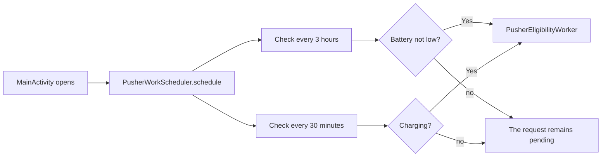

<style>
main {
  direction: ltr !important;
  text-align: left !important;
}
</style>

[Hebrew version]({{ '/android/CollectCircles/15.collect-circles-periodic-work' | relative_url }}) · [English chapter index]({{ '/android/CollectCircles/en/' | relative_url }})


[Previous chapter]({{ '/android/CollectCircles/en/14.collect-circles-first-worker' | relative_url }}){: data-sequence-nav="prev"} · [Next chapter]({{ '/android/CollectCircles/en/16.collect-circles-json-schedule' | relative_url }}){: data-sequence-nav="next"}

On the touch screen you can swipe right to the next chapter and left to the previous chapter.

{: .box-note}
In chapter 14, the button requested a one-time eligibility check. Now we will schedule the same unit of work in two periodic schedules: once every three hours when the battery is not low, and once every 30 minutes when the device is connected to the charger.


{: .box-warning}
WorkManager is not an accurate alarm clock. `30 minutes` means **at least** 30 minutes between runs. Android may defer work because of a constraint, Doze or system optimization.

## What we will build



Both requests refer to the same Worker class. The difference is **when** WorkManager is allowed to run it.

## 1. Separate Worker from WorkRequest

- `PusherEligibilityWorker` defines **what to do**: read progress, check price, and maybe post a notification.
- `PeriodicWorkRequest` defines **when it is allowed to try**: time interval and constraints.
- `WorkManager` saves and schedules the request using system services.

According to [the official documentation of periodic work](https://developer.android.com/develop/background-work/background-tasks/persistent/getting-started/define-work#schedule_periodic_work), the interval is a minimum time and not an exact time, and the smallest periodic interval allowed is 15 minutes. Therefore 30 minutes is a valid value.

## 2. Create a scheduling class

In the **Android** window, under `app > kotlin+java > com.example.collectcircles`, create a **Java Class** named `PusherWorkScheduler`:

```java
package com.example.collectcircles;

import android.content.Context;

import androidx.work.Constraints;
import androidx.work.ExistingPeriodicWorkPolicy;
import androidx.work.PeriodicWorkRequest;
import androidx.work.WorkManager;

import java.util.concurrent.TimeUnit;

public final class PusherWorkScheduler {

    private static final String BATTERY_WORK_NAME =
            "pusher_check_battery";
    private static final String CHARGING_WORK_NAME =
            "pusher_check_charging";

    private PusherWorkScheduler() {
    }

    public static void schedule(Context context) {
        WorkManager workManager = WorkManager.getInstance(context);

        PeriodicWorkRequest batteryRequest = createBatteryRequest();
        PeriodicWorkRequest chargingRequest = createChargingRequest();

        workManager.enqueueUniquePeriodicWork(
                BATTERY_WORK_NAME,
                ExistingPeriodicWorkPolicy.KEEP,
                batteryRequest
        );
        workManager.enqueueUniquePeriodicWork(
                CHARGING_WORK_NAME,
                ExistingPeriodicWorkPolicy.KEEP,
                chargingRequest
        );
    }

    private static PeriodicWorkRequest createBatteryRequest() {
        Constraints constraints = new Constraints.Builder()
                .setRequiresBatteryNotLow(true)
                .build();

        return new PeriodicWorkRequest.Builder(
                PusherEligibilityWorker.class,
                3,
                TimeUnit.HOURS
        )
                .setConstraints(constraints)
                .build();
    }

    private static PeriodicWorkRequest createChargingRequest() {
        Constraints constraints = new Constraints.Builder()
                .setRequiresCharging(true)
                .build();

        return new PeriodicWorkRequest.Builder(
                PusherEligibilityWorker.class,
                30,
                TimeUnit.MINUTES
        )
                .setConstraints(constraints)
                .build();
    }
}
```

This class is neither an Activity, a Service, nor a Worker. It simply builds two requests and submits them to WorkManager.

## 3. Compare the two requests

<div class="two-columns">
<div markdown="1" class="column">

### Battery track

```java
Constraints constraints = new Constraints.Builder()
        .setRequiresBatteryNotLow(true)
        .build();

return new PeriodicWorkRequest.Builder(
        PusherEligibilityWorker.class,
        3,
        TimeUnit.HOURS
)
        .setConstraints(constraints)
        .build();
```

- Minimum interval: 3 hours
- Allowed when the battery is not low
- Does not require a charger

</div>
<div markdown="1" class="column">

### Charging track

```java
Constraints constraints = new Constraints.Builder()
        .setRequiresCharging(true)
        .build();

return new PeriodicWorkRequest.Builder(
        PusherEligibilityWorker.class,
        30,
        TimeUnit.MINUTES
)
        .setConstraints(constraints)
        .build();
```

- Minimum interval: 30 minutes
- Allowed only while charging
- Suitable for more frequent checks

</div>
</div>

If the device is charging and the battery is not low, both constraints may be true. This is expected: the two schedules are independent. Both use the same notification ID, so a new notification replaces the previous one.

{: .box-note}
In a later chapter, the timetable check will decide whether this is a suitable time for the message. For now, we are only testing the scheduling mechanism.

## 4. Why are unique names used?

`schedule()` will be called every time the Activity opens. Without a unique name, each opening would add two more identical schedules:

<div class="two-columns">
<div markdown="1" class="column">

### Normal enqueue — does not fit here

```java
workManager.enqueue(batteryRequest);
```

First opening: one schedule <br> Second opening: two schedules <br> Tenth opening: ten schedules

</div>
<div markdown="1" class="column">

### Unique enqueue

```java
workManager.enqueueUniquePeriodicWork(
        BATTERY_WORK_NAME,
        ExistingPeriodicWorkPolicy.KEEP,
        batteryRequest
);
```

Every opening refers to the same schedule named `pusher_check_battery`.

</div>
</div>

`KEEP` says: if there is already an active periodic job with this name, keep it and do not replace it with a new request. This way, opening the screen does not reset the interval and does not create duplicates.

[The official documentation for managing unique work](https://developer.android.com/develop/background-work/background-tasks/persistent/how-to/manage-work#unique-work) recommends unique names to avoid enqueuing the same task more than once.

## 5. Schedule work when the process starts

In `MainActivity.onCreate`, after loading `GameProgress`, add:

```diff
 gameProgress = GameProgress.load(this);
+PusherWorkScheduler.schedule(this);
 bestTimeMillis = preferences.getLong(BEST_TIME_KEY, NO_BEST_TIME);
```

There is no need to wait for a result. `schedule()` submits the requests to WorkManager, and the Activity continues its initialization.

<div class="two-columns">
<div markdown="1" class="column">

### The life of the Activity

```text
onCreate
onStart
onResume
...
onStop
onDestroy
```

The screen can close minutes after the work is scheduled.

</div>
<div markdown="1" class="column">

### Work lifetime

```text
ENQUEUED
  ↓ when the interval and constraint allow
RUNNING
  ↓ Result.success()
ENQUEUED for the next cycle
```

The work is saved even after the Activity is destroyed.

</div>
</div>

## 6. What happens behind the scenes?

1. The UI thread calls `schedule()` and `enqueueUniquePeriodicWork()`.
2. WorkManager saves the job description in its internal database. The call does not immediately activate `doWork()` and does not block until the work runs.
3. Android chooses an appropriate time according to the interval, battery status, charger and system optimizations.
4. If the application process does not exist, the system can create it for WorkManager to run the Worker.
5. `doWork()` runs on a background thread provided by WorkManager.
6. For periodic work, `Result.success()` ends **the current cycle**; the request returns to the waiting state for the next cycle.

{: .box-warning}
There is no thread here that lives for three hours and there is no loop that does `sleep`. Keeping such a thread would waste resources and break when Android kills the application process. WorkManager saves a small description of a job and asks the system to run it later.

### And what about Service?

We do not write `Service`. WorkManager uses Android's proper scheduling mechanisms behind a single API. Our code remains a short `Worker`, designed to finish quickly. Long-running work or work requiring exact timing needs a different solution; checking a few values and posting a notification is a good fit for WorkManager.

## 7. Can two Workers run concurrently?

Yes. Theoretically a three-hour cycle and a 30-minute cycle can be eligible at the same time, and WorkManager is allowed to run more than one job on its background executor.

At this stage `PusherEligibilityWorker` only:

- Creates a new snapshot of `GameProgress` from `SharedPreferences`;
- Reads balance and price;
- Publishes a notification.

It does not reduce the balance, buy a Pusher, or settle offline progress. Therefore, two concurrent reads cannot lose an economy update. Both may request a notification, but the same notification ID causes the second notification to replace the first.

{: .box-warning}
When we want the Worker to also write offline progress, separate reading and writing will no longer be enough. We will have to protect the read-modify-write operation as a single unit. We will not add writing in the background until we explain and implement this coordination.

## 8. What promises does WorkManager not make?

- It does not guarantee to run at exactly `22:00`, `22:30` and so on.
- A constraint that is no longer met can delay execution.
- Doze and manufacturer optimizations can delay work further.
- Explicit force-stop of the application stops jobs until the user starts the application again.
- Periodic work is not for animation, screen timer or game that runs 60 times per second.

It is suitable for work that can be postponed and must survive leaving the screen, such as a short eligibility check.

## 9. Testing without waiting three hours

1. Run the application once for `schedule()` to be called.
2. In the Android Studio menu, select **View → Tool Windows → App Inspection**.
3. In the window that opens, select the **Background Task Inspector** tab, then select the emulator and the application process `com.example.collectcircles` at the top.
4. Look for two lines of `PusherEligibilityWorker`. In the next version of the chapter we will add tags that will explicitly display `pusher_check_battery` and `pusher_check_charging`.
5. Check that one has an interval of 3 hours and Battery Not Low, and the other 30 minutes and Charging.
6. Close and open the Activity again. The number of schedules should remain two and not increase.
7. To check the immediate notification, continue to use the **Check** button from chapter 14; there is no need to wait for a real cycle for each code change.

If the tab is empty, make sure the application is still running on an emulator with API 26 or higher and that you have selected the correct application process. WorkManager displays the Worker class name here, not necessarily the unique name given to the enqueue.

{: .box-note}
Checking the exact run time on a device is unreliable, because deferral is expected behavior. In this chapter, verify that the schedules, intervals, and constraints were saved correctly.

Run once:

```powershell
.\gradlew.bat testDebugUnitTest assembleDebug
```

{: .box-success}
The game now has two persistent background schedules that are not duplicated on every launch. In the next chapter we will save the timetable as JSON and allow the Worker to interrupt only during computer science classes.

[continue to chapter 16: timetable in JSON](/android/CollectCircles/en/16.collect-circles-json-schedule){: data-sequence-nav="next"}

<!-- gemini-tutor-links:start -->
<div markdown="1" class="english">

## Gemini tutor

{: .box-note}
[Open Gem: CollectCircles Background Trainer](https://gemini.google.com/gem/1QiC7WZPzbDpNaSbBjiX_Y8JqusBIXwQG?usp=sharing) to get hints, diagnostic questions and explanations appropriate to the stage you are on.

</div>
<!-- gemini-tutor-links:end -->
