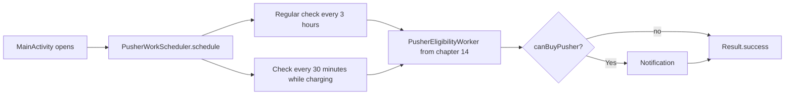
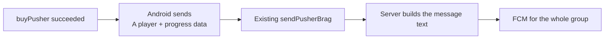

<style>
main {
  direction: ltr !important;
  text-align: left !important;
}
</style>

[Hebrew version]({{ '/android/CollectCircles/15b.collect-circles-notification-only' | relative_url }}) · [English chapter index]({{ '/android/CollectCircles/en/' | relative_url }})


[Previous chapter]({{ '/android/CollectCircles/en/14.collect-circles-first-worker' | relative_url }}){: data-sequence-nav="prev"}


{: .box-note}
This is a shorter alternative to chapter 15. It starts directly from the end of chapter 14, makes the existing eligibility check periodic, and completes the WorkManager topic. You do not need to complete the regular chapter 15 first.


## What we will build



The division remains simple:

- `PusherWorkScheduler` decides when to check.
- `PusherEligibilityWorker` performs the existing eligibility check and displays a notification.
- `GameProgress` holds the game economy and calculates the current theoretical eligibility.
- `MainActivity.onStart` continues to be the place that settles and saves offline progress.

{: .box-warning}
WorkManager is not an accurate clock. The shortest periodic interval that `PeriodicWorkRequest` allows is **15 minutes**. If we enter a smaller value, for example 3 minutes, WorkManager will automatically increase it to 15 minutes. Even 30 minutes or 3 hours are only minimum intervals; Android may delay work due to device state, Doze or battery optimizations.

{: .box-warning}
Therefore, it is not possible to shorten the test wait using a 3-minute cycle. For an immediate check, use the **Check** button from chapter 14; to check the periodic timing itself, you must wait at least 15 minutes, when all the constraints are met.

## 1. Create a small scheduler

In the **Android** window, under `app > kotlin+java > com.example.collectcircles`, create a **Java Class** named `PusherWorkScheduler`:

```java
package com.example.collectcircles;

import android.content.Context;

import androidx.work.Constraints;
import androidx.work.ExistingPeriodicWorkPolicy;
import androidx.work.PeriodicWorkRequest;
import androidx.work.WorkManager;

import java.util.concurrent.TimeUnit;

public final class PusherWorkScheduler {

    private static final String BATTERY_WORK_NAME =
            "pusher_check_battery";
    private static final String CHARGING_WORK_NAME =
            "pusher_check_charging";

    /** Prevents creating objects from this utility class. */
    private PusherWorkScheduler() {
    }

    /**
     * Keeps one regular check and one charging check scheduled.
     *
     * @param context context used to access WorkManager
     */
    public static void schedule(Context context) {
        WorkManager workManager = WorkManager.getInstance(context);

        workManager.enqueueUniquePeriodicWork(
                BATTERY_WORK_NAME,
                ExistingPeriodicWorkPolicy.KEEP,
                createBatteryRequest()
        );
        workManager.enqueueUniquePeriodicWork(
                CHARGING_WORK_NAME,
                ExistingPeriodicWorkPolicy.KEEP,
                createChargingRequest()
        );
    }

    /** @return a regular check that avoids a low battery */
    private static PeriodicWorkRequest createBatteryRequest() {
        Constraints constraints = new Constraints.Builder()
                .setRequiresBatteryNotLow(true)
                .build();

        return new PeriodicWorkRequest.Builder(
                PusherEligibilityWorker.class,
                3,
                TimeUnit.HOURS
        )
                .setConstraints(constraints)
                .build();
    }

    /** @return a more frequent check that runs only while charging */
    private static PeriodicWorkRequest createChargingRequest() {
        Constraints constraints = new Constraints.Builder()
                .setRequiresCharging(true)
                .build();

        return new PeriodicWorkRequest.Builder(
                PusherEligibilityWorker.class,
                15,
                TimeUnit.MINUTES
        )
                .setConstraints(constraints)
                .build();
    }
}
```

Without charging, only the normal request can check — and it also waits if the battery is low. While charging, the frequent check is also allowed. Both requests may be eligible at the same time, but they run the same short check and use the same notification ID; a new message replaces the previous one.

The unique names and `KEEP` prevent another schedule from being created each time the Activity opens. There is no thread waiting for three hours and no `sleep` loop: WorkManager stores the requests and runs them when the system allows.

## 2. Teach `canBuyPusher()` to calculate the current state

The Worker is already asking `GameProgress` if it is possible to buy a Pusher. We'll keep the same question and the same API, and only improve `canBuyPusher()`'s answer:

    
/**
- * Checks whether the saved balance can cover the next Pusher's price.
+ * Checks whether the balance, including theoretical offline progress,
+ * can cover the next Pusher's price.
 *
- * @return true when the saved balance is large enough
+ * @return true when the theoretical current balance is large enough
 */
public boolean canBuyPusher() {
-    return circlesBalance >= getNextPusherPrice();
+    long projectedBalance = circlesBalance;
+
+    if (autonomousMode && pusherCount > 0) {
+        long elapsedMillis = Math.max(
+                0,
+                System.currentTimeMillis() - lastProgressUpdateMillis
+        );
+        OfflineProgressCalculator.Result result =
+                OfflineProgressCalculator.calculate(
+                        elapsedMillis,
+                        pusherCount,
+                        fractionalProgress
+                );
+        projectedBalance = addWithSaturation(
+                circlesBalance,
+                result.getWholeCircles()
+        );
+    }
+
+    return projectedBalance >= getNextPusherPrice();
}
    

The method calculates how many whole circles would be added if the user opened the application now. It uses the same `OfflineProgressCalculator` from chapter 13, but does not modify any fields and does not call `preferences.edit()`.

When the user actually opens the application, `MainActivity.onStart` still calls `settleOfflineProgress()` and saves the result. The previous eligibility calculation was only a forecast, so there is no double counting.

## 3. Schedule the work

In `MainActivity.onCreate`, immediately after loading `GameProgress`, add:

```diff
 gameProgress = GameProgress.load(this);
+PusherWorkScheduler.schedule(this);
 bestTimeMillis = preferences.getLong(BEST_TIME_KEY, NO_BEST_TIME);
```

`schedule()` returns immediately. WorkManager is responsible for saving both schedules and running the Worker on a background thread when the interval and constraint allow it.


## Checkpoint after section 3

{: .box-success}

At this stage, you should receive a notification that a purchase is available even while the application is inactive, once enough circles have accumulated (as long as you have run the application since the last reboot).

## 4. Close with something you see: Brag after buying

The periodic Worker only handles a local reminder. Now let's go back to Firebase from chapter 6 for a moment: when a purchase is successful, a small event will be sent to the teacher's function and it will notify all subscribers that someone bought a Pusher.



We will not add a player name or another screen. The message will be anonymous, for example: `A player now employs 3 pushers after collecting 240 circles.` This way we will get a social ending with a small amount of code.

### A. Add strings and a sending method

In `strings.xml` add:

```xml
<string name="brag_sent">Brag sent!</string>
<string name="brag_failed">Pusher hired, but the brag could not be sent</string>
```

In `MainActivity` add imports:

```java
import java.util.HashMap;
import java.util.Map;
```

`FirebaseFunctions` is already in the project from chapter 6. Add to `MainActivity`:

```java
/** Sends the latest Pusher achievement to the teacher-owned function. */
private void sendPusherBrag() {
    Map<String, Object> data = new HashMap<>();
    data.put("name", "A player");
    data.put("pusherCount", gameProgress.getPusherCount());
    data.put("lifetimeCircles", gameProgress.getLifetimeCircles());

    FirebaseFunctions.getInstance()
            .getHttpsCallable("sendPusherBrag")
            .call(data)
            .addOnCompleteListener(task -> {
                int message = task.isSuccessful()
                        ? R.string.brag_sent
                        : R.string.brag_failed;
                Toast.makeText(
                        this,
                        message,
                        Toast.LENGTH_SHORT
                ).show();
            });
}
```

We use `sendPusherBrag` which was already written and published for the tutorial. The existing function also requires `name`, so the shortcut sends the constant value `A player` instead of adding a name entry screen. The client does not send title, body or topic.

### B. Send only after a successful purchase

Inside the listener of the buy button, add one call:

```diff
 if (gameProgress.buyPusher()) {
     showProgress();
     // Sync the active board with the updated saved Pusher count.
     binding.gameBoard.setPusherCount(gameProgress.getPusherCount());
     Toast.makeText(this, R.string.pusher_hired, Toast.LENGTH_SHORT).show();
+    sendPusherBrag();
     dialog.dismiss();
 }
```

The local purchase is completed before the network call. If the send fails, the Pusher remains owned by the user; a Brag message is not a reason to cancel a valid purchase.

### C. Show the server text even when the application is in the foreground

In `Notifications` add an ID and a general method for notifications received from the server:

```java
private static final int REMOTE_NOTIFICATION_ID = 3;

/**
 * Shows notification text supplied by the trusted classroom function.
 *
 * @param context context used to access NotificationManager
 * @param title notification title supplied through FCM
 * @param body notification body supplied through FCM
 */
public static void showRemote(
        Context context,
        String title,
        String body
) {
    createChannel(context);
    NotificationManager manager = context.getSystemService(
            NotificationManager.class
    );
    Notification notification = new Notification.Builder(
            context,
            CHANNEL_ID
    )
            .setSmallIcon(R.drawable.ic_launcher_foreground)
            .setContentTitle(title)
            .setContentText(body)
            .setAutoCancel(true)
            .build();
    manager.notify(REMOTE_NOTIFICATION_ID, notification);
}
```

Replace the code in `CircleMessagingService.onMessageReceived()`: 

```diff
 if (message.getNotification() != null) {
-    Notifications.show(this);
+    Notifications.showRemote(
+            this,
+            message.getNotification().getTitle(),
+            message.getNotification().getBody()
+    );
 }
```

When the application is in the background, Android displays a notification payload by itself. When the application is in the foreground, the service receives it and displays the same title and body through `showRemote()`.

{: .box-note}
There is no need to add or publish a new Cloud Function. Neither `Invite` nor `Check` is a prerequisite for sending a Brag: the topic subscription happens in `onCreate`, and a purchase calls the existing `sendPusherBrag` directly.

## 5. Testing and finishing

1. Activate Auto and make sure there is at least one Pusher.
2. Leave the balance slightly below the next price and move the application to the background.
3. Open **View → Tool Windows → App Inspection → Background Task Inspector** Make sure there are two `PusherEligibilityWorker` jobs.
4. Make sure that one has an interval of 3 hours and Battery Not Low, and the other 30 minutes and Charging.
5. Connect a charger. The charging request may perform the same check more frequently.
6. After enough theoretical time has passed for the purchase, run the Worker through the test tool. A notification should appear even though the new balance has not yet been saved.
7. Open the application again and make sure `onStart` only saves your offline progress once.
8. Buy a Pusher and check that a Toast appears when the Brag is sent.
9. Make sure that another device subscribed to the topic receives the purchase message. Also check once with the receiving application in the foreground.

Run once:

```powershell
.\gradlew.bat testDebugUnitTest assembleDebug
```

{: .box-success}
You can stop here. The game uses the same Worker from chapter 14 in two periodic schedules, takes into account the state of the battery and charging and celebrates the purchase of a Pusher with the whole group - without a timetable in JSON and without adding responsibility for the game data to the Worker.

<details markdown="1"><summary> What is left on the long track? </summary>

- [The regular chapter 15](/android/CollectCircles/en/15.collect-circles-periodic-work) continues the in-depth route with a timetable, JSON, and synchronization between multiple writers. Chapter 18 adds a richer Brag version with a player name. You do not need to complete these chapters after finishing 15b.

- [SQL with requery](/android/sqlite/01.requery-student)

</details>

<!-- gemini-tutor-links:start -->
<div markdown="1" class="english">

## Gemini tutor

{: .box-note}
[Open Gem: CollectCircles Background Trainer](https://gemini.google.com/gem/1QiC7WZPzbDpNaSbBjiX_Y8JqusBIXwQG?usp=sharing) to get hints, diagnostic questions and explanations appropriate to the stage you are on.

</div>
<!-- gemini-tutor-links:end -->
