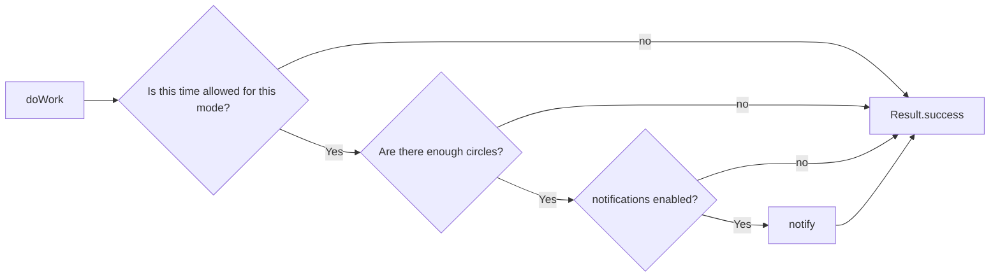

<style>
main {
  direction: ltr !important;
  text-align: left !important;
}
</style>

[Hebrew version]({{ '/android/CollectCircles/16.collect-circles-json-schedule' | relative_url }}) · [English chapter index]({{ '/android/CollectCircles/en/' | relative_url }})


[Previous chapter]({{ '/android/CollectCircles/en/15.collect-circles-periodic-work' | relative_url }}){: data-sequence-nav="prev"} · [Next chapter]({{ '/android/CollectCircles/en/17.collect-circles-worker-settlement' | relative_url }}){: data-sequence-nav="next"}

On the touch screen you can swipe right to the next chapter and left to the previous chapter.

{: .box-note}
Both periodic schedules already know when the battery allows work. Now we will add a second gate: the battery schedule will only send notifications during the specified computer science lessons, while the charging schedule will be able to check every 15 minutes between 08:00 and 24:00 every day.


## The exact policy

<div class="two-columns">
<div markdown="1" class="column">

### Without requiring a charger

- Worker every 3 hours
- Constraint: the battery is not low
- Notifications are allowed only during these lessons:
  - Sunday 15:50–17:15
  - Monday 08:15–12:10
  - Tuesday 13:40–17:15

</div>
<div markdown="1" class="column">

### While charging

- Worker every 15 minutes
- Constraint: the device is charging
- Notifications are allowed every day:
  - 08:00–24:00

</div>
</div>

{: .box-warning}
The 08:00–24:00 window ends at midnight and does not include 00:00 of the following day. In the code we will use the rule `start <= now < end`: the beginning is included and the end is not included.

## 1. Add a real JSON file to the project

In the **Android** window, under `app > res`, create an **Android Resource Directory** of type `raw`. Then create the file `notification_schedule.json` in the `app > res > raw` folder:

```json
{
  "lessonWindows": [
    { "day": "SUNDAY", "start": "15:50", "end": "17:15" },
    { "day": "MONDAY", "start": "08:15", "end": "12:10" },
    { "day": "TUESDAY", "start": "13:40", "end": "17:15" }
  ],
  "chargingWindow": {
    "start": "08:00",
    "end": "24:00"
  }
}
```

This is the default source, stored in Git and easy to read or change. The day names use English `DayOfWeek` values so that the code does not depend on the device language.

## 2. Copy the JSON to SharedPreferences

Under `app > kotlin+java > com.example.collectcircles` create a **Java Class** named `NotificationSchedule` and start with the constants:

```java
package com.example.collectcircles;

import android.content.Context;
import android.content.SharedPreferences;

import org.json.JSONArray;
import org.json.JSONException;
import org.json.JSONObject;

import java.io.InputStream;
import java.time.DayOfWeek;
import java.time.Instant;
import java.time.ZoneId;
import java.time.ZonedDateTime;
import java.util.Scanner;

public final class NotificationSchedule {

    public static final String LESSON_MODE = "lessons";
    public static final String CHARGING_MODE = "charging";

    private static final String SCHEDULE_KEY = "notification_schedule_json";

    private NotificationSchedule() {
    }
}
```

Add the loading methods:

```java
public static void ensureStored(Context context) {
    getJson(context);
}

private static String getJson(Context context) {
    SharedPreferences preferences = context.getSharedPreferences(
            GameProgress.PREFERENCES_NAME,
            Context.MODE_PRIVATE
    );
    String storedJson = preferences.getString(SCHEDULE_KEY, null);
    if (storedJson != null) {
        return storedJson;
    }

    String defaultJson = readDefaultJson(context);
    preferences.edit()
            .putString(SCHEDULE_KEY, defaultJson)
            .apply();
    return defaultJson;
}

private static String readDefaultJson(Context context) {
    InputStream input = context.getResources().openRawResource(
            R.raw.notification_schedule
    );
    try (Scanner scanner = new Scanner(input).useDelimiter("\\A")) {
        return scanner.hasNext() ? scanner.next() : "{}";
    }
}
```

On the first call, read the small resource and copy it to SharedPreferences. From the second call onward, `getJson()` returns the saved copy.

{: .box-note}
The JSON is saved as a setting and not as a game state. Therefore, it is possible in the future to build an editing screen or download a new timetable and save it under the same key, without changing the checking code.

## 3. Checking a time window

Add to `NotificationSchedule`:

```java
private static boolean isInsideWindow(
        int currentMinutes,
        String start,
        String end
) {
    int startMinutes = parseMinutes(start);
    int endMinutes = parseMinutes(end);

    if (startMinutes <= endMinutes) {
        return currentMinutes >= startMinutes
                && currentMinutes < endMinutes;
    }
    return currentMinutes >= startMinutes
            || currentMinutes < endMinutes;
}

private static int parseMinutes(String time) {
    String[] parts = time.split(":");
    if (parts.length != 2) {
        throw new IllegalArgumentException("Time must be HH:mm");
    }

    int hour = Integer.parseInt(parts[0]);
    int minute = Integer.parseInt(parts[1]);
    if (hour == 24 && minute == 0) {
        return 24 * 60;
    }
    if (hour < 0 || hour > 23 || minute < 0 || minute > 59) {
        throw new IllegalArgumentException("Invalid time: " + time);
    }
    return hour * 60 + minute;
}
```

`LocalTime.parse("24:00")` does not accept the end-of-day notation, so we convert hours to minutes ourselves. `24:00` becomes `1440`.

The second branch in `isInsideWindow` also supports a future window that crosses midnight, for example `22:00–02:00`.

## 4. Select the gate according to the work mode

Add the public method:

```java
public static boolean allows(
        Context context,
        String mode,
        long nowMillis
) {
    ZonedDateTime now = Instant.ofEpochMilli(nowMillis)
            .atZone(ZoneId.systemDefault());

    try {
        JSONObject schedule = new JSONObject(getJson(context));
        if (CHARGING_MODE.equals(mode)) {
            return allowsCharging(schedule, now);
        }
        if (LESSON_MODE.equals(mode)) {
            return allowsLesson(schedule, now);
        }
    } catch (JSONException | IllegalArgumentException exception) {
        return false;
    }
    return false;
}
```

And add the two tracks:

<div class="two-columns">
<div markdown="1" class="column">

### Lesson gate

```java
private static boolean allowsLesson(
        JSONObject schedule,
        ZonedDateTime now
) throws JSONException {
    JSONArray windows = schedule.getJSONArray(
            "lessonWindows"
    );
    for (int i = 0; i < windows.length(); i++) {
        JSONObject window = windows.getJSONObject(i);
        DayOfWeek day = DayOfWeek.valueOf(
                window.getString("day")
        );
        if (now.getDayOfWeek() == day
                && isInsideWindow(
                        minutesOfDay(now),
                        window.getString("start"),
                        window.getString("end")
                )) {
            return true;
        }
    }
    return false;
}
```

</div>
<div markdown="1" class="column">

### Charging gate

```java
private static boolean allowsCharging(
        JSONObject schedule,
        ZonedDateTime now
) throws JSONException {
    JSONObject window = schedule.getJSONObject(
            "chargingWindow"
    );
    return isInsideWindow(
            minutesOfDay(now),
            window.getString("start"),
            window.getString("end")
    );
}
```

</div>
</div>

Both need a helper method:

```java
private static int minutesOfDay(ZonedDateTime time) {
    return time.getHour() * 60 + time.getMinute();
}
```

If the JSON is malformed, a day is invalid, or a time is incorrect, `allows()` returns `false`. This is a **fail closed** behavior: it is better to miss a notification than to disturb outside the defined window.

## 5. Attach a mode to each WorkRequest

In `PusherWorkScheduler` add:

```java
import androidx.work.Data;
```

And a field shared by Scheduler and Worker:

```java
static final String SCHEDULE_MODE_KEY = "schedule_mode";
```

At the beginning of `schedule()`, make sure the default is saved:

```java
NotificationSchedule.ensureStored(context);
```

<div class="two-columns">
<div markdown="1" class="column">

### Battery request

```java
Data input = new Data.Builder()
        .putString(
                SCHEDULE_MODE_KEY,
                NotificationSchedule.LESSON_MODE
        )
        .build();

return new PeriodicWorkRequest.Builder(
        PusherEligibilityWorker.class,
        3,
        TimeUnit.HOURS
)
        .setConstraints(constraints)
        .setInputData(input)
        .addTag(BATTERY_WORK_NAME)
        .build();
```

</div>
<div markdown="1" class="column">

### Charging request

```java
Data input = new Data.Builder()
        .putString(
                SCHEDULE_MODE_KEY,
                NotificationSchedule.CHARGING_MODE
        )
        .build();

return new PeriodicWorkRequest.Builder(
        PusherEligibilityWorker.class,
        15,
        TimeUnit.MINUTES
)
        .setConstraints(constraints)
        .setInputData(input)
        .addTag(CHARGING_WORK_NAME)
        .build();
```

</div>
</div>

`Data` is a small input bundle saved with the work request. This does not call a Worker method, and there is no shared Java object that must stay in memory. The tag does not change the timing; it lets you identify the battery check and the charging check in the Background Task Inspector, even though both run the same Worker class.

## 6. Updating work that has already been saved

In chapter 15 we used `KEEP`. But the device already has a 30-minute charging schedule; `KEEP` will leave it unchanged and ignore the new 15-minute request.

Replace the two enqueue calls:

```diff
-ExistingPeriodicWorkPolicy.KEEP,
+ExistingPeriodicWorkPolicy.UPDATE,
```

`UPDATE` updates the specification of a job with the same name without creating another copy. According to [the official documentation](https://developer.android.com/reference/androidx/work/ExistingPeriodicWorkPolicy#UPDATE), it preserves the original enqueue time; if a Worker is already running, the current run continues with the old specification and the update is applied in the next cycle.

So the existing installation gets both the new interval and `schedule_mode`.

## 7. The Worker checks the gate before eligibility

At the beginning of `doWork()` add:

```java
String scheduleMode = getInputData().getString(
        PusherWorkScheduler.SCHEDULE_MODE_KEY
);
if (scheduleMode != null
        && !NotificationSchedule.allows(
                context,
                scheduleMode,
                System.currentTimeMillis()
        )) {
    return Result.success();
}
```

The full method is now built from three gates:



For the **Check** button from chapter 14 there is no `schedule_mode`, so it remains a manual check that does not depend on the time. Only the two periodic requests receive a mode and are blocked outside their window.

## 8. Threads, storage, and time

- `schedule()` is called in the UI thread. Reading the JSON resource only happens the first time, and the file is tiny and local; there is no network access. In a large project, we would also move substantial local I/O off the UI thread.
- `enqueueUniquePeriodicWork()` submits a job description and returns; it does not wait 15 minutes or keep a thread alive.
- `doWork()` and the JSON read from SharedPreferences run on the background thread provided by WorkManager.
- `System.currentTimeMillis()` is a wall clock. We convert it to `ZoneId.systemDefault()`, so changing the time zone on the device immediately changes the local message window.
- `SharedPreferences.apply()` updates memory immediately and writes to disk asynchronously.

### Can the JSON change while the Worker is reading it?

Each `SharedPreferences` read returns a complete `String` value; the Worker does not read half a string. If a future settings screen saves new JSON at the same time, the Worker will use the version returned by that read, and the next run will see the new version.

There is no need for a lock at this stage, because the Worker does not yet change the circle balance. A complete JSON update is not a read-modify-write operation on the economy.

## 9. An important limitation of the lesson window

The battery Worker is checked only about once every three hours, while some of the class windows are shorter than three hours. WorkManager may run it before and after the lesson, without running inside the window. The JSON prevents messages at the wrong time, but does not guarantee that a message will be received every class.

The charging schedule runs every 15 minutes in the wide window and is therefore easier to check and greatly reduces the chance of missing a study evening. If in the future we want an accurate notification at the beginning of each lesson, we will learn to schedule a calculated OneTimeWorkRequest or we will consider AlarmManager - with its battery limits and permissions.

## 10. Manual test

1. Connect the device to the charger and open the application between 08:00 and 24:00. This opening updates the existing job from 30 to 15 minutes.
2. In the Background Task Inspector the two lines may be called `PusherEligibilityWorker`. Select a line and check the tag in Work Details to identify it.
3. Make sure that the `pusher_check_charging` tag has a 15 minute interval, a Charging constraint and an input named `schedule_mode` whose value is `charging`.
4. Make sure that the `pusher_check_battery` tag still has a 3-hour interval, Battery Not Low, and a mode called `lessons`.
5. If you are eligible for the next Pusher, you can leave the device charging and check if the notification arrives in an appropriate cycle. 15 minutes is still a minimum, so further delays are allowed.
6. Click **Check** to immediately verify that the eligibility and notification mechanism still works without depending on the current time.
7. To test the boundaries, you can temporarily edit the JSON in SharedPreferences through a debugger or clear the application data and set a short window around the current time in the raw file.

{: .box-warning}
Clearing the application data also deletes the balance, the number of Pushers, and the best time. Only do this on a test device or use a debugger to edit the timetable key.

Run once:

```powershell
.\gradlew.bat testDebugUnitTest assembleDebug
```

{: .box-success}
The periodic notifications are now subject to a policy that can be read and changed as JSON: precise class hours in the battery track, and a wide daily window in the charging track.

[Continue to chapter 17: safe updates from the Worker](/android/CollectCircles/en/17.collect-circles-worker-settlement){: data-sequence-nav="next"}

<!-- gemini-tutor-links:start -->
<div markdown="1" class="english">

## Gemini tutor

{: .box-note}
[Open Gem: CollectCircles Background Trainer](https://gemini.google.com/gem/1QiC7WZPzbDpNaSbBjiX_Y8JqusBIXwQG?usp=sharing) to get hints, diagnostic questions and explanations appropriate to the stage you are on.

</div>
<!-- gemini-tutor-links:end -->
