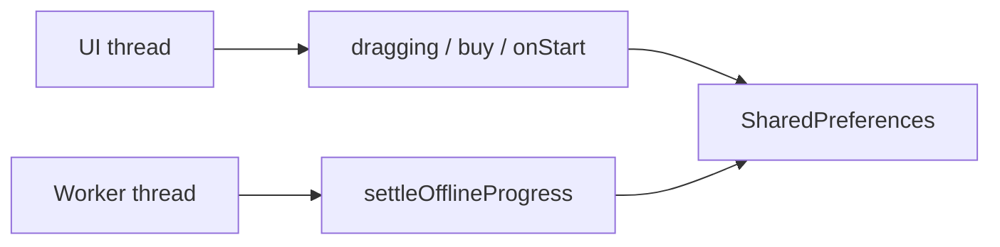
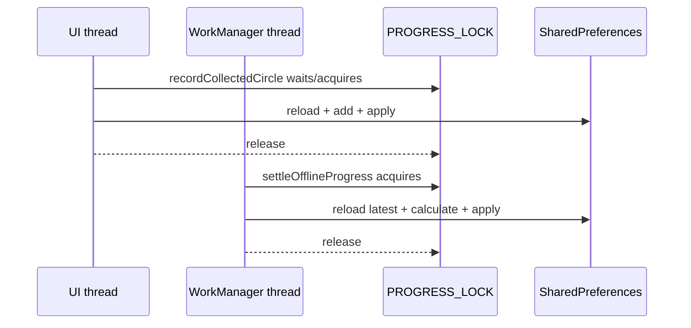

<style>
main {
  direction: ltr !important;
  text-align: left !important;
}
</style>

[Hebrew version]({{ '/android/CollectCircles/17.collect-circles-worker-settlement' | relative_url }}) · [English chapter index]({{ '/android/CollectCircles/en/' | relative_url }})


[Previous chapter]({{ '/android/CollectCircles/en/16.collect-circles-json-schedule' | relative_url }}){: data-sequence-nav="prev"} · [Next chapter]({{ '/android/CollectCircles/en/18.collect-circles-pusher-brag' | relative_url }}){: data-sequence-nav="next"}

On the touch screen you can swipe right to the next chapter and left to the previous chapter.

{: .box-note}
Until now, the Worker has only read the balance. It therefore could not report that the Pushers had produced enough for a purchase while the application stayed closed. In this chapter, it will settle offline production before checking eligibility—but only after we protect the data from two writers running concurrently.


## The problem: two writers updating the same economy



`SharedPreferences` allows reading and writing from several threads, but a sequence of **read → calculate → write** does not automatically become a single operation.

For example:

```text
balance = 100

UI reads 100
Worker reads 100
UI adds 1 and writes 101
Worker adds 20 and writes 120

final balance = 120, although it should be 121
```

This is a lost update. No individual line is wrong; the interaction between the two timelines produces the wrong result.

## 1. Add one lock to all GameProgress instances

In `GameProgress` add:

```java
private static final Object PROGRESS_LOCK = new Object();
```

The lock is `static`, so both the Activity's `GameProgress` and a new object that the Worker loads use the same lock within the application process.

{: .box-warning}
`synchronized (this)` would not be enough. Each of the two objects has a different `this`, so two threads could still enter the critical section at the same time.

## 2. Load a fresh snapshot inside the lock

Move all the reads from the constructor into a new method:

<div class="two-columns">
<div markdown="1" class="column">

### Before

```java
public GameProgress(SharedPreferences preferences) {
    this.preferences = preferences;
    circlesBalance = preferences.getLong(
            CIRCLES_BALANCE_KEY,
            0
    );
    // load the remaining fields...
}
```

</div>
<div markdown="1" class="column">

### After

```java
public GameProgress(SharedPreferences preferences) {
    this.preferences = preferences;
    reload();
}

private void reload() {
    circlesBalance = preferences.getLong(
            CIRCLES_BALANCE_KEY,
            0
    );
    lifetimeCircles = preferences.getLong(
            LIFETIME_CIRCLES_KEY,
            0
    );
    pusherCount = preferences.getInt(
            PUSHER_COUNT_KEY,
            0
    );
    autonomousMode = preferences.getBoolean(
            AUTONOMOUS_MODE_KEY,
            false
    );
    lastProgressUpdateMillis = preferences.getLong(
            LAST_PROGRESS_UPDATE_KEY,
            System.currentTimeMillis()
    );
    fractionalProgress = Double.longBitsToDouble(
            preferences.getLong(
                    FRACTIONAL_PROGRESS_KEY,
                    Double.doubleToRawLongBits(0)
            )
    );
}
```

</div>
</div>

Object creation still loads state immediately. The difference is that now any method that changes state can reread the current values **after** acquiring the lock.

## 3. Wrap read-modify-write operations

Change `recordCollectedCircles`:

<div class="two-columns">
<div markdown="1" class="column">

### Before

```java
circlesBalance = addWithSaturation(
        circlesBalance,
        count
);
lifetimeCircles = addWithSaturation(
        lifetimeCircles,
        count
);
preferences.edit()
        .putLong(CIRCLES_BALANCE_KEY, circlesBalance)
        .putLong(LIFETIME_CIRCLES_KEY, lifetimeCircles)
        .apply();
```

</div>
<div markdown="1" class="column">

### After

```java
synchronized (PROGRESS_LOCK) {
    reload();
    circlesBalance = addWithSaturation(
            circlesBalance,
            count
    );
    lifetimeCircles = addWithSaturation(
            lifetimeCircles,
            count
    );
    preferences.edit()
            .putLong(
                    CIRCLES_BALANCE_KEY,
                    circlesBalance
            )
            .putLong(
                    LIFETIME_CIRCLES_KEY,
                    lifetimeCircles
            )
            .apply();
}
```

</div>
</div>

Use the same structure in the following methods too:

- `buyPusher()`
- `setAutonomousMode(...)`
- `settleOfflineProgress(...)`
- `markBackgroundStarted(...)`
- Eligibility check — so that the Worker receives an up-to-date snapshot after settlement

For example, `buyPusher()` becomes:

```java
public boolean buyPusher() {
    synchronized (PROGRESS_LOCK) {
        reload();
        long price = getNextPusherPrice();
        if (circlesBalance < price) {
            return false;
        }

        circlesBalance -= price;
        pusherCount++;
        preferences.edit()
                .putLong(CIRCLES_BALANCE_KEY, circlesBalance)
                .putInt(PUSHER_COUNT_KEY, pusherCount)
                .apply();
        return true;
    }
}
```

To get the eligibility result and notification price from the same snapshot, add:

```java
public long getEligiblePusherPrice() {
    synchronized (PROGRESS_LOCK) {
        reload();
        long price = getNextPusherPrice();
        return circlesBalance >= price ? price : -1;
    }
}

public boolean canBuyPusher() {
    return getEligiblePusherPrice() >= 0;
}
```

The value `-1` means no eligibility. Any legal price is positive, so there is no conflict. If the Worker first called `canBuyPusher()` and then read the price in a separate operation, a purchase in the UI could change the number of Pushers between those calls.

### Why reload inside synchronized?

If we had loaded before getting the lock, another thread could have written a new value between loading and locking. The correct order is:

```text
lock → reload → calculate → edit/apply → unlock
```

`apply()` updates the SharedPreferences map in memory before the lock is released; the disk write is then scheduled. Therefore, the next method in the same process will load the new values.

## 4. Protect settleOfflineProgress too

Wrap the body of the existing method:

```java
public long settleOfflineProgress(long nowMillis) {
    synchronized (PROGRESS_LOCK) {
        reload();

        long elapsedMillis = Math.max(
                0,
                nowMillis - lastProgressUpdateMillis
        );
        lastProgressUpdateMillis = nowMillis;

        long collectedCircles = 0;
        if (autonomousMode && pusherCount > 0) {
            OfflineProgressCalculator.Result result =
                    OfflineProgressCalculator.calculate(
                            elapsedMillis,
                            pusherCount,
                            fractionalProgress
                    );
            collectedCircles = result.getWholeCircles();
            fractionalProgress = result.getFraction();
            circlesBalance = addWithSaturation(
                    circlesBalance,
                    collectedCircles
            );
            lifetimeCircles = addWithSaturation(
                    lifetimeCircles,
                    collectedCircles
            );
        }

        preferences.edit()
                .putLong(CIRCLES_BALANCE_KEY, circlesBalance)
                .putLong(LIFETIME_CIRCLES_KEY, lifetimeCircles)
                .putLong(
                        LAST_PROGRESS_UPDATE_KEY,
                        lastProgressUpdateMillis
                )
                .putLong(
                        FRACTIONAL_PROGRESS_KEY,
                        Double.doubleToRawLongBits(
                                fractionalProgress
                        )
                )
                .apply();
        return collectedCircles;
    }
}
```

If `onStart` and the Worker run at the same time, the first to acquire the lock settles the elapsed time and updates the timestamp. The second loads the new timestamp and therefore gets almost no elapsed time, rather than counting the entire offline interval again.

## 5. Screen time is not counted as offline time

WorkManager may run a Worker even when the Activity is open. In that case the circles on the board already credit the user through a callback. The Worker must not credit the same progress again based on elapsed time.

In the **Android** window, under `app > kotlin+java > com.example.collectcircles`, create a **Java Class** named `AppVisibility`:

```java
package com.example.collectcircles;

public final class AppVisibility {

    private static volatile boolean activityVisible;

    private AppVisibility() {
    }

    public static void enterForeground() {
        activityVisible = true;
    }

    public static void enterBackground() {
        activityVisible = false;
    }

    public static boolean isActivityVisible() {
        return activityVisible;
    }
}
```

### What does volatile promise?

`volatile` ensures that the Worker thread will read the last visibility value written by the UI thread, instead of continuing to use an old copy saved in the thread's cache.

`volatile` **does not** make a sequence of economic operations atomic. It is suitable for a single read/write flag; the balance, Lifetime, fractional remainder, and timestamp still require the lock.

<div class="two-columns">
<div markdown="1" class="column">

### `onStart`

```java
protected void onStart() {
    super.onStart();
    AppVisibility.enterForeground();

    long offlineCircles =
            gameProgress.settleOfflineProgress(
                    System.currentTimeMillis()
            );
    // refresh UI...
}
```

Mark the app as being in the foreground **before** settlement so that a new Worker does not start counting screen time.

</div>
<div markdown="1" class="column">

### `onStop`

```java
protected void onStop() {
    // pause UI callbacks...
    gameProgress.markBackgroundStarted(
            System.currentTimeMillis()
    );
    AppVisibility.enterBackground();
    enteredBackground = true;
    super.onStop();
}
```

Save a timestamp **before** allowing the Worker to see the app as being in the background.

</div>
</div>

## 6. Settle progress only for periodic requests while in the background

Update `doWork()`:

```java
Context context = getApplicationContext();
String scheduleMode = getInputData().getString(
        PusherWorkScheduler.SCHEDULE_MODE_KEY
);
boolean periodicCheck = scheduleMode != null;

if (periodicCheck && AppVisibility.isActivityVisible()) {
    return Result.success();
}

long nowMillis = System.currentTimeMillis();
if (periodicCheck
        && !NotificationSchedule.allows(
                context,
                scheduleMode,
                nowMillis
        )) {
    return Result.success();
}

GameProgress progress = GameProgress.load(context);
if (periodicCheck) {
    progress.settleOfflineProgress(nowMillis);

    if (AppVisibility.isActivityVisible()) {
        return Result.success();
    }
}

long eligiblePrice = progress.getEligiblePusherPrice();
if (eligiblePrice >= 0 && Notifications.canShow(context)) {
    Notifications.showPusherAvailable(
            context,
            eligiblePrice
    );
}
return Result.success();
```

The **Check** button creates `OneTimeWorkRequest` without `schedule_mode`. Therefore it remains a manual read-only check and does not generate offline time while the screen is open.

The second `AppVisibility` check handles the case where the user opened the Activity while the Worker was waiting for the lock. Settlement remains safe, but there is no need to send a notification exactly when the user already sees the balance on the screen.

## 7. Do Worker and Activity really run at the same time?

Yes. These are two different executors:



They can run in parallel outside the locked section. Only one thread at a time can execute the short section that changes the game economy.

There is no separate thread for each Pusher: the animation of all Pushers is still updated on one UI thread. The Worker is a separate background thread that is rarely activated for calculation and notification purposes, not for drawing.

## 8. Limits of the solution

- The lock is `static` and works within one process. This is appropriate for the project, because we did not define a Worker in a separate process.
- If in the future there will be several processes or a shared database between devices, we will use a Room transaction or a server mechanism - a memory lock will not be enough.
- `AppVisibility` starts as `false` in every new process. This makes sense: a process started by WorkManager without an Activity is in the background.
- Android can still kill the process. The state of the game is saved in SharedPreferences and does not depend on the lock or the objects remaining alive.

## 9. Manual test

1. Activate Auto with at least one Pusher and make sure the balance is lower than the next price.
2. Within the charging window 08:00–24:00, connect the device to the charger and put the application in the background.
3. After an appropriate Worker cycle, look for a purchase eligibility alert. 15 minutes is a minimum and Android may delay.
4. Open the application. The balance and Lifetime should include the circles that the Worker has already credited; the return Toast should only show circles accumulated since that settlement, if there were any.
5. Leave the screen open and work manually. A periodic Worker that arrives at this time should finish without adding offline production.
6. Press **Check** when the screen is open. The manual check can still send notification if eligibility exists, but does not change balance.

{: .box-note}
If you are already eligible, you can buy a Pusher to move to the next price before testing accumulation. The number of Pushers only increases; there is no need to reduce it.

Run once:

```powershell
.\gradlew.bat testDebugUnitTest assembleDebug
```

{: .box-success}
The Worker is now able to turn offline time into circles and report purchase eligibility before the application opens, without losing circles collected by the user and without counting the animation twice.

[Continue to chapter 18: Brag after buying a Pusher](/android/CollectCircles/en/18.collect-circles-pusher-brag){: data-sequence-nav="next"}

<!-- gemini-tutor-links:start -->
<div markdown="1" class="english">

## Gemini tutor

{: .box-note}
[Open Gem: CollectCircles Background Trainer](https://gemini.google.com/gem/1QiC7WZPzbDpNaSbBjiX_Y8JqusBIXwQG?usp=sharing) to get hints, diagnostic questions and explanations appropriate to the stage you are on.

</div>
<!-- gemini-tutor-links:end -->
