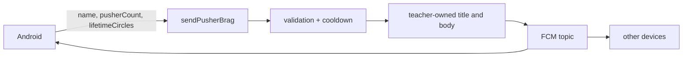
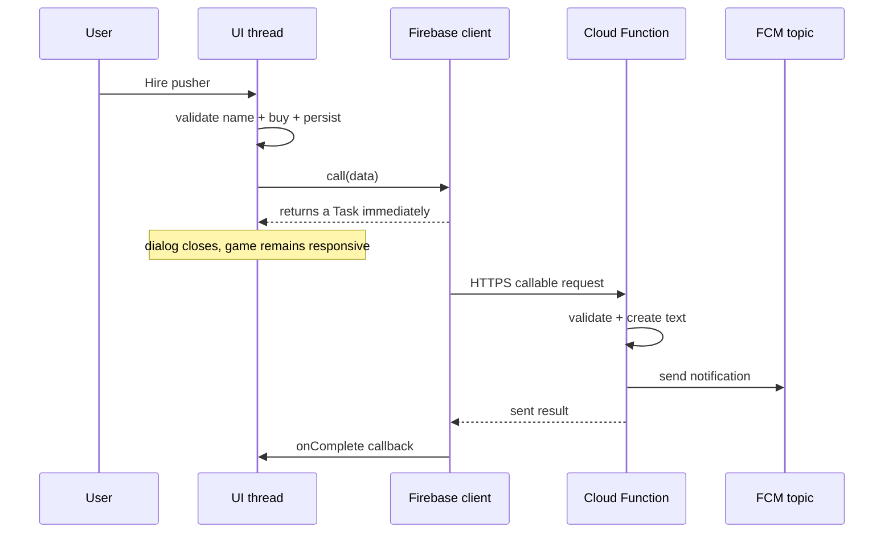

<style>
main {
  direction: ltr !important;
  text-align: left !important;
}
</style>

[Hebrew version]({{ '/android/CollectCircles/18.collect-circles-pusher-brag' | relative_url }}) · [English chapter index]({{ '/android/CollectCircles/en/' | relative_url }})


[Previous chapter]({{ '/android/CollectCircles/en/17.collect-circles-worker-settlement' | relative_url }}){: data-sequence-nav="prev"}


{: .box-note}
This is the last chapter in the game sequence. When a purchase in the store is successful, the application will save the player's name and send only three values to a Cloud Function: name, number of Pushers and Lifetime. The teacher's function will compose the title and message text and send them to everyone subscribed to the topic - including the device that sent it, so that it is easy to check.


## Responsibility boundary



The client does not send `title`, `body` or topic. Therefore a student can choose the values that the contract allows, but cannot turn the function into a service that sends free text to the entire class.

{: .box-warning}
The values still come from the user's device and are not proof of real achievement. Without Authentication and an authoritative database someone could modify the client and send false values. This is suitable for a classroom brag, not a competitive leaderboard.

## 1. Add a name to the shop window

In the **Android** window, create the file `dialog_pusher_shop.xml` under `app > res > layout`:

```xml
<?xml version="1.0" encoding="utf-8"?>
<LinearLayout xmlns:android="http://schemas.android.com/apk/res/android"
    xmlns:app="http://schemas.android.com/apk/res-auto"
    android:layout_width="match_parent"
    android:layout_height="wrap_content"
    android:orientation="vertical"
    android:paddingHorizontal="24dp"
    android:paddingTop="8dp"
    android:paddingBottom="4dp">

    <TextView
        android:id="@+id/shopDetailsText"
        android:layout_width="match_parent"
        android:layout_height="wrap_content"
        android:layout_marginBottom="12dp" />

    <com.google.android.material.textfield.TextInputLayout
        android:id="@+id/playerNameLayout"
        android:layout_width="match_parent"
        android:layout_height="wrap_content"
        android:hint="@string/player_name_hint"
        app:counterEnabled="true"
        app:counterMaxLength="30">

        <com.google.android.material.textfield.TextInputEditText
            android:id="@+id/playerNameInput"
            android:layout_width="match_parent"
            android:layout_height="wrap_content"
            android:inputType="textPersonName"
            android:maxLength="30"
            android:singleLine="true" />

    </com.google.android.material.textfield.TextInputLayout>

</LinearLayout>
```

And in `app > res > values > strings.xml`:

```xml
<string name="player_name_hint">Player name</string>
<string name="player_name_required">Enter a name before hiring</string>
<string name="brag_sent">Brag sent!</string>
<string name="brag_failed">Pusher hired, but the brag could not be sent</string>
```

The name is inside a window that already belongs to the purchase event, so we do not add another Activity or row of buttons to the crowded screen.

## 2. Replace the store message with View Binding

In `MainActivity` add:

```java
import com.example.collectcircles.databinding.DialogPusherShopBinding;
```

And a field for the key:

```java
private static final String PLAYER_NAME_KEY = "player_name";
```

<div class="two-columns">
<div markdown="1" class="column">

### Before

```java
AlertDialog dialog =
        new MaterialAlertDialogBuilder(this)
                .setTitle(R.string.shop_title)
                .setMessage(getString(
                        R.string.shop_message,
                        gameProgress.getPusherCount(),
                        gameProgress.getCirclesBalance(),
                        gameProgress.getNextPusherPrice()
                ))
                .setNegativeButton(R.string.close, null)
                .setPositiveButton(R.string.hire_pusher, null)
                .create();
```

</div>
<div markdown="1" class="column">

### After

```java
DialogPusherShopBinding shopBinding =
        DialogPusherShopBinding.inflate(
                getLayoutInflater()
        );
shopBinding.shopDetailsText.setText(getString(
        R.string.shop_message,
        gameProgress.getPusherCount(),
        gameProgress.getCirclesBalance(),
        gameProgress.getNextPusherPrice()
));
shopBinding.playerNameInput.setText(
        preferences.getString(PLAYER_NAME_KEY, "")
);

AlertDialog dialog =
        new MaterialAlertDialogBuilder(this)
                .setTitle(R.string.shop_title)
                .setView(shopBinding.getRoot())
                .setNegativeButton(R.string.close, null)
                .setPositiveButton(R.string.hire_pusher, null)
                .create();
```

</div>
</div>

View Binding is also automatically created for the dialog layout file. `findViewById` is not needed.

## 3. Validate and save the name only for a successful purchase

Inside the listener of the positive button, before `buyPusher()`, read the name:

```java
String playerName = String.valueOf(
        shopBinding.playerNameInput.getText()
).trim();
if (playerName.isEmpty()) {
    shopBinding.playerNameLayout.setError(
            getString(R.string.player_name_required)
    );
    return;
}
shopBinding.playerNameLayout.setError(null);
```

After the purchase was successful:

```java
preferences.edit()
        .putString(PLAYER_NAME_KEY, playerName)
        .apply();
```

If there are not enough circles, the button is already disabled. If the name is missing, we neither buy nor send. Each Brag therefore corresponds to a purchase made in that same dialog.

## 4. The first callable that receives data

Add imports:

```java
import java.util.HashMap;
import java.util.Map;
```

And add to `MainActivity`:

```java
private void sendPusherBrag(String playerName) {
    Map<String, Object> data = new HashMap<>();
    data.put("name", playerName);
    data.put("pusherCount", gameProgress.getPusherCount());
    data.put(
            "lifetimeCircles",
            gameProgress.getLifetimeCircles()
    );

    FirebaseFunctions.getInstance()
            .getHttpsCallable("sendPusherBrag")
            .call(data)
            .addOnCompleteListener(task -> {
                int message = task.isSuccessful()
                        ? R.string.brag_sent
                        : R.string.brag_failed;
                Toast.makeText(
                        this,
                        message,
                        Toast.LENGTH_SHORT
                ).show();
            });
}
```

According to the [official Firebase callable documentation](https://firebase.google.com/docs/functions/callable), the Map passed to `call(data)` arrives on the server as `request.data`.

{: .box-error}
Do not add a title, message content or topic to the map. The three keys are the entire data contract; the teacher controls the wording and destination from within the function.

## 5. Connect the purchase event

<div class="two-columns">
<div markdown="1" class="column">

### Before

```java
if (gameProgress.buyPusher()) {
    showProgress();
    binding.gameBoard.setPusherCount(
            gameProgress.getPusherCount()
    );
    Toast.makeText(
            this,
            R.string.pusher_hired,
            Toast.LENGTH_SHORT
    ).show();
    dialog.dismiss();
}
```

</div>
<div markdown="1" class="column">

### After

```java
if (gameProgress.buyPusher()) {
    preferences.edit()
            .putString(PLAYER_NAME_KEY, playerName)
            .apply();
    showProgress();
    binding.gameBoard.setPusherCount(
            gameProgress.getPusherCount()
    );
    Toast.makeText(
            this,
            R.string.pusher_hired,
            Toast.LENGTH_SHORT
    ).show();
    sendPusherBrag(playerName);
    dialog.dismiss();
}
```

</div>
</div>

The local purchase precedes the network call. If the Callable fails, the Pusher remains owned by the user; there is no reason to cancel a valid local purchase because of a temporary communication problem.

## 6. What is asynchronous here?



- Clicking, checking the name, buying and updating Views run on the UI thread.
- `call(data)` begins asynchronous I/O and returns a `Task`; it does not block the screen until the server answers.
- The Cloud Function runs in a Node.js process in the cloud, not on the phone.
- `addOnCompleteListener` runs after the end of the task and displays a short toast.
- FCM fanout is a separate operation: the callable may have already succeeded, but delivery of the notification to devices may be delayed.

There is no new `Thread` in the Activity code, and no WorkManager is needed: brag belongs to clicking while the application is open. If a process is killed after the purchase and before the end of the call, we do not guarantee a retry - this is an appropriate compromise for a social message that is not critical data.

## 7. The teacher's function

In this section, students need to understand the contract, while the teacher maintains and deploys the code.

Add to `functions/index.js`:

```javascript
const BRAG_COOLDOWN_MILLIS = 10_000;
let lastBragTime = 0;

function readBragData(request) {
  const data = request.data;
  if (data === null || typeof data !== "object" || Array.isArray(data)) {
    throw new HttpsError("invalid-argument", "Brag data must be an object.");
  }

  const allowedKeys = ["name", "pusherCount", "lifetimeCircles"];
  if (Object.keys(data).some((key) => !allowedKeys.includes(key))) {
    throw new HttpsError("invalid-argument", "Unexpected brag field.");
  }

  const name = typeof data.name === "string" ? data.name.trim() : "";
  if (name.length < 1 || name.length > 30 || /[\r\n]/u.test(name)) {
    throw new HttpsError("invalid-argument", "Invalid player name.");
  }
  if (!Number.isSafeInteger(data.pusherCount) ||
      data.pusherCount < 1 || data.pusherCount > 58) {
    throw new HttpsError("invalid-argument", "Invalid pusher count.");
  }
  if (!Number.isSafeInteger(data.lifetimeCircles) ||
      data.lifetimeCircles < 0) {
    throw new HttpsError("invalid-argument", "Invalid lifetime total.");
  }

  return {
    name,
    pusherCount: data.pusherCount,
    lifetimeCircles: data.lifetimeCircles,
  };
}

exports.sendPusherBrag = onCall(FUNCTION_OPTIONS, async (request) => {
  const brag = readBragData(request);
  const now = Date.now();
  if (now - lastBragTime < BRAG_COOLDOWN_MILLIS) {
    throw new HttpsError(
        "resource-exhausted",
        "Please wait before sending another brag.",
    );
  }

  const messageId = await getMessaging().send({
    topic: NOTIFICATION_TOPIC,
    notification: {
      title: "A new pusher joined the crew!",
      body: `${brag.name} now employs ${brag.pusherCount} pushers ` +
          `after collecting ${brag.lifetimeCircles} circles.`,
    },
    android: {
      priority: "high",
      notification: {
        channelId: "circle_invitations",
        icon: "ic_launcher_foreground",
      },
    },
  });

  lastBragTime = now;
  return {sent: true, messageId};
});
```

The function:

- Accepts only three recognized fields;
- Limits name to 30 characters and prohibits new lines;
- Requires integers within JavaScript's safe range;
- Builds all the text on the server;
- Sends to `circle_notifications`, to which the sender is also already registered;
- Rate-limits calls in the same server instance.

The cooldown is not a full security mechanism and can be reset on a cold start. The real defense in a future project will be App Check, Authentication and authoritative state on the server. Here, it is a simple guardrail added to an expensive purchase that happens infrequently.

## 8. Keep the server text in the foreground as well

When the application is in the background, Android displays a notification payload by itself. When in the foreground, `onMessageReceived()` is called. The old code calls `Notifications.show(this)`, replacing the brag with the standard invitation text.

Add to `Notifications`:

```java
private static final int REMOTE_NOTIFICATION_ID = 3;

public static void showRemote(
        Context context,
        String title,
        String body
) {
    createChannel(context);
    NotificationManager manager = context.getSystemService(
            NotificationManager.class
    );
    Notification notification = new Notification.Builder(
            context,
            CHANNEL_ID
    )
            .setSmallIcon(R.drawable.ic_launcher_foreground)
            .setContentTitle(title)
            .setContentText(body)
            .setAutoCancel(true)
            .build();
    manager.notify(REMOTE_NOTIFICATION_ID, notification);
}
```

And in `CircleMessagingService` replace:

```diff
 if (message.getNotification() != null) {
-    Notifications.show(this);
+    Notifications.showRemote(
+            this,
+            message.getNotification().getTitle(),
+            message.getNotification().getBody()
+    );
 }
```

Here we allow remote text because it comes from FCM and the teacher's function, rather than directly from a text field sent to the topic by the phone.

## 9. Testing and deployment

Syntax check for functions:

```powershell
cd functions
npm run check
```

Deploy only the new function:

```powershell
firebase deploy --only functions:sendPusherBrag
```

Targeted deployment does not modify or delete invitation functions that are already running. This is also [the targeted deployment pattern recommended by Firebase](https://firebase.google.com/docs/functions/manage-functions#deploy_functions).

It is possible to check the validation without sending a real message: a call with an empty name should return `INVALID_ARGUMENT` before the FCM operation. There is no need to make an automated successful call, because it will broadcast immediately to all subscribers.

After deployment:

1. Open the shop when there are enough circles.
2. Enter a name and buy a Pusher.
3. Make sure the Pusher is added immediately, even before the network reply.
4. Make sure a Toast reports whether sending the Brag succeeded or failed.
5. Check that the sending device receives a notification with name, number of Pushers and Lifetime.
6. Test once with the app in the foreground and once in the background. The server’s message text should be preserved in both cases.
7. If there is another device subscribed to the topic, make sure it also receives the same notification.

Also run once:

```powershell
.\gradlew.bat testDebugUnitTest assembleDebug
```

{: .box-success}
The game is now complete as a learning sequence: manual play, saved economy, animated pushers, offline production, scheduled WorkManager tasks, and a group Brag where the client sends data and the server controls the message.

<!-- gemini-tutor-links:start -->
<div markdown="1" class="english">

## Gemini tutor

{: .box-note}
[Open Gem: CollectCircles Background Trainer](https://gemini.google.com/gem/1QiC7WZPzbDpNaSbBjiX_Y8JqusBIXwQG?usp=sharing) to get hints, diagnostic questions and explanations appropriate to the stage you are on.

</div>
<!-- gemini-tutor-links:end -->
