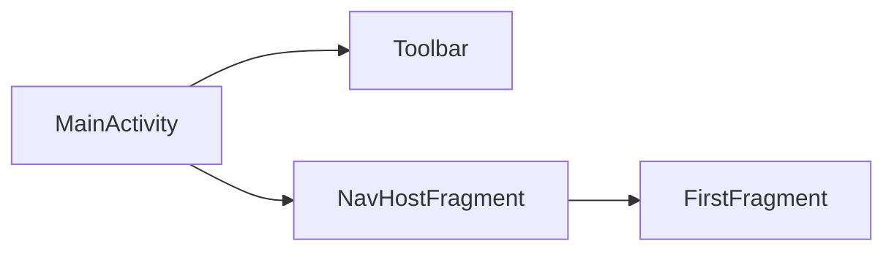

[לשיעור הראשון — מונה נקודות]({{ '/android/basics/01-score-counter/' | relative_url }}){: data-sequence-nav="prev"}

{: .box-success}
בשיעור הראשון בניתם מונה בתוך פרויקט שבו התבנית כבר יצרה את ה־View Binding ואת שני המסכים. הפעם תפתחו פרויקט Java נפרד, תפעילו בו את ה־View Binding בעצמכם ותחברו את כפתורי המונה ל־`MainActivity`. בסוף שלב 3 תוכלו להריץ את המונה ולהסביר איך לחיצה משנה את המספר על המסך.

| זמן מוצע | תוצר שרץ בסוף |
|---:|---:|
| כ־45 דקות | View Binding פעיל, ומונה ההוספה וההפחתה פועל מתוך `MainActivity` |
| הרחבה במפגש נוסף | סרגל כלים מופיע, והמונה פועל מתוך `FirstFragment` |
| המשך ההרחבה | מסך הוראות נפתח, הכותרת משתנה, ואפשר לחזור למונה בשלוש דרכים |

בכיתה אפשר לעבור אחרי חלק א ל[היכרות עם Android Studio]({{ '/android/basics/android-studio-intro/' | relative_url }}). חלקים ב ו־ג מיועדים למפגש שבו תרצו לפרק ולבנות מחדש את הניווט של התבנית. אפשר לחזור אליהם אחרי פריסות ו־Activity, מאותו פרויקט.

## חלק א — מפעילים View Binding ומריצים את המונה
{: #view-binding}

### 1. מתחילים מ־Empty Views Activity

במחשב המעבדה צרו **New Project**. בחרו **Empty Views Activity**, תנו לפרויקט את השם `ScoreCounterLab`, בחרו **Java** והשאירו **Kotlin DSL** בשדה של שפת הגדרות הבנייה. השתמשו בתיקייה חדשה ובשם חבילה שונה מזה של המונה הראשון, כך ששתי האפליקציות יוכלו להיות מותקנות במקביל. שם החבילה בדוגמאות הוא `com.example.scorecounterlab`. אם בחרתם חבילה אחרת, השתמשו בה בשורות `package`, בייבואי ה־binding ובשמות המחלקות שבגרף הניווט. הריצו פעם אחת ובדקו שאתם רואים **Hello World!**.

### 2. מחברים את הפריסה לקוד



`ActivityMainBinding` נוצרת עבור `activity_main.xml`. אחרי ההסבה `binding.getRoot()` נותנת ל־Activity את עץ הפקדים שנוצר מאותו XML. הריצו שוב. אם `ActivityMainBinding` עדיין מסומנת באדום, בדקו שביצעתם **Sync**, שהפרויקט נבנה, וש־Android Studio ייבאה את המחלקה מתוך תיקיית `databinding` של החבילה שלכם.

{: .box-success}
אותו **Hello World!** אמור להופיע גם אחרי ההסבה. בדקתם את החיבור החדש לפני שהוספתם אליו את המונה.

### 3. מחזירים את המונה למסך

ב־**app > res > values > strings.xml** הוסיפו את הטקסטים של המונה ושנו את הערך הקיים של `app_name`. הכותרת תשמש אותנו גם כשנוסיף סרגל כלים.

```diff
 <resources>
-    <string name="app_name">ScoreCounterLab</string>
+    <string name="app_name">מונה נקודות</string>
+    <string name="score_add">הוספת נקודה</string>
+    <string name="score_subtract">הפחתת נקודה</string>
 </resources>
```

ב־**app > res > layout > activity_main.xml** החליפו את ה־`TextView` של Hello World ב־`LinearLayout` של המונה. ה־`ConstraintLayout` החיצוני עם המזהה `main` הוא שורש התבנית. ה־`LinearLayout` הפנימי מסדר את המספר ואת הכפתורים מלמעלה למטה, כמו בשיעור הראשון. הרוחב `0dp` יחד עם אילוצי `start` ו־`end` מותח את המכל הפנימי בין שני הצדדים.

```diff
     tools:context=".MainActivity">

-    <TextView
-        android:layout_width="wrap_content"
+    <LinearLayout
+        android:layout_width="0dp"
         android:layout_height="wrap_content"
-        android:text="Hello World!"
-        app:layout_constraintBottom_toBottomOf="parent"
+        android:gravity="center_horizontal"
+        android:orientation="vertical"
+        android:padding="16dp"
         app:layout_constraintEnd_toEndOf="parent"
         app:layout_constraintStart_toStartOf="parent"
-        app:layout_constraintTop_toTopOf="parent" />
+        app:layout_constraintTop_toTopOf="parent">
+
+        <TextView
+            android:id="@+id/textview_score"
+            android:layout_width="wrap_content"
+            android:layout_height="wrap_content"
+            android:textSize="32sp"
+            tools:text="0" />
+
+        <Button
+            android:id="@+id/button_plus"
+            android:layout_width="wrap_content"
+            android:layout_height="wrap_content"
+            android:text="@string/score_add" />
+
+        <Button
+            android:id="@+id/button_minus"
+            android:layout_width="wrap_content"
+            android:layout_height="wrap_content"
+            android:text="@string/score_subtract" />
+    </LinearLayout>

 </androidx.constraintlayout.widget.ConstraintLayout>
```

ב־**app > kotlin+java > com.example.scorecounterlab > MainActivity** הוסיפו את שדה הניקוד, את שני המאזינים ואת `showScore()`. כאן המאזינים נרשמים ב־`onCreate` אחרי שה־Activity כבר קיבלה את הפריסה. מזהה `button_plus` מופיע בקוד בתור `binding.buttonPlus`.

```diff

     private ActivityMainBinding binding;
+    private int score = 0;

     @Override
```

```diff
             return insets;
         });
+
+        binding.buttonPlus.setOnClickListener(v -> {
+            score++;
+            showScore();
+        });
+        binding.buttonMinus.setOnClickListener(v -> {
+            score--;
+            showScore();
+        });
+        showScore();
+    }
+
+    /** Displays the current score in the score label. */
+    private void showScore() {
+        binding.textviewScore.setText(String.valueOf(score));
     }
 }
```

{: .box-success}
הריצו מפתיחה חדשה. לחצו פעמיים על הוספה ופעם על הפחתה. התצוגה אמורה לעבור מ־0 ל־1, ל־2 ואז לחזור ל־1.

בדקו שאתם יכולים להצביע על `button_plus` בפריסה, על `binding.buttonPlus` ב־Java ועל הקריאה ל־`showScore()`. בשיעור הראשון מצאתם את המאזין ב־`FirstFragment`. כאן הצגתם את אותו מונה ישירות מתוך `MainActivity`, המחלקה שמערכת Android מפעילה כשפותחים את האפליקציה.

[המשך המסלול — היכרות עם Android Studio דרך המונה]({{ '/android/basics/android-studio-intro/' | relative_url }}){: data-sequence-nav="next"}

## חלק ב — הרחבה: סרגל כלים ומסך בתוך Fragment
{: #first-fragment}

התחילו מנקודת הבדיקה של חלק א, כשהמונה עובד ב־`MainActivity`. תחילה נוסיף סרגל כלים. לאחר מכן נעביר את המונה ל־Fragment, חלק ממשק עם פריסה והתנהגות משלו שמתארח בתוך ה־Activity. בחלק ג נוסיף Fragment שני ונעבור ביניהם דרך אותו מארח.

### 4. מוסיפים סרגל כלים

ב־`activity_main.xml` הוסיפו `MaterialToolbar` מעל המונה. `?attr/actionBarSize` נותן לסרגל את הגובה שמוגדר בערכת העיצוב. הצמידו את ראש ה־`LinearLayout` לתחתית הסרגל. כך הסרגל והמונה מקבלים מקום משלהם על המסך.

```diff
     tools:context=".MainActivity">

+    <com.google.android.material.appbar.MaterialToolbar
+        android:id="@+id/toolbar"
+        android:layout_width="0dp"
+        android:layout_height="?attr/actionBarSize"
+        app:layout_constraintEnd_toEndOf="parent"
+        app:layout_constraintStart_toStartOf="parent"
+        app:layout_constraintTop_toTopOf="parent" />
+
     <LinearLayout
         android:layout_width="0dp"
```

```diff
         app:layout_constraintEnd_toEndOf="parent"
         app:layout_constraintStart_toStartOf="parent"
-        app:layout_constraintTop_toTopOf="parent">
+        app:layout_constraintTop_toBottomOf="@id/toolbar">

         <TextView
```

ב־`MainActivity` חברו את הסרגל בעזרת `setSupportActionBar` אחרי `setContentView`. תבנית הפרויקט משתמשת בערכת עיצוב מסוג `NoActionBar`, ולכן זה הסרגל שיופיע למעלה.

```diff
         binding = ActivityMainBinding.inflate(getLayoutInflater());
         setContentView(binding.getRoot());
+        setSupportActionBar(binding.toolbar);
         ViewCompat.setOnApplyWindowInsetsListener(binding.main, (v, insets) -> {
             Insets systemBars = insets.getInsets(WindowInsetsCompat.Type.systemBars());
```

**בדיקה בהרצה.** ודאו שהכותרת **מונה נקודות** מופיעה למעלה, והמספר וכפתורי המונה מופיעים מתחתיה.

### 5. מעבירים את המונה ל־Fragment

ה־Activity מחזיקה את סרגל הכלים ואת המקום שבו יוצג המסך. נכניס למקום הזה `NavHostFragment`, שמציג את היעד הנוכחי מתוך **גרף ניווט**. כרגע יהיה לגרף יעד אחד, `FirstFragment`.



ב־**Gradle Scripts > libs.versions.toml** הוסיפו גרסה משותפת לשתי ספריות הניווט. ספריית `navigation-fragment` מספקת את המארח ואת הניווט בין Fragments. ספריית `navigation-ui` מחברת את גרף הניווט לסרגל הכלים.

```diff
 constraintlayout = "2.2.2"

+navigation = "2.10.2"
+
 [libraries]
 junit = { group = "junit", name = "junit", version.ref = "junit" }
```

```diff
 constraintlayout = { group = "androidx.constraintlayout", name = "constraintlayout", version.ref = "constraintlayout" }

+navigation-fragment = { group = "androidx.navigation", name = "navigation-fragment", version.ref = "navigation" }
+navigation-ui = { group = "androidx.navigation", name = "navigation-ui", version.ref = "navigation" }
+
 [plugins]
 android-application = { id = "com.android.application", version.ref = "agp" }
-
```

ב־**Gradle Scripts > build.gradle.kts (Module :app)** הוסיפו את שתי התלויות ובצעו **Sync**.

```diff
     implementation(libs.constraintlayout)
     implementation(libs.material)
+    implementation(libs.navigation.fragment)
+    implementation(libs.navigation.ui)
     testImplementation(libs.junit)
     androidTestImplementation(libs.espresso.core)
```

ב־**app > res > layout** צרו את `fragment_first.xml`. זהו ה־`LinearLayout` של המונה בתוך `NestedScrollView`. מזהי הפקדים נשארים זהים, ולכן אותן פעולות לחיצה ימשיכו להתאים למסך.

```xml
<?xml version="1.0" encoding="utf-8"?>
<androidx.core.widget.NestedScrollView xmlns:android="http://schemas.android.com/apk/res/android"
    xmlns:tools="http://schemas.android.com/tools"
    android:layout_width="match_parent"
    android:layout_height="match_parent">

    <LinearLayout
        android:layout_width="match_parent"
        android:layout_height="wrap_content"
        android:gravity="center_horizontal"
        android:orientation="vertical"
        android:padding="16dp">

        <TextView
            android:id="@+id/textview_score"
            android:layout_width="wrap_content"
            android:layout_height="wrap_content"
            android:textSize="32sp"
            tools:text="0" />

        <Button
            android:id="@+id/button_plus"
            android:layout_width="wrap_content"
            android:layout_height="wrap_content"
            android:text="@string/score_add" />

        <Button
            android:id="@+id/button_minus"
            android:layout_width="wrap_content"
            android:layout_height="wrap_content"
            android:text="@string/score_subtract" />
    </LinearLayout>
</androidx.core.widget.NestedScrollView>
```

ב־**app > kotlin+java > com.example.scorecounterlab** צרו מחלקת Java בשם `FirstFragment`. ה־Fragment יוצרת את הפריסה שלה ב־`onCreateView`, מחברת את הפקדים כשהם מוכנים ב־`onViewCreated`, ומשחררת את ההפניות אליהם ב־`onDestroyView`. שימו לב ששם ה־binding נגזר מהקובץ `fragment_first.xml`.

```java
package com.example.scorecounterlab;

import android.os.Bundle;
import android.view.LayoutInflater;
import android.view.View;
import android.view.ViewGroup;

import androidx.annotation.NonNull;
import androidx.fragment.app.Fragment;

import com.example.scorecounterlab.databinding.FragmentFirstBinding;

public class FirstFragment extends Fragment {

    private FragmentFirstBinding binding;
    private int score = 0;

    /** Creates the views for this instance of the counter screen. */
    @Override
    public View onCreateView(@NonNull LayoutInflater inflater, ViewGroup container,
                             Bundle savedInstanceState) {
        binding = FragmentFirstBinding.inflate(inflater, container, false);
        return binding.getRoot();
    }

    /** Connects the buttons and displays the current score after the views are ready. */
    @Override
    public void onViewCreated(@NonNull View view, Bundle savedInstanceState) {
        super.onViewCreated(view, savedInstanceState);
        binding.buttonPlus.setOnClickListener(v -> {
            score++;
            showScore();
        });
        binding.buttonMinus.setOnClickListener(v -> {
            score--;
            showScore();
        });
        showScore();
    }

    /** Displays the current score in the score label. */
    private void showScore() {
        binding.textviewScore.setText(String.valueOf(score));
    }

    /** Releases references to the old views when the screen's view is destroyed. */
    @Override
    public void onDestroyView() {
        super.onDestroyView();
        binding = null;
    }
}
```

{: .box-warning}
משתנה `score` שייך למונה. משתנה `binding` שייך לפקדים שנוצרו עבור המסך הנוכחי. כשמנקים את ה־binding, מפסיקים להחזיק הפניות לפקדים הישנים. תצוגה חדשה תוכל להציג שוב את ערכו הנוכחי של `score`.

ב־**app > res** צרו תיקיית משאבים מסוג **navigation**, ובה את הקובץ `nav_graph.xml`. `startDestination` קובע איזה יעד יוצג בפתיחה. `android:name` מצביע על המחלקה של המסך, ו־`android:label` מספק את הכותרת שלו לסרגל.

```xml
<?xml version="1.0" encoding="utf-8"?>
<navigation xmlns:android="http://schemas.android.com/apk/res/android"
    xmlns:app="http://schemas.android.com/apk/res-auto"
    android:id="@+id/nav_graph"
    app:startDestination="@id/firstFragment">

    <fragment
        android:id="@+id/firstFragment"
        android:name="com.example.scorecounterlab.FirstFragment"
        android:label="@string/app_name" />
</navigation>
```

ב־`activity_main.xml` החליפו את כל ה־`LinearLayout` הפנימי של המונה, שנמצא אחרי הסרגל, במארח הבא. השינוי הזה מעביר את הצגת המונה ל־`FirstFragment`.

```xml
    <androidx.fragment.app.FragmentContainerView
        android:id="@+id/nav_host"
        android:name="androidx.navigation.fragment.NavHostFragment"
        android:layout_width="0dp"
        android:layout_height="0dp"
        app:defaultNavHost="true"
        app:layout_constraintBottom_toBottomOf="parent"
        app:layout_constraintEnd_toEndOf="parent"
        app:layout_constraintStart_toStartOf="parent"
        app:layout_constraintTop_toBottomOf="@id/toolbar"
        app:navGraph="@navigation/nav_graph" />
```

ב־`MainActivity.java` העבירו את האחריות ללחיצות ולניקוד ל־`FirstFragment` על ידי הסרת הקוד הכפול מה־Activity. הוסיפו את החיבור של `NavController` לסרגל הכלים. `getNavController()` מקבלת את מנהל הניווט מתוך המארח שהגדרתם ב־XML.

```diff
 import androidx.core.view.ViewCompat;
 import androidx.core.view.WindowInsetsCompat;
+import androidx.navigation.NavController;
+import androidx.navigation.fragment.NavHostFragment;
+import androidx.navigation.ui.AppBarConfiguration;
+import androidx.navigation.ui.NavigationUI;

 import com.example.scorecounterlab.databinding.ActivityMainBinding;
```

```diff

     private ActivityMainBinding binding;
-    private int score = 0;
+    private AppBarConfiguration appBarConfiguration;

     @Override
```

```diff
         });

-        binding.buttonPlus.setOnClickListener(v -> {
-            score++;
-            showScore();
-        });
-        binding.buttonMinus.setOnClickListener(v -> {
-            score--;
-            showScore();
-        });
-        showScore();
+        NavController navController = getNavController();
+        appBarConfiguration = new AppBarConfiguration.Builder(navController.getGraph()).build();
+        NavigationUI.setupActionBarWithNavController(this, navController, appBarConfiguration);
     }

-    /** Displays the current score in the score label. */
-    private void showScore() {
-        binding.textviewScore.setText(String.valueOf(score));
+    /** Returns the controller from the NavHostFragment declared in activity_main.xml. */
+    private NavController getNavController() {
+        NavHostFragment host = (NavHostFragment) getSupportFragmentManager()
+                .findFragmentById(R.id.nav_host);
+        return host.getNavController();
     }
 }
```

{: .box-error}
אם פתיחת האפליקציה נכשלת אחרי הוספת המארח, בדקו ב־**Logcat** את השגיאה הראשונה שנוגעת לפרויקט. ודאו ששמו המלא של `FirstFragment` בגרף זהה לשורת `package` ולשם המחלקה שיצרתם.

{: .box-success}
הריצו שוב. סרגל הכלים והמונה אמורים לפעול בדיוק כמו בנקודת הבדיקה הקודמת. הפעם `FirstFragment` מחזיקה את הניקוד ואת כפתורי ההוספה וההפחתה. זו נקודת עצירה טובה.

## חלק ג — המשך ההרחבה: מסך שני, מעבר וחזרה
{: #navigation}

### 6. יוצרים את מסך ההוראות

הוסיפו ל־`strings.xml` את הכותרת והטקסט של מסך ההוראות ואת תווית כפתור החזרה.

```diff
     <string name="score_add">הוספת נקודה</string>
     <string name="score_subtract">הפחתת נקודה</string>
+    <string name="rules_title">איך משחקים</string>
+    <string name="rules_text">לחצו על הוספת נקודה כדי להעלות את הניקוד ועל הפחתת נקודה כדי להוריד אותו.</string>
+    <string name="return_to_score">חזרה למונה</string>
 </resources>
```

צרו את `fragment_second.xml` ב־**app > res > layout** ואת `SecondFragment.java` בחבילה של הפרויקט. `popBackStack()` סוגרת את היעד הנוכחי וחוזרת ליעד שכבר קיים במחסנית. במקרה שלנו זה המונה שממנו הגענו.

```xml
<?xml version="1.0" encoding="utf-8"?>
<LinearLayout xmlns:android="http://schemas.android.com/apk/res/android"
    android:layout_width="match_parent"
    android:layout_height="match_parent"
    android:orientation="vertical"
    android:padding="16dp">

    <TextView
        android:layout_width="match_parent"
        android:layout_height="wrap_content"
        android:text="@string/rules_text" />

    <Button
        android:id="@+id/button_back"
        android:layout_width="wrap_content"
        android:layout_height="wrap_content"
        android:layout_marginTop="16dp"
        android:text="@string/return_to_score" />

</LinearLayout>
```

```java
package com.example.scorecounterlab;

import android.os.Bundle;
import android.view.LayoutInflater;
import android.view.View;
import android.view.ViewGroup;

import androidx.annotation.NonNull;
import androidx.fragment.app.Fragment;
import androidx.navigation.fragment.NavHostFragment;

import com.example.scorecounterlab.databinding.FragmentSecondBinding;

public class SecondFragment extends Fragment {

    private FragmentSecondBinding binding;

    /** Creates the views for the instructions screen. */
    @Override
    public View onCreateView(@NonNull LayoutInflater inflater, ViewGroup container,
                             Bundle savedInstanceState) {
        binding = FragmentSecondBinding.inflate(inflater, container, false);
        return binding.getRoot();
    }

    /** Returns to the counter that is already on the navigation back stack. */
    @Override
    public void onViewCreated(@NonNull View view, Bundle savedInstanceState) {
        super.onViewCreated(view, savedInstanceState);
        binding.buttonBack.setOnClickListener(v ->
                NavHostFragment.findNavController(this).popBackStack());
    }

    /** Releases references to the views of the instructions screen. */
    @Override
    public void onDestroyView() {
        super.onDestroyView();
        binding = null;
    }
}
```

### 7. מחברים את היעדים ואת חץ החזרה

ב־`nav_graph.xml` הוסיפו את היעד השני ופעולה שמובילה אליו מהיעד הראשון. המזהה של ה־`action` ישמש את הקוד של כפתור ההוראות.

```diff
         android:id="@+id/firstFragment"
         android:name="com.example.scorecounterlab.FirstFragment"
-        android:label="@string/app_name" />
+        android:label="@string/app_name">
+        <action
+            android:id="@+id/action_first_to_second"
+            app:destination="@id/secondFragment" />
+    </fragment>
+
+    <fragment
+        android:id="@+id/secondFragment"
+        android:name="com.example.scorecounterlab.SecondFragment"
+        android:label="@string/rules_title" />
 </navigation>
```

ב־`fragment_first.xml` הוסיפו את כפתור **איך משחקים** אחרי כפתור ההפחתה. ב־`FirstFragment.java` חברו אותו בעזרת `navigate`.

```diff
             android:layout_height="wrap_content"
             android:text="@string/score_subtract" />
+
+        <Button
+            android:id="@+id/button_rules"
+            android:layout_width="wrap_content"
+            android:layout_height="wrap_content"
+            android:layout_marginTop="16dp"
+            android:text="@string/rules_title" />
     </LinearLayout>
 </androidx.core.widget.NestedScrollView>
```

```diff
 import androidx.annotation.NonNull;
 import androidx.fragment.app.Fragment;
+import androidx.navigation.fragment.NavHostFragment;

 import com.example.scorecounterlab.databinding.FragmentFirstBinding;
```

```diff
             showScore();
         });
+        binding.buttonRules.setOnClickListener(v ->
+                NavHostFragment.findNavController(this).navigate(R.id.action_first_to_second));
         showScore();
     }
```

ב־`MainActivity.java` הוסיפו את `onSupportNavigateUp()` כדי שחץ **Up** בסרגל יפעיל את מנהל הניווט. שם היעד הנוכחי מגיע מה־`label` בגרף.

```diff
     }

+    /** Handles the app bar's Up arrow using the same navigation graph as Back. */
+    @Override
+    public boolean onSupportNavigateUp() {
+        return NavigationUI.navigateUp(getNavController(), appBarConfiguration)
+                || super.onSupportNavigateUp();
+    }
+
     /** Returns the controller from the NavHostFragment declared in activity_main.xml. */
     private NavController getNavController() {
```

{: .box-success}
הריצו ובדקו. העלו את המונה ל־2, פתחו **איך משחקים** ובדקו שהכותרת משתנה. חזרו למונה בעזרת הכפתור שבמסך וודאו שעדיין מוצג 2. חזרו על הבדיקה עם חץ **Up** בסרגל ועם **Back** של Android. לחיצה נוספת על הוספה אמורה להציג 3.

<details markdown="1">
<summary>שאלת הבנה על החזרה למונה</summary>

למה במסך ההוראות קראנו ל־`popBackStack()`? המונה שממנו הגענו כבר נמצא במחסנית. סגירת מסך ההוראות מחזירה אותנו אליו. מעבר נוסף ליעד של המונה היה פותח מופע נוסף ומוסיף תחנה למחסנית.

</details>

## השלמה — תפריט וכפתור צף
{: #toolbar-actions}

כמו בתבנית **Basic Views Activity**, סרגל הכלים יכול להציע פעולה בתפריט, וה־Activity יכולה להציג כפתור צף מעל המסך הנוכחי. כאן **אודות** יציג הודעה קצרה, והכפתור הצף יזכיר איך מפעילים את המונה.

ב־`strings.xml` הוסיפו את התוויות וההודעות. צרו תיקיית משאבים מסוג **menu** ובתוכה את `menu_main.xml`. הערך `never` מציג את הפריט בתוך תפריט שלוש הנקודות.

```diff
     <string name="rules_text">לחצו על הוספת נקודה כדי להעלות את הניקוד ועל הפחתת נקודה כדי להוריד אותו.</string>
     <string name="return_to_score">חזרה למונה</string>
+    <string name="help_button">עזרה קצרה</string>
+    <string name="help_message">פלוס מוסיף נקודה ומינוס מפחית נקודה.</string>
+    <string name="menu_about">אודות</string>
+    <string name="about_message">מונה נקודות — תרגיל Android לכיתה י״א</string>
 </resources>
```

```xml
<?xml version="1.0" encoding="utf-8"?>
<menu xmlns:android="http://schemas.android.com/apk/res/android"
    xmlns:app="http://schemas.android.com/apk/res-auto">
    <item
        android:id="@+id/action_about"
        android:title="@string/menu_about"
        app:showAsAction="never" />
</menu>
```

ב־`activity_main.xml` הוסיפו `FloatingActionButton` אחרי המארח. `contentDescription` נותן לכפתור שם גם עבור קוראי מסך. ב־`MainActivity.java` חברו את התפריט ואת הכפתור הצף. `setAnchorView` ממקמת את ה־Snackbar מעל הכפתור.

```diff
         app:navGraph="@navigation/nav_graph" />

+
+    <com.google.android.material.floatingactionbutton.FloatingActionButton
+        android:id="@+id/fab"
+        android:layout_width="wrap_content"
+        android:layout_height="wrap_content"
+        android:layout_margin="16dp"
+        android:contentDescription="@string/help_button"
+        app:layout_constraintBottom_toBottomOf="parent"
+        app:layout_constraintEnd_toEndOf="parent"
+        app:srcCompat="@android:drawable/ic_menu_help" />
 </androidx.constraintlayout.widget.ConstraintLayout>
```

```diff

 import android.os.Bundle;
+import android.view.Menu;
+import android.view.MenuItem;

 import androidx.activity.EdgeToEdge;
```

```diff

 import com.example.scorecounterlab.databinding.ActivityMainBinding;
+import com.google.android.material.snackbar.Snackbar;
 public class MainActivity extends AppCompatActivity {

```

```diff
         appBarConfiguration = new AppBarConfiguration.Builder(navController.getGraph()).build();
         NavigationUI.setupActionBarWithNavController(this, navController, appBarConfiguration);
+
+        binding.fab.setOnClickListener(view -> showMessage(R.string.help_message));
+    }
+
+    /** Adds the About item to the toolbar's overflow menu. */
+    @Override
+    public boolean onCreateOptionsMenu(Menu menu) {
+        getMenuInflater().inflate(R.menu.menu_main, menu);
+        return true;
+    }
+
+    /** Shows the app's About message when its menu item is selected. */
+    @Override
+    public boolean onOptionsItemSelected(MenuItem item) {
+        if (item.getItemId() == R.id.action_about) {
+            showMessage(R.string.about_message);
+            return true;
+        }
+        return super.onOptionsItemSelected(item);
+    }
+
+    /** Shows a short message above the floating action button. */
+    private void showMessage(int message) {
+        Snackbar.make(binding.getRoot(), message, Snackbar.LENGTH_LONG)
+                .setAnchorView(binding.fab).show();
     }

```

**בדיקה בהרצה.** לחצו על הכפתור הצף ובדקו שמופיעה שורת העזרה. פתחו את תפריט שלוש הנקודות ובחרו **אודות**. נסו את שתי הפעולות גם במסך ההוראות.

להעמקה קראו על [View Binding בתיעוד Android](https://developer.android.com/topic/libraries/view-binding) ועל [החיבור בין סרגל הכלים לגרף הניווט](https://developer.android.com/guide/navigation/integrations/ui).

[חזרה למסלול הכיתה — היכרות עם Android Studio]({{ '/android/basics/android-studio-intro/' | relative_url }})
