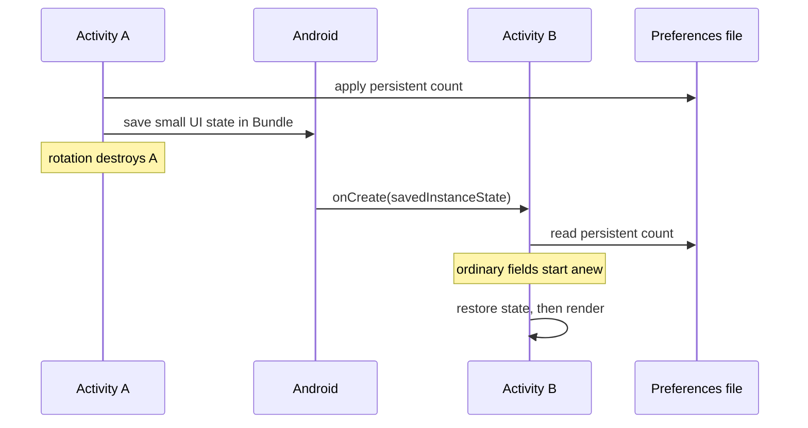

[Lab map]({{ '/android/topics/' | relative_url }}) · [Hebrew version]({{ '/android/topics/01-lifecycle-state/' | relative_url }})

<style>
main {
  direction: ltr !important;
  text-align: left !important;
}
</style>

[Lab source on GitHub — Android-Lifecycle](https://github.com/3strategy/Android-Lifecycle). Open the project in Android Studio, run the experiments, and compare the code with the explanations here.

{: .box-success}
By the end of this lab, the Activity will display three counters and the Fragment will display another. Increment them, rotate the device, force stop the app, and return to it. You will be able to predict **which value survives each action**. A separate button destroys only the Fragment's View; pressing Back restores the View while the same Fragment instance remains.

## Pause and predict

You increment all three Activity counters once, then rotate the screen. What values will appear, and why? Write your prediction before opening the explanation. Then identify the field or condition in the code that supports it.

<details markdown="1">
<summary>Check your understanding</summary>

The ordinary field starts at 0 in the new Activity. The Bundle counter is restored to 1 during recreation. The preferences counter is read from storage and remains 1. Restoring state before rendering brings the correct values to the new Views.

</details>

## Starting point and predictions

Start with an **Empty Views Activity** project using Java and XML, with the package `com.example.topics`. First enable and learn View Binding below; the rest of the lab assumes that conversion is complete. The finished project is on the `main` branch of [Android-Lifecycle](https://github.com/3strategy/Android-Lifecycle). In Git Log, compare the change implementing this lab with the template baseline using View Binding. In Android Studio's **Android** view, find the files under **app > kotlin+java > com.example.topics**, **app > res > layout**, and **app > res > values**.



Before writing the code, make a prediction for each row:

| Action | Ordinary Activity field | Value in `Bundle` | Value in `SharedPreferences` |
|:---|:---:|:---:|:---:|
| Rotate the screen | ? | ? | ? |
| Go to the background with `Don't keep activities`, then return | ? | ? | ? |
| Force stop and relaunch | ? | ? | ? |

The `onSaveInstanceState` Bundle restores UI state when the system recreates a component. It **is not a database** and does not promise restoration after force stopping or freshly launching the app. `SharedPreferences` supplies local data that survives the app process ending. An ordinary Java field lives only as long as its owning instance.

## Mental model: value, owner, and lifetime

When you say a value is "saved," complete the thought: **where is it stored, and who can recover it after its owner disappears?** A button increments three equal numbers, but their recovery paths differ. `memoryCount` belongs to the current Java instance; `savedCount` is copied into restoration state that Android may give to the next instance; `persistentCount` is read from a private file. The text on screen displays those values; it should not be their source of truth.



Follow one number, such as 2, through the diagram. It does not move automatically between fields in two instances: the code reads it from the Bundle or the file. After force stopping and freshly launching the app, the file path remains, but you must not assume Android supplies the old task's Bundle. These are different experiments.

A Fragment also has **two lifetimes**: the object holding `count`, and the View tree displaying it. Detaching and returning through the back stack can destroy and recreate the tree without replacing the object. The old binding references the destroyed tree, so clear it. Do not reset `count` in `onCreateView`: creating a display is not a request to erase the data. The [Android Fragment lifecycle documentation](https://developer.android.com/guide/fragments/lifecycle) defines the View lifecycle separately.

{: .box-note}
When reading a callback, ask: who calls me, and which resource is valid now? Android calls `onCreateView`, where you can create a binding. Android calls `onDestroyView`, after which you must not use that binding. `renderCount` is our own method, so we are responsible for calling it only while a View exists.

## Build the experiment

New files are shown in full. For an existing file, a `diff` excerpt shows only the changed region: remove `-` lines, add `+` lines, and keep context lines. Do not delete template code omitted from the excerpt. The `⁞` marker represents omitted context; do not type it into Java.

### 1. Display strings

In **app > res > values > strings.xml**, add these strings. The numbered format placeholders receive values through `getString`.

```diff
 <resources>
     <string name="app_name">topics</string>
+    <string name="lifecycle_intro">Tap Increment, rotate the device, then force stop and relaunch. Which values survive?</string>
+    <string name="memory_value">Activity field: %1$d</string>
+    <string name="saved_value">Saved Bundle: %1$d</string>
+    <string name="persistent_value">SharedPreferences: %1$d</string>
+    <string name="increment">Increment all three</string>
+    <string name="reset">Reset counters</string>
+    <string name="fragment_intro">Fragment view lifecycle (watch LifecycleDemo in Logcat)</string>
+    <string name="fragment_value">Fragment saved count: %1$d</string>
+    <string name="fragment_increment">Increment Fragment</string>
+    <string name="detach_view">Destroy Fragment View (press Back to restore)</string>
 </resources>
```

### 2. The Fragment's View

Create `fragment_lifecycle.xml` under **app > res > layout**. The last button temporarily detaches the Fragment; Back attaches it again. This reveals a new View lifecycle **without creating a new Fragment instance**.

```xml
<?xml version="1.0" encoding="utf-8"?>
<LinearLayout xmlns:android="http://schemas.android.com/apk/res/android"
    android:layout_width="match_parent"
    android:layout_height="wrap_content"
    android:orientation="vertical">

    <TextView
        android:layout_width="match_parent"
        android:layout_height="wrap_content"
        android:text="@string/fragment_intro" />

    <TextView
        android:id="@+id/fragment_value"
        android:layout_width="match_parent"
        android:layout_height="wrap_content" />

    <Button
        android:id="@+id/fragment_increment"
        android:layout_width="match_parent"
        android:layout_height="wrap_content"
        android:text="@string/fragment_increment" />

    <Button
        android:id="@+id/detach_view"
        android:layout_width="match_parent"
        android:layout_height="wrap_content"
        android:text="@string/detach_view" />
</LinearLayout>
```

### 3. The Fragment class

Under **app > kotlin+java > com.example.topics**, create a Java class named `LifecycleFragment`. It stores `count` in a field and also copies it into a Bundle for system restoration. The binding refers **only to the current View**: create it in `onCreateView` and clear it in `onDestroyView` so the Fragment does not retain a destroyed View tree.

```java
package com.example.topics;

import android.os.Bundle;
import android.util.Log;
import android.view.LayoutInflater;
import android.view.View;
import android.view.ViewGroup;

import androidx.annotation.NonNull;
import androidx.annotation.Nullable;
import androidx.fragment.app.Fragment;

import com.example.topics.databinding.FragmentLifecycleBinding;

/** Demonstrates that a Fragment and its View have separate lifetimes. */
public final class LifecycleFragment extends Fragment {
    private static final String TAG = "LifecycleDemo";
    private static final String SAVED_COUNT = "fragment_count";

    private FragmentLifecycleBinding binding;
    private int count;

    /**
     * Creates the current View tree; the Fragment object may already exist.
     *
     * @param inflater creates Views using the host theme
     * @param container parent used for layout parameters; do not attach yet
     * @param savedInstanceState prior UI state, or null on a fresh creation
     * @return the root of this new View tree
     */
    @Nullable
    @Override
    public View onCreateView(@NonNull LayoutInflater inflater, @Nullable ViewGroup container,
                             @Nullable Bundle savedInstanceState) {
        Log.d(TAG, "Fragment " + System.identityHashCode(this) + " onCreateView");
        // The manager attaches the root; attaching here would attach it twice.
        binding = FragmentLifecycleBinding.inflate(inflater, container, false);
        return binding.getRoot();
    }

    /**
     * Restores the counter and connects actions after the current binding exists.
     * A detach/back cycle retains the field when no saved Bundle is supplied.
     *
     * @param view the newly created root
     * @param savedInstanceState saved counter when Android restores this Fragment
     */
    @Override
    public void onViewCreated(@NonNull View view, @Nullable Bundle savedInstanceState) {
        super.onViewCreated(view, savedInstanceState);
        Log.d(TAG, "Fragment " + System.identityHashCode(this) + " onViewCreated");
        if (savedInstanceState != null) {
            count = savedInstanceState.getInt(SAVED_COUNT);
        }
        binding.fragmentIncrement.setOnClickListener(v -> {
            count++;
            renderCount();
        });
        binding.detachView.setOnClickListener(v -> getParentFragmentManager()
                .beginTransaction()
                .detach(this)
                .addToBackStack("detached_view")
                .commit());
        renderCount();
    }

    /**
     * Copies this component's small UI counter into Android's restoration Bundle.
     * This is a restoration snapshot, not durable storage for a fresh app launch.
     *
     * @param outState destination delivered to a later restored instance
     */
    @Override
    public void onSaveInstanceState(@NonNull Bundle outState) {
        outState.putInt(SAVED_COUNT, count);
        super.onSaveInstanceState(outState);
    }

    /**
     * Releases references to the old View tree while the Fragment may stay alive.
     */
    @Override
    public void onDestroyView() {
        Log.d(TAG, "Fragment " + System.identityHashCode(this)
                + " onDestroyView; clearing binding");
        // The Fragment can outlive this View; release the obsolete references.
        binding = null;
        super.onDestroyView();
    }

    /**
     * Displays the Fragment counter without changing it.
     * Call only between View creation and View destruction.
     */
    private void renderCount() {
        binding.fragmentValue.setText(getString(R.string.fragment_value, count));
    }
}
```

The number from `identityHashCode(this)` identifies the Fragment instance **within the same process for this observation only**; do not persist it as a business identifier. After `detach`, Logcat shows `onDestroyView`; after Back, it shows `onCreateView` with the same number. The count remains in the `count` field even though the View and binding have been replaced.

### 4. The Activity screen

In **app > res > layout > activity_main.xml**, keep the template's `ConstraintLayout` and its `main` ID. Replace only the Hello World `TextView` with the following content. The `ScrollView` keeps the buttons accessible on small screens and in landscape. `FragmentContainerView` creates `LifecycleFragment` from `android:name`.

```diff
-    <TextView
-        android:layout_width="wrap_content"
-        android:layout_height="wrap_content"
-        android:text="Hello World!"
+    <ScrollView
+        android:layout_width="0dp"
+        android:layout_height="0dp"
         app:layout_constraintBottom_toBottomOf="parent"
         app:layout_constraintEnd_toEndOf="parent"
         app:layout_constraintStart_toStartOf="parent"
-        app:layout_constraintTop_toTopOf="parent" />
+        app:layout_constraintTop_toTopOf="parent">

+        <LinearLayout
+            android:layout_width="match_parent"
+            android:layout_height="wrap_content"
+            android:orientation="vertical"
+            android:padding="24dp">
+
+            <TextView
+                android:layout_width="match_parent"
+                android:layout_height="wrap_content"
+                android:text="@string/lifecycle_intro"
+                android:textSize="18sp" />
+
+            <TextView
+                android:id="@+id/memory_value"
+                android:layout_width="match_parent"
+                android:layout_height="wrap_content"
+                android:layout_marginTop="24dp"
+                tools:text="Activity field: 0" />
+
+            <TextView
+                android:id="@+id/saved_value"
+                android:layout_width="match_parent"
+                android:layout_height="wrap_content"
+                android:layout_marginTop="8dp"
+                tools:text="Saved Bundle: 0" />
+
+            <TextView
+                android:id="@+id/persistent_value"
+                android:layout_width="match_parent"
+                android:layout_height="wrap_content"
+                android:layout_marginTop="8dp"
+                tools:text="SharedPreferences: 0" />
+
+            <Button
+                android:id="@+id/increment"
+                android:layout_width="match_parent"
+                android:layout_height="wrap_content"
+                android:layout_marginTop="16dp"
+                android:text="@string/increment" />
+
+            <Button
+                android:id="@+id/reset"
+                android:layout_width="match_parent"
+                android:layout_height="wrap_content"
+                android:text="@string/reset" />
+
+            <androidx.fragment.app.FragmentContainerView
+                android:id="@+id/lifecycle_fragment"
+                android:name="com.example.topics.LifecycleFragment"
+                android:layout_width="match_parent"
+                android:layout_height="wrap_content"
+                android:layout_marginTop="32dp" />
+        </LinearLayout>
+    </ScrollView>
```

`tools:text` affects only Android Studio's design preview; runtime values come from `renderCounts`. `android:name` is the Fragment's fully qualified class name, so a typo can cause a crash during layout inflation.

### 5. Three ways to preserve state in MainActivity

In **app > kotlin+java > com.example.topics > MainActivity**, add the import, constants, and fields. We deliberately do not restore `memoryCount`: it is the experiment's control. Restore `savedCount` from `savedInstanceState`, and load `persistentCount` from local storage.

```diff
 package com.example.topics;

+import android.content.SharedPreferences;
 import android.os.Bundle;
 ⁞
 public class MainActivity extends AppCompatActivity {
+    private static final String PREFS = "lifecycle_demo";
+    private static final String SAVED_COUNT = "saved_count";
+    private static final String PERSISTENT_COUNT = "persistent_count";
+
     private ActivityMainBinding binding;
+    private int memoryCount;
+    private int savedCount;
+    private int persistentCount;
+    private SharedPreferences preferences;
```

Inside `onCreate`, after the existing `ViewCompat.setOnApplyWindowInsetsListener(...)` call, add the reads, listeners, and initial rendering below. If your template places `return insets;` on the same line as `setPadding`, separate them into two lines; the behavior stays the same.

```java
        preferences = getSharedPreferences(PREFS, MODE_PRIVATE);
        persistentCount = preferences.getInt(PERSISTENT_COUNT, 0);
        if (savedInstanceState != null) {
            savedCount = savedInstanceState.getInt(SAVED_COUNT);
        }
        binding.increment.setOnClickListener(v -> {
            memoryCount++;
            savedCount++;
            persistentCount++;
            // Persist the model value, never the formatted TextView text.
            preferences.edit().putInt(PERSISTENT_COUNT, persistentCount).apply();
            renderCounts();
        });
        binding.reset.setOnClickListener(v -> {
            memoryCount = 0;
            savedCount = 0;
            persistentCount = 0;
            preferences.edit().remove(PERSISTENT_COUNT).apply();
            renderCounts();
        });
        renderCounts();
```

`apply()` updates the in-memory preferences immediately and writes the file asynchronously. For the experiment, press the button and allow the preferences write to complete before force stopping the app; displaying the new value alone does not prove the disk write has finished. At the end of the class, add the temporary-state save callback and rendering method. Calling `super.onSaveInstanceState` also allows Android to save supported View state.

```java
    /**
     * Copies this component's small UI counter into Android's restoration Bundle.
     * This is a restoration snapshot, not durable storage for a fresh app launch.
     *
     * @param outState destination delivered to a later restored instance
     */
    @Override
    protected void onSaveInstanceState(Bundle outState) {
        outState.putInt(SAVED_COUNT, savedCount);
        super.onSaveInstanceState(outState);
    }

    /**
     * Displays the three counters from their owning state.
     * Rendering does not increment, restore, or write any counter.
     */
    private void renderCounts() {
        binding.memoryValue.setText(getString(R.string.memory_value, memoryCount));
        binding.savedValue.setText(getString(R.string.saved_value, savedCount));
        binding.persistentValue.setText(getString(R.string.persistent_value, persistentCount));
    }
```

Build and run the app. If `binding.increment` or `FragmentLifecycleBinding` is unresolved, check that the XML files are saved, the IDs match, and Gradle Sync/Build has completed.

Add this Javadoc above the existing `@Override` for `onCreate`. Do not replace the method body or remove the template's window-inset handling:

```java
    /**
     * Creates the current Activity View tree and connects the screen's actions.
     *
     * @param savedInstanceState prior small UI snapshot, or null for a fresh launch
     */
```

## Test your predictions

1. Press **Increment all three** twice and **Increment Fragment** once. All Activity counters should display 2; the Fragment counter should display 1.
2. Rotate the device. The ordinary Activity field returns to 0; the Bundle and SharedPreferences counters remain 2; the Fragment counter remains 1 through its saved Bundle.
3. Press **Destroy Fragment View**, then device Back. Filter Logcat by `LifecycleDemo`: you should see `onDestroyView` followed by `onCreateView` with the same instance number. The Fragment counter remains 1. This distinguishes the Fragment's lifetime from its View's lifetime.
4. Enable **Don't keep activities** in Developer options. Go to the home screen, then return through Recent apps. Check all three counters again. Disable the option afterward. The result may differ if Android starts a new task rather than restoring the previous one.
5. **Force stop** the app through its settings, then launch it from its icon. Only the SharedPreferences counter should remain 2. Clear app data only if you want a completely fresh experiment.

The following table uses a separate starting example in which every counter has been incremented once:

| Observation in the example project | Activity field | `Bundle` | `SharedPreferences` | Fragment counter |
|:---|:---:|:---:|:---:|:---:|
| After rotation, starting from 1 | 0 | 1 | 1 | 1 |
| After force stop and relaunch | 0 | 0 | 1 | 0 |

{: .box-note}
Rotation creates a new Activity, so ordinary fields start anew. `savedInstanceState` can restore an Activity after process death **when Android restores the same task**; it is not persistent storage. Force stopping and freshly launching the app does not use that restoration path. A long-lived source of truth belongs in suitable storage, not only in a View or Fragment field.

## Check your understanding

1. What happens to the Fragment counter if you remove `outState.putInt` and rotate? Why can Back after `detach` still preserve it?
2. Why does `binding = null` belong in `onDestroyView` rather than `onDestroy`?
3. If you stored `savedCount` in SharedPreferences, what kind of state would become persistent? Is that always appropriate for a temporary screen draft?

## Companion example: a typical Fragments implementation

The [3strategy/fragments repository](https://github.com/3strategy/fragments) demonstrates a simple Java/XML implementation: one Activity, a display container, and three screens — Home, Dashboard, and Notifications — selected through bottom navigation. Compare it with the lifecycle lab: here we destroy and recreate a View, while the companion example replaces the displayed Fragment.

## More about controlling Fragments

<details markdown="1" id="fragment-control">
<summary>Fragment control: creation, replacement, Back, saved state, and the View lifecycle</summary>

The first three questions below come from the local English `QuestionsAndAnswers.md` for Android-Lifecycle, including its latest saved-state explanation. The [upstream Q&A document](https://github.com/3strategy/Android-Lifecycle/blob/main/QuestionsAndAnswers.md) is also available. The first three questions concern this lab; the last two concern the companion **Fragments** project. These excerpts explain existing code and are not additional implementation steps.

### 1. How does Back reattach the Fragment without an explicit attach() call?

**Back reverses the transaction recorded by FragmentManager**

The key is `.addToBackStack("detached_view")` in `LifecycleFragment.onViewCreated()` in [`LifecycleFragment.java`](https://github.com/3strategy/Android-Lifecycle/blob/main/app/src/main/java/com/example/topics/LifecycleFragment.java):

```java
binding.detachView.setOnClickListener(v -> getParentFragmentManager()
        .beginTransaction()
        .detach(this)
        .addToBackStack("detached_view")
        .commit());
```

This listener asks the fragment's owning `FragmentManager` to detach this fragment and record the transaction on its back stack. `commit()` schedules the transaction to run. The string `"detached_view"` names the back-stack entry; it is not a method name or a callback.

When the user presses device Back, AndroidX's built-in Back handling pops the top fragment transaction. Popping reverses its operations: the reverse of `detach(this)` is to attach that fragment again. The manager performs that operation internally, so this project does not need its own Back listener or an explicit `attach()` call. See the Android documentation on [fragment back-stack handling](https://developer.android.com/guide/fragments/fragmentmanager) and [fragment transactions](https://developer.android.com/guide/fragments/transactions).

The experiment follows this sequence:

1. The fragment and its view are visible.
2. **Destroy Fragment View** runs the detach transaction. The view is destroyed, but the fragment object remains managed by `FragmentManager`.
3. `onDestroyView()` clears `binding`, releasing this fragment's references to the old view tree.
4. Back pops the transaction and reverses the detach.
5. `onCreateView()` creates a new view tree and binding. `onViewCreated()` reconnects the listeners and calls `renderCount()`.

The relevant cleanup in this project's `onDestroyView()` is:

```java
binding = null;
super.onDestroyView();
```

The new view is created in `onCreateView()`:

```java
binding = FragmentLifecycleBinding.inflate(inflater, container, false);
return binding.getRoot();
```

During a simple detach/Back cycle, with no activity recreation or process death, the same fragment object survives. Its `count` field therefore survives too. Clearing `binding` does not clear `count`; `renderCount()` displays that field through the new binding. The instance numbers logged by this class let you compare the fragment identity before and after the cycle.

If Android recreates the component, retaining the old Java object is no longer the explanation. This project also saves `count` in `onSaveInstanceState()` and reads it in `onViewCreated()` when a saved bundle is supplied.

Without `addToBackStack(...)`, Back would not undo this detach automatically. Explicit reattachment would then require another transaction using `attach(fragment)`. Also, the transaction operation `detach()` is distinct from the lifecycle callback `onDetach()`; destroying the fragment's view does not mean destroying the fragment object or disconnecting it from its activity. See [attaching and detaching fragments](https://developer.android.com/guide/fragments/transactions#attaching-and-detaching-fragments).

### 2. Is the XML declaration enough to display the Fragment?

**XML declares the fragment, and MainActivity inflates and displays the layout**

There is no explicit fragment-add transaction in [`MainActivity.java`](https://github.com/3strategy/Android-Lifecycle/blob/main/app/src/main/java/com/example/topics/MainActivity.java). The declaration in [`activity_main.xml`](https://github.com/3strategy/Android-Lifecycle/blob/main/app/src/main/res/layout/activity_main.xml) selects the fragment class and its container:

```xml
<androidx.fragment.app.FragmentContainerView
    android:id="@+id/lifecycle_fragment"
    android:name="com.example.topics.LifecycleFragment"
    android:layout_width="match_parent"
    android:layout_height="wrap_content"
    android:layout_marginTop="32dp" />
```

`android:name` is the important part for automatic fragment creation. A `FragmentContainerView` without that attribute supplies a container, but does not select a fragment to instantiate. The ID identifies the container. AndroidX adds the declared fragment during layout inflation, or uses the fragment restored by its manager when applicable. See [adding a fragment using XML](https://developer.android.com/guide/fragments/create#add-xml).

The XML still needs to be loaded by a fragment-capable activity. This project's activity extends `AppCompatActivity`, which inherits AndroidX fragment support, and its `onCreate()` calls:

```java
super.onCreate(savedInstanceState);
EdgeToEdge.enable(this);
binding = ActivityMainBinding.inflate(getLayoutInflater());
setContentView(binding.getRoot());
```

Here, `ActivityMainBinding` is generated from `activity_main.xml` because View Binding is enabled in [`app/build.gradle.kts`](https://github.com/3strategy/Android-Lifecycle/blob/main/app/build.gradle.kts). `inflate(...)` builds that layout, including the `FragmentContainerView`. `setContentView(...)` installs the resulting root as the activity's screen. The superclass supplies the fragment infrastructure and restoration handling.

The fragment then supplies its own UI through `LifecycleFragment.onCreateView()`. That method inflates [`fragment_lifecycle.xml`](https://github.com/3strategy/Android-Lifecycle/blob/main/app/src/main/res/layout/fragment_lifecycle.xml) using `FragmentLifecycleBinding` and returns the root. The `false` argument to its `inflate(...)` call leaves attachment of that root to `FragmentManager`.

So the XML declaration is sufficient to specify and automatically add this fragment within the existing activity setup. The Java code is still necessary to host fragments and load/display the activity layout, but it does not need an additional `add()` or `attach()` transaction. The counter listeners, edge-to-edge setup, and window-inset listener do not select or add the fragment.

If you removed `android:name`, you would need to add the fragment through code instead. That alternative should normally add it only on a fresh creation (`savedInstanceState == null`), allowing the manager to restore it on recreation. It is an alternative to this project's XML declaration, not an extra step required by the current code.

### 3. Who calls onSaveInstanceState(), and how does the Bundle reach the new instance?
{: #saved-state-flow}

**Android requests a snapshot, your code fills it, and Android supplies it during restoration**

Android calls the activity's `onSaveInstanceState(Bundle outState)` through its lifecycle machinery. You override this callback to contribute your state; the button listeners do not call it. Android supplies `outState`, your method writes values into it, and Android retains the resulting saved state for possible recreation. See [saving activity instance state](https://developer.android.com/guide/components/activities/activity-lifecycle#save-simple-lightweight-ui-state-using-onsaveinstancestate).

In [`MainActivity.java`](https://github.com/3strategy/Android-Lifecycle/blob/main/app/src/main/java/com/example/topics/MainActivity.java), the callback is:

```java
@Override
protected void onSaveInstanceState(Bundle outState) {
    outState.putInt(SAVED_COUNT, savedCount);
    super.onSaveInstanceState(outState);
}
```

`SAVED_COUNT` is the key `"saved_count"`. If `savedCount` is 2 when the callback runs, `putInt(...)` puts that number into the supplied bundle under that key. It does not save the activity object, the binding, or every field automatically.

`super.onSaveInstanceState(outState)` lets the inherited Android/AndroidX implementation contribute framework state, including supported view state and fragment-manager state. It is part of completing the save operation, rather than calling your override again.

For this project's Android versions (minimum API 31), a normal rotation that recreates the activity follows this activity callback sequence:

```text
Old MainActivity:
    onPause()
    onStop()
    onSaveInstanceState(outState)   <-- copy savedCount into the snapshot
    onDestroy()

New MainActivity:
    onCreate(savedInstanceState)   <-- read savedCount from the snapshot
    onStart()
    onRestoreInstanceState(...)    <-- inherited restoration; no override here
    onResume()
```

For apps targeting API 28 or later, `onSaveInstanceState()` occurs after `onStop()` when it is invoked. Older targeting rules differ. This is a rotation example, not a promise that every pause, stop, or destruction invokes saving. See the [Activity callback reference](https://developer.android.com/reference/android/app/Activity#onSaveInstanceState(android.os.Bundle)).

The new activity reads the saved value in this project's `onCreate()`:

```java
if (savedInstanceState != null) {
    savedCount = savedInstanceState.getInt(SAVED_COUNT);
}
```

`outState` means the outgoing snapshot being filled; `savedInstanceState` means the incoming saved state being read. These are parameter names, not two storage services. Restoration preserves the saved values; it does not require the exact same Java `Bundle` object to survive.

That explains this project's rotation result after two increments: `memoryCount` starts at 0 in the new activity because the code never saves it, `savedCount` becomes 2 from the bundle, and `persistentCount` becomes 2 by reading `SharedPreferences`. `renderCounts()` then displays those fields.

The fragment's snapshot is coordinated by AndroidX `FragmentManager` as part of saving the host activity. It calls the fragment's `onSaveInstanceState()` and includes that fragment's saved state within the manager's state. The activity and fragment receive their own state bundles; they do not share one flat collection of custom keys. See [saving state with fragments](https://developer.android.com/guide/fragments/saving-state#savedstate).

In [`LifecycleFragment.java`](https://github.com/3strategy/Android-Lifecycle/blob/main/app/src/main/java/com/example/topics/LifecycleFragment.java), the fragment contributes its own counter:

```java
@Override
public void onSaveInstanceState(@NonNull Bundle outState) {
    outState.putInt(SAVED_COUNT, count);
    super.onSaveInstanceState(outState);
}
```

Here, `SAVED_COUNT` means `"fragment_count"`. On restoration, the manager supplies this fragment's saved bundle to its creation callbacks. This project reads the counter in `onViewCreated()`:

```java
if (savedInstanceState != null) {
    count = savedInstanceState.getInt(SAVED_COUNT);
}
```

The activity does not manually call the fragment's save method or forward its own bundle to the fragment. Also, the earlier detach/Back experiment can retain `count` in the surviving fragment object without needing a fresh saved-state callback just because its view was destroyed.

The bundle is a small restoration snapshot, not a file your code writes or permanent app storage. Android keeps saved state outside the app process so it can restore a retained task after system-initiated process death. The snapshot must already have been collected; killing a process does not give the app a final opportunity to run this callback. Finishing the activity, force stopping, or dismissing the task is not a durable-storage use case. Use persistent storage for values that must survive those actions. See [saved state and persistence](https://developer.android.com/topic/libraries/architecture/saving-states).

In this demo, the persistent counter is written separately on every increment:

```java
preferences.edit().putInt(PERSISTENT_COUNT, persistentCount).apply();
```

So there are two distinct triggers in the code: an increment changes the fields and requests a preferences write immediately; an Android save request copies the current `savedCount` and fragment `count` into restoration bundles later.

**Check your understanding:** after two increments, the counters display 2, but no new save request has occurred yet. Which line will put 2 into the Bundle when the callback arrives? Does killing the process now guarantee restoration of the latest value? Explain using the time at which the snapshot is collected.

### 4. How does the Fragments project display and switch screens?

**MainActivity places one of three Fragments in an empty container.** The [Fragments activity_main.xml](https://github.com/3strategy/fragments/blob/main/app/src/main/res/layout/activity_main.xml) contains a `FragmentContainerView` with the ID `fragment_container` and a bottom navigation bar. The container has no `android:name`, so [MainActivity.java](https://github.com/3strategy/fragments/blob/main/app/src/main/java/com/example/topic/MainActivity.java) chooses the Fragment in code.

After loading the Activity layout, `onCreate()` connects the navigation listener and chooses Home on first creation:

```java
binding.navView.setOnItemSelectedListener(item -> showFragment(item.getItemId()));
if (savedInstanceState == null) {
    showFragment(R.id.navigation_home);
}
```

`showFragment(...)` maps the Home, Dashboard, and Notifications menu IDs to `new HomeFragment()`, `new DashboardFragment()`, and `new NotificationsFragment()`. It then checks the class of the Fragment currently displayed in the container, replacing the screen only when the container is empty or the classes differ:

```java
Fragment current = getSupportFragmentManager()
        .findFragmentById(R.id.fragment_container);
if (current == null || current.getClass() != fragment.getClass()) {
    getSupportFragmentManager().beginTransaction()
            .setReorderingAllowed(true)
            .replace(R.id.fragment_container, fragment)
            .commit();
}
```

`getSupportFragmentManager()` accesses the manager from the Activity. `setReorderingAllowed(true)` lets it coordinate the transaction's state and lifecycle changes. `replace(...)` removes the current Fragment from the container and adds the selected one; `commit()` schedules execution. Selecting the already displayed screen does not replace it. Switching to another screen and then returning creates a new Fragment; this implementation does not retain a separate instance for each tab.

The `savedInstanceState == null` condition avoids selecting Home again during Activity recreation and lets FragmentManager restore the previously displayed Fragment.

### 5. Why do the example classes have no onCreateView(), and does Back undo a tab change?

**Each Fragment passes its layout to the superclass; tab replacements are not recorded on the back stack.** Each of the three classes has only a public no-argument constructor passing its layout resource to `Fragment`. For example, [HomeFragment.java](https://github.com/3strategy/fragments/blob/main/app/src/main/java/com/example/topic/HomeFragment.java):

```java
public class HomeFragment extends Fragment {
    public HomeFragment() {
        super(R.layout.fragment_home);
    }
}
```

The inherited `onCreateView()` implementation inflates that layout. Dashboard and Notifications use the same pattern with `fragment_dashboard` and `fragment_notifications`. Their layouts display simple screen labels, so the classes do not need View Binding or button listeners. In contrast, `LifecycleFragment` overrides `onCreateView()` to create a binding for its interactive View and clears it in `onDestroyView()`.

The replacement transactions in the Fragments project do not call `addToBackStack(...)`, so Back does not return to the previous tab. These are three peer screens selected through the navigation bar. In the lifecycle lab, we deliberately record `detach(this)` on the stack, so Back reverses the detach and recreates the View of the same managed Fragment.

**Test the distinction:** in the lifecycle lab, increment the counter, detach the View, and return with Back. In the Fragments project, switch from Home to Dashboard and press Back. Before running, predict which experiment will reverse its transaction, and identify the code call responsible.

</details>
