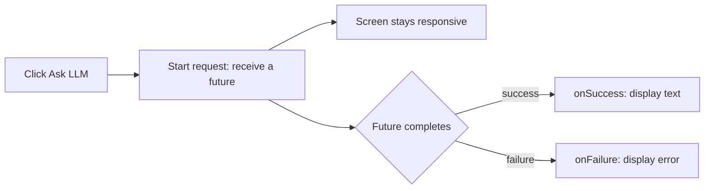

[הכנה מאובטחת בצד Google](setup/) · [English]({{ '/android/topics/firebase-ai-logic/' | relative_url }}?lang=en)

לוחצים **Ask LLM**, רואים **Thinking...**, ואז תשובה שנוצרה מוצגת בתווית אחת. אין צורך במאגר Git חדש, בטבלת נתונים, במחלקת מודל משלנו או במפענח JSON. מתחילים מ־**Empty Views Activity** בשפת **Java**, בחבילה `com.example.topic`, ומשלימים קודם את [עמוד ההכנה](setup/). משאירים את קוד התבנית והתלויות שאינם קשורים לשינוי. נדרשת רמת API של 24 ומעלה; אם בתבנית כבר מוגדר מינימום גבוה יותר, משאירים אותו. השתמשו באמולטור נפרד אם לתרגיל אחר ב־TopicProjects יש אותו מזהה אפליקציה.

## 1. כפתור ותווית שאפשר לגלול

ב־**Gradle Scripts**, בקובץ **build.gradle.kts (Module :app)**, הפעילו View Binding בתוך מקטע `android` הקיים. אם כבר יש `buildFeatures`, הוסיפו רק את ההגדרה `viewBinding`.

```kotlin
android {
    // Keep the existing namespace, SDK levels, build types, etc.
    buildFeatures {
        viewBinding = true
    }
}
```

ב־**app > res > layout**, פתחו את **activity_main.xml** והחליפו רק את רכיב Hello World בפקדים הבאים. משאירים את ConstraintLayout הראשי ואת המזהה `main`. ה־ScrollView מאפשר לקרוא גם תשובה ארוכה.

```diff
android:layout_height="match_parent"
     tools:context=".MainActivity">

-    <TextView
-        android:layout_width="wrap_content"
+    <Button
+        android:id="@+id/ask_llm"
+        android:layout_width="0dp"
         android:layout_height="wrap_content"
-        android:text="Hello World!"
+        android:layout_margin="16dp"
+        android:text="Ask LLM"
+        app:layout_constraintTop_toTopOf="parent"
+        app:layout_constraintStart_toStartOf="parent"
+        app:layout_constraintEnd_toEndOf="parent" />
+
+    <ScrollView
+        android:layout_width="0dp"
+        android:layout_height="0dp"
+        android:layout_margin="16dp"
+        app:layout_constraintTop_toBottomOf="@id/ask_llm"
         app:layout_constraintBottom_toBottomOf="parent"
-        app:layout_constraintEnd_toEndOf="parent"
         app:layout_constraintStart_toStartOf="parent"
-        app:layout_constraintTop_toTopOf="parent" />
-
+        app:layout_constraintEnd_toEndOf="parent">
+        <TextView
+            android:id="@+id/answer_label"
+            android:layout_width="match_parent"
+            android:layout_height="wrap_content"
+            android:text="The answer will appear here."
+            android:textIsSelectable="true" />
+    </ScrollView>
 </androidx.constraintlayout.widget.ConstraintLayout>
```

View Binding ממירה את מזהי XML בשם `ask_llm` ו־`answer_label` לשדות Java בשם `askLlm` ו־`answerLabel`. מחלקת ה־binding נוצרת אוטומטית; אין לכתוב אותה בעצמנו.

## 2. מחברים את המסך ואת המודל שהוכן

ב־**app > kotlin+java > com.example.topic**, פתחו את **MainActivity** והוסיפו את פקודות ה־import האלה מתחת לקיימות:

```java
import androidx.core.content.ContextCompat;
import com.example.topic.databinding.ActivityMainBinding;
import com.google.firebase.FirebaseApp;
import com.google.firebase.appcheck.FirebaseAppCheck;
import com.google.firebase.appcheck.debug.DebugAppCheckProviderFactory;
import com.google.firebase.ai.FirebaseAI;
import com.google.firebase.ai.GenerativeModel;
import com.google.firebase.ai.java.GenerativeModelFutures;
import com.google.firebase.ai.type.Content;
import com.google.firebase.ai.type.GenerateContentResponse;
import com.google.firebase.ai.type.GenerativeBackend;
import com.google.common.util.concurrent.FutureCallback;
import com.google.common.util.concurrent.Futures;
import com.google.common.util.concurrent.ListenableFuture;
```

בתוך `onCreate`, שנו את ההפניות לפריסה כפי שמוצג. גוף מאזין ה־insets נשאר כפי שהוא:

```diff
         EdgeToEdge.enable(this);
+        ActivityMainBinding binding = ActivityMainBinding.inflate(getLayoutInflater());
         setContentView(R.layout.activity_main);
```


-        setContentView(R.layout.activity_main);
+        setContentView(binding.getRoot());
-        ViewCompat.setOnApplyWindowInsetsListener(findViewById(R.id.main), (v, insets) -> {
+        ViewCompat.setOnApplyWindowInsetsListener(binding.main, (v, insets) -> {
             Insets systemBars = insets.getInsets(WindowInsetsCompat.Type.systemBars());


אחרי ה־`});` שסוגר את מאזין ה־insets, אתחלו את Firebase, הפעילו את ספק App Check של התרגול וצרו את מעטפת המודל ל־Java:

```java
FirebaseApp.initializeApp(this);
// Use the classroom token registered on the setup page.
FirebaseAppCheck.getInstance().installAppCheckProviderFactory(
        DebugAppCheckProviderFactory.getInstance());
GenerativeModel ai = FirebaseAI.getInstance(GenerativeBackend.googleAI())
        .generativeModel("gemini-3.8-flash");
GenerativeModelFutures model = GenerativeModelFutures.from(ai);
```

שם המודל הוא דוגמה מתוך [רשימת המודלים הנתמכים](https://firebase.google.com/docs/ai-logic/models), שנבדקה ב־24 באוקטובר 2026. אם המודל יוצא משימוש בהמשך, בחרו מודל טקסט נתמך באותו זמן. לבנאי הזה לא מוסרים מפתח Gemini API.

## 3. מוסיפים את פעולת הלחיצה

מיד אחרי אתחול המודל, עדיין בתוך `onCreate`, הוסיפו:

```java
// Android calls this lambda when the user clicks ask_llm.
binding.askLlm.setOnClickListener(v -> {
    binding.answerLabel.setText("Thinking...");
    binding.askLlm.setEnabled(false); // One request at a time.
    Content prompt = new Content.Builder()
            .addText("Explain a callback in two simple sentences.")
            .build();

    // Start asynchronously: future is a handle, not the answer.
    ListenableFuture<GenerateContentResponse> future = model.generateContent(prompt);
    // Attach ONE callback object with TWO possible outcome methods.
    Futures.addCallback(future, new FutureCallback<GenerateContentResponse>() {
        /** Called on success; result is supplied by the callback mechanism. */
        @Override
        public void onSuccess(GenerateContentResponse result) {
            if (isFinishing() || isDestroyed()) return;
            String text = result.getText(); // SDK already decoded the response.
            binding.answerLabel.setText(text != null ? text : "No text returned.");
            binding.askLlm.setEnabled(true);
        }

        /** Called on failure; error describes what went wrong. */
        @Override
        public void onFailure(Throwable error) {
            if (isFinishing() || isDestroyed()) return;
            binding.answerLabel.setText("Request failed: " + error.getMessage());
            binding.askLlm.setEnabled(true);
        }
    }, ContextCompat.getMainExecutor(this)); // Run BOTH callbacks on the UI thread.
    // This click callback ends now; the screen does not wait for the answer.
});
```

**בצעו Build והריצו עכשיו.** אם זאת ההרצה הראשונה עם ספק ה־debug של App Check, רשמו את הטוקן הפרטי שלו כפי שמוסבר בעמוד ההכנה, ואז נסו שוב. לחצו Ask LLM: התווית אמורה להשתנות מיד, והכפתור יחזור להיות זמין אחרי הצלחה או כישלון.



הקריאה `Futures.addCallback` מקבלת שלושה ארגומנטים: **איזה future**, **איזה אובייקט callback**, ו**איזה executor**. מתודות התגובה ירוצו מאוחר יותר ב־main thread, כי בחרנו במפורש `ContextCompat.getMainExecutor(this)`. הבחירה הזאת קובעת היכן יפעלו ה־callbacks; עבודת הרשת נשארת אסינכרונית. הבדיקות `isFinishing` ו־`isDestroyed` מדלגות על עדכון Activity שנסגרה. הדוגמה הכיתתית אינה משמרת בקשה ממתינה בזמן סיבוב המסך; יציאה מהמסך אינה מבטלת פעולה שכבר הגיעה לשרת.

## מנבאים ובודקים

- שנו את ה־prompt כך שיבקש תשובה בעברית. איזו שורה מספקת את טקסט הבקשה ואיזו מציגה את התוצאה?
- כבו את הרשת ונסו פעם אחת. צפו לשגיאה גלויה ולכפתור שחוזר להיות זמין; הפעילו שוב את הרשת בסיום. ניסוח התשובות המוצלחות עשוי להשתנות בין בקשות.
- התשובה ניתנת לבחירה: העתיקו אותה ל־Notepad++ וקראו אותה כטקסט.

1. **האם ה־future הוא התשובה?** לא. הוא מייצג פעולה אסינכרונית; ה־callback מקבל את התוצאה בהמשך.
2. **למה יש שתי מתודות עם Override?** האובייקט האנונימי מסוג `FutureCallback` מממש תגובה להצלחה ותגובה לכישלון. לכל future תימסר אחת משתי התוצאות.
3. **איפה ה־JSON?** ה־SDK מטפל ב־HTTP ומפענח את התשובה ל־`GenerateContentResponse`. המתודה `getText()` מחלצת טקסט מהאובייקט. ב[מעבדת Petstore]({{ '/android/topics/petstore-json/he/' | relative_url }}) אפשר לבדוק בעצמנו את ה־JSON הגולמי.

מקורות: [דוגמת הבקשה ב־Java של Firebase](https://firebase.google.com/docs/ai-logic/get-started?platform=android), [executor ל־main thread באנדרואיד](https://developer.android.com/reference/androidx/core/content/ContextCompat#getMainExecutor(android.content.Context)).
