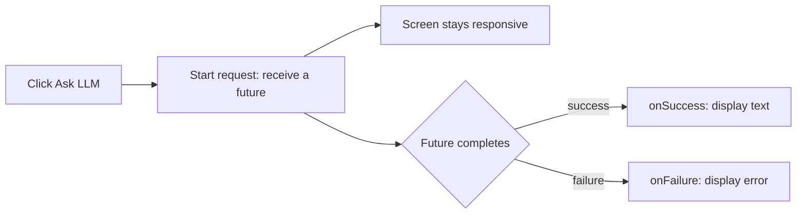

[חובה קודם: 1 — הכנת הפרויקט](setup/) · [English]({{ '/android/topics/firebase-ai-logic/' | relative_url }}?lang=en)

{: .box-warning}
**אין להתחיל את העמוד הזה לפני השלמת [חלק 1 — הכנת הפרויקט](setup/).** שם יוצרים או פותחים את פרויקט Android, מחברים את פרויקט Firebase האישי, מגדירים View Binding, מורידים `google-services.json`, מוסיפים תוסף וספריות ל־Gradle ומאתחלים את Firebase ואת `model`. חוזרים לכאן רק אחרי בדיקת הבנייה שבסיום ההכנה.

{: .box-error}
**כבר בניתם את הממשק, אבל ה־imports של Firebase אדומים?** שמרו את הממשק שלכם. השלימו את [עמוד ההכנה, ובמיוחד את סעיף Gradle](setup/#firebase-sdk), ואז חזרו לכאן. אין צורך להתחיל מחדש או לחזור על הסבת View Binding. מוסיפים כל מקטע אתחול פעם אחת בלבד.

לוחצים **Ask LLM**, רואים **Thinking...**, ואז תשובה שנוצרה מוצגת בתווית אחת. ממשיכים ב**אותה אפליקציה ובפרויקט Firebase האישי שלכם במסלול Spark**, שהוכנו בחלק 1. `com.example.topic` הוא שם החבילה בדוגמה; בניווט השתמשו בחבילה שלכם. אין צורך במאגר נוסף, בטבלת נתונים או במפענח JSON.

{: .box-success}
**נקודת ההתחלה:** ב־Activity כבר יש שדה `binding` ומשתנה מקומי `model` בתוך `onCreate`, אחרי מאזין ה־insets. שניהם עוברים קומפילציה. בעמוד הזה נוסיף את הממשק ואת ה־callback של הבקשה.

## 1. כפתור ותווית שאפשר לגלול

ב־**app > res > layout**, פתחו את **activity_main.xml** והחליפו רק את רכיב Hello World בפקדים הבאים. משאירים את ConstraintLayout הראשי ואת המזהה `main`. ה־ScrollView מאפשר לקרוא גם תשובה ארוכה.

```diff
     android:layout_height="match_parent"
     tools:context=".MainActivity">

-    <TextView
-        android:layout_width="wrap_content"
+    <Button
+        android:id="@+id/ask_llm"
+        android:layout_width="0dp"
         android:layout_height="wrap_content"
-        android:text="Hello World!"
+        android:layout_margin="16dp"
+        android:text="Ask LLM"
+        app:layout_constraintTop_toTopOf="parent"
+        app:layout_constraintStart_toStartOf="parent"
+        app:layout_constraintEnd_toEndOf="parent" />
+
+    <ScrollView
+        android:layout_width="0dp"
+        android:layout_height="0dp"
+        android:layout_margin="16dp"
+        app:layout_constraintTop_toBottomOf="@id/ask_llm"
         app:layout_constraintBottom_toBottomOf="parent"
-        app:layout_constraintEnd_toEndOf="parent"
         app:layout_constraintStart_toStartOf="parent"
-        app:layout_constraintTop_toTopOf="parent" />
-
+        app:layout_constraintEnd_toEndOf="parent">
+        <TextView
+            android:id="@+id/answer_label"
+            android:layout_width="match_parent"
+            android:layout_height="wrap_content"
+            android:text="The answer will appear here."
+            android:textIsSelectable="true" />
+    </ScrollView>
 </androidx.constraintlayout.widget.ConstraintLayout>
```

View Binding ממירה את מזהי XML בשם `ask_llm` ו־`answer_label` לשדות Java בשם `askLlm` ו־`answerLabel`. מחלקת ה־binding נוצרת אוטומטית; אין לכתוב אותה בעצמנו.

## 2. מוסיפים imports לבקשה ואת פעולת הלחיצה

ב־**app > kotlin+java > החבילה שלכם > MainActivity**, הוסיפו רק את ה־imports האלה. משאירים את ה־imports של אתחול Firebase מחלק 1:

```java
import androidx.core.content.ContextCompat;
import com.google.firebase.ai.type.Content;
import com.google.firebase.ai.type.GenerateContentResponse;
import com.google.common.util.concurrent.FutureCallback;
import com.google.common.util.concurrent.Futures;
import com.google.common.util.concurrent.ListenableFuture;
```

מיד אחרי השורה הקיימת `GenerativeModelFutures model = GenerativeModelFutures.from(ai);`, עדיין בתוך `onCreate`, הוסיפו:

```java
// Android calls this lambda when the user clicks ask_llm.
binding.askLlm.setOnClickListener(v -> {
    binding.answerLabel.setText("Thinking...");
    binding.askLlm.setEnabled(false); // One request at a time.
    Content prompt = new Content.Builder()
            .addText("Explain a callback in two simple sentences.")
            .build();

    // Start asynchronously: future is a handle, not the answer.
    ListenableFuture<GenerateContentResponse> future = model.generateContent(prompt);
    // Attach ONE callback object with TWO possible outcome methods.
    Futures.addCallback(future, new FutureCallback<GenerateContentResponse>() {
        /** Called on success; result is supplied by the callback mechanism. */
        @Override
        public void onSuccess(GenerateContentResponse result) {
            if (isFinishing() || isDestroyed()) return;
            String text = result.getText(); // SDK already decoded the response.
            binding.answerLabel.setText(text != null ? text : "No text returned.");
            binding.askLlm.setEnabled(true);
        }

        /** Called on failure; error describes what went wrong. */
        @Override
        public void onFailure(Throwable error) {
            if (isFinishing() || isDestroyed()) return;
            binding.answerLabel.setText("Request failed: " + error.getMessage());
            binding.askLlm.setEnabled(true);
        }
    }, ContextCompat.getMainExecutor(this)); // Run BOTH callbacks on the UI thread.
    // This click callback ends now; the screen does not wait for the answer.
});
```

{: .box-success}
**בנו והריצו עכשיו.** התווית והכפתור צריכים להופיע. לחצו Ask LLM: התווית אמורה להשתנות מיד ל־Thinking, והכפתור יחזור להיות זמין אחרי הצלחה או כישלון.

### הבקשה הראשונה: רושמים את טוקן App Check של ההתקנה
{: #first-request}

{: .box-warning}
**הבקשה הראשונה עשויה להיכשל עד לרישום טוקן ה־debug שלה.** זהו שלב הרשאה בזמן ריצה; הוא אינו גורם ל־imports אדומים ב־Java או לשגיאת קומפילציה ב־Gradle.

1. אחרי הלחיצה הראשונה פתחו **Logcat** וסננו לפי **DebugAppCheckProvider**. העתיקו באופן פרטי את טוקן ה־debug שנוצר.
2. ב**פרויקט Firebase שלכם > Security > App Check > Apps**, פתחו את תפריט שלוש הנקודות של האפליקציה ובחרו **Manage debug tokens**. רשמו את הטוקן.
3. לחצו שוב **Ask LLM**. התשובה אמורה להחליף את Thinking, בתנאי שה־API זמין ויש מכסה.

שמרו את הטוקן באופן פרטי עבור התקנת התרגול שלכם. בטלו אותו כשאינו בשימוש או אם נחשף. [הוראות ספק debug](https://firebase.google.com/docs/app-check/android/debug-provider).

{: .box-error}
**עדיין נכשל בזמן ריצה?** קראו את השגיאה בתווית וב־Logcat: שגיאות App Check מצביעות על רישום הטוקן; `API_KEY_SERVICE_BLOCKED` מצביע על רשימת ה־APIs המותרים למפתח; `404` עשוי להצביע על מודל שאינו זמין; `429` מציין מגבלות מכסה או קיבולת. במקרה של `429` בודקים מכסה וממתינים, ומשאירים את ההגדרה ללא חיוב. השגיאות האלה נפרדות ממחלקות Java שאינן מזוהות.



הקריאה `Futures.addCallback` מקבלת שלושה ארגומנטים: **איזה future**, **איזה אובייקט callback**, ו**איזה executor**. מתודות התגובה ירוצו מאוחר יותר ב־main thread, כי בחרנו במפורש `ContextCompat.getMainExecutor(this)`. הבחירה הזאת קובעת היכן יפעלו ה־callbacks; עבודת הרשת נשארת אסינכרונית. הבדיקות `isFinishing` ו־`isDestroyed` מדלגות על עדכון Activity שנסגרה. הדוגמה הכיתתית אינה משמרת בקשה ממתינה בזמן סיבוב המסך; יציאה מהמסך אינה מבטלת פעולה שכבר הגיעה לשרת.

## מנבאים ובודקים

- שנו את ה־prompt כך שיבקש תשובה בעברית. איזו שורה מספקת את טקסט הבקשה ואיזו מציגה את התוצאה?
- כבו את הרשת ונסו פעם אחת. צפו לשגיאה גלויה ולכפתור שחוזר להיות זמין; הפעילו שוב את הרשת בסיום. ניסוח התשובות המוצלחות עשוי להשתנות בין בקשות.
- התשובה ניתנת לבחירה: העתיקו אותה ל־Notepad++ וקראו אותה כטקסט.

1. **האם ה־future הוא התשובה?** לא. הוא מייצג פעולה אסינכרונית; ה־callback מקבל את התוצאה בהמשך.
2. **למה יש שתי מתודות עם Override?** האובייקט האנונימי מסוג `FutureCallback` מממש תגובה להצלחה ותגובה לכישלון. לכל future תימסר אחת משתי התוצאות.
3. **איפה ה־JSON?** ה־SDK מטפל ב־HTTP ומפענח את התשובה ל־`GenerateContentResponse`. המתודה `getText()` מחלצת טקסט מהאובייקט. ב[מעבדת Petstore]({{ '/android/topics/petstore-json/he/' | relative_url }}) אפשר לבדוק בעצמנו את ה־JSON הגולמי.

מקורות: [דוגמת הבקשה ב־Java של Firebase](https://firebase.google.com/docs/ai-logic/get-started?platform=android), [executor ל־main thread באנדרואיד](https://developer.android.com/reference/androidx/core/content/ContextCompat#getMainExecutor(android.content.Context)).
