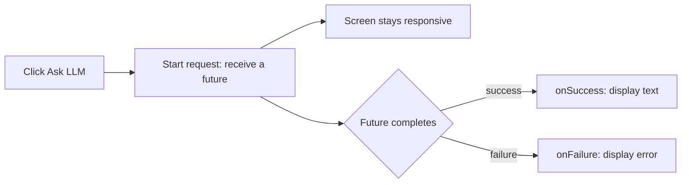

<style>
main {
  direction: ltr !important;
  text-align: left !important;
}
</style>

[Required first: 1 — project setup](setup/) · [עברית]({{ '/android/topics/firebase-ai-logic/he/' | relative_url }}?lang=he)

{: .box-warning}
**Do not start this page before completing [part 1 — project setup](setup/).** That page creates/opens the Android project, links your own Firebase project, configures View Binding, downloads `google-services.json`, adds the Gradle plugin/libraries, and initializes Firebase and `model`. Return here only after its build checkpoint passes.

{: .box-error}
**Already built the UI, but Firebase imports are red?** Keep your UI. Complete [the setup page, especially the Gradle section](setup/#firebase-sdk), then return here. There is no need to restart the project or repeat the View Binding conversion. Add each initialization block only once.

Press **Ask LLM**, see **Thinking...**, then see the generated answer in one label. We continue in the **same app and your own Spark Firebase project** prepared in part 1. `com.example.topic` in the navigation is our example package; use your own package. No extra repository, data table or JSON parser is needed.

{: .box-success}
**Starting checkpoint:** your Activity already has the `binding` field and the local `model` variable inside `onCreate`, after the insets listener. Both compile. This page adds the UI and its request callback.

## 1. One button and a scrollable label

In **app > res > layout > activity_main.xml**, replace only the Hello World TextView with the following children. Keep the root ConstraintLayout and its `main` ID. The ScrollView lets longer answers remain readable.

```diff
     android:layout_height="match_parent"
     tools:context=".MainActivity">

-    <TextView
-        android:layout_width="wrap_content"
+    <Button
+        android:id="@+id/ask_llm"
+        android:layout_width="0dp"
         android:layout_height="wrap_content"
-        android:text="Hello World!"
+        android:layout_margin="16dp"
+        android:text="Ask LLM"
+        app:layout_constraintTop_toTopOf="parent"
+        app:layout_constraintStart_toStartOf="parent"
+        app:layout_constraintEnd_toEndOf="parent" />
+
+    <ScrollView
+        android:layout_width="0dp"
+        android:layout_height="0dp"
+        android:layout_margin="16dp"
+        app:layout_constraintTop_toBottomOf="@id/ask_llm"
         app:layout_constraintBottom_toBottomOf="parent"
-        app:layout_constraintEnd_toEndOf="parent"
         app:layout_constraintStart_toStartOf="parent"
-        app:layout_constraintTop_toTopOf="parent" />
-
+        app:layout_constraintEnd_toEndOf="parent">
+        <TextView
+            android:id="@+id/answer_label"
+            android:layout_width="match_parent"
+            android:layout_height="wrap_content"
+            android:text="The answer will appear here."
+            android:textIsSelectable="true" />
+    </ScrollView>
 </androidx.constraintlayout.widget.ConstraintLayout>
```

View Binding turns XML IDs `ask_llm` and `answer_label` into the Java fields `askLlm` and `answerLabel`. The binding class is generated; do not write it yourself.

## 2. Add the request imports and click action

In **app > kotlin+java > your package > MainActivity**, add only these imports. Keep the Firebase initialization imports from part 1:

```java
import androidx.core.content.ContextCompat;
import com.google.firebase.ai.type.Content;
import com.google.firebase.ai.type.GenerateContentResponse;
import com.google.common.util.concurrent.FutureCallback;
import com.google.common.util.concurrent.Futures;
import com.google.common.util.concurrent.ListenableFuture;
```

Immediately after the existing `GenerativeModelFutures model = GenerativeModelFutures.from(ai);`, still inside `onCreate`, add:

```java
// Android calls this lambda when the user clicks ask_llm.
binding.askLlm.setOnClickListener(v -> {
    binding.answerLabel.setText("Thinking...");
    binding.askLlm.setEnabled(false); // One request at a time.
    Content prompt = new Content.Builder()
            .addText("Explain a callback in two simple sentences.")
            .build();

    // Start asynchronously: future is a handle, not the answer.
    ListenableFuture<GenerateContentResponse> future = model.generateContent(prompt);
    // Attach ONE callback object with TWO possible outcome methods.
    Futures.addCallback(future, new FutureCallback<GenerateContentResponse>() {
        /** Called on success; result is supplied by the callback mechanism. */
        @Override
        public void onSuccess(GenerateContentResponse result) {
            if (isFinishing() || isDestroyed()) return;
            String text = result.getText(); // SDK already decoded the response.
            binding.answerLabel.setText(text != null ? text : "No text returned.");
            binding.askLlm.setEnabled(true);
        }

        /** Called on failure; error describes what went wrong. */
        @Override
        public void onFailure(Throwable error) {
            if (isFinishing() || isDestroyed()) return;
            binding.answerLabel.setText("Request failed: " + error.getMessage());
            binding.askLlm.setEnabled(true);
        }
    }, ContextCompat.getMainExecutor(this)); // Run BOTH callbacks on the UI thread.
    // This click callback ends now; the screen does not wait for the answer.
});
```

{: .box-success}
**Build and run now.** The label and button should be visible. Press Ask LLM: the label should change to Thinking immediately, and the button should become available again after success or failure.

### First request: register your installation's App Check token
{: #first-request}

{: .box-warning}
**The first request may fail until its debug token is registered.** This is a runtime authorization step; it does not cause red Java imports or a Gradle compilation error.

1. After the first click, open **Logcat** and filter for **DebugAppCheckProvider**. Copy the generated debug token privately.
2. In **your Firebase project > Security > App Check > Apps**, open your app's overflow menu and choose **Manage debug tokens**. Register that token.
3. Press **Ask LLM** again. The returned text should now replace Thinking, provided the API and quota are available.

Keep this token private for your test installation. Revoke it when unused or exposed. [Debug-provider instructions](https://firebase.google.com/docs/app-check/android/debug-provider).

{: .box-error}
**Still failing at runtime?** Check the actual label/Logcat error: App Check errors point to token registration; `API_KEY_SERVICE_BLOCKED` points to the API-key allowlist; `404` may indicate an unavailable model; `429` means quota/capacity limits. Wait/check quota for `429`; keep the no-billing setup. These failures are separate from unresolved Java classes.



`Futures.addCallback` receives three arguments: **which future**, **which callback object**, and **which executor**. The callback methods run later on the main thread because we explicitly chose `ContextCompat.getMainExecutor(this)`. This does not move networking onto the UI thread. The `isFinishing` / `isDestroyed` checks skip updates to an Activity that has ended. This classroom example does not preserve a pending request through rotation; leaving the screen does not undo server work.

## Predict and check

- Change the prompt to request an answer in Hebrew. Predict which line supplies the request text and which line displays the result.
- Turn off networking and try once. Expect a visible failure and a re-enabled button; restore networking afterwards. Generated wording varies between successful calls.
- Keep the answer selectable: copy it into Notepad++ and inspect it as text.

1. **Is the future the answer?** No: it represents an asynchronous operation; the callback receives the eventual result.
2. **Why two overridden methods?** The anonymous `FutureCallback` object implements success and failure callbacks. Exactly one outcome is delivered for that future.
3. **Where is the JSON?** The SDK handles HTTP and decodes the response into `GenerateContentResponse`. `getText()` extracts text from that object. Use the [Petstore lab]({{ '/android/topics/petstore-json/' | relative_url }}) to inspect raw JSON yourself.

References: [Firebase's Java request example](https://firebase.google.com/docs/ai-logic/get-started?platform=android), [Android's main-thread executor](https://developer.android.com/reference/androidx/core/content/ContextCompat#getMainExecutor(android.content.Context)).
