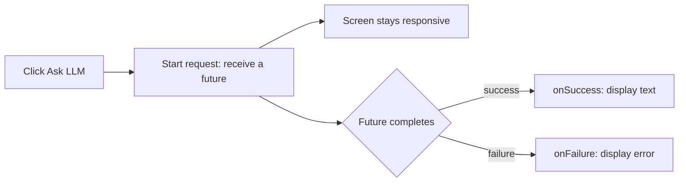

<style>
main {
  direction: ltr !important;
  text-align: left !important;
}
</style>

[Secure Google-side setup](setup/) · [עברית]({{ '/android/topics/firebase-ai-logic/he/' | relative_url }}?lang=he)

Press **Ask LLM**, see **Thinking...**, then see the generated answer in one label. Connect to **your own Firebase project for your yearly Android app**, on **Spark with no linked billing account**, as described on the [setup page](setup/).

The code below starts from a Java **Empty Views Activity**. `com.example.topic` is the example package: use your own package in Android Studio navigation and in the binding import, and register your app's actual `applicationId` with Firebase. Keep that identity as your yearly app grows. If your yearly app already has its own screen, follow this small UI example in an Empty Views exercise before integrating the button there. No new Git repository, data table, model class, or JSON parser is needed. Keep unrelated template code and dependencies. Use Android API 24 or higher; keep a higher template minimum if already set.

## 1. One button and a scrollable label

In **Gradle Scripts > build.gradle.kts (Module :app)**, enable View Binding inside the existing `android` block. If `buildFeatures` already exists, add only its `viewBinding` setting.

```kotlin
android {
    // Keep the existing namespace, SDK levels, build types, etc.
    buildFeatures {
        viewBinding = true
    }
}
```

In **app > res > layout > activity_main.xml**, replace only the Hello World TextView with the following children. Keep the root ConstraintLayout and its `main` ID. The ScrollView lets longer answers remain readable.

```diff
android:layout_height="match_parent"
     tools:context=".MainActivity">

-    <TextView
-        android:layout_width="wrap_content"
+    <Button
+        android:id="@+id/ask_llm"
+        android:layout_width="0dp"
         android:layout_height="wrap_content"
-        android:text="Hello World!"
+        android:layout_margin="16dp"
+        android:text="Ask LLM"
+        app:layout_constraintTop_toTopOf="parent"
+        app:layout_constraintStart_toStartOf="parent"
+        app:layout_constraintEnd_toEndOf="parent" />
+
+    <ScrollView
+        android:layout_width="0dp"
+        android:layout_height="0dp"
+        android:layout_margin="16dp"
+        app:layout_constraintTop_toBottomOf="@id/ask_llm"
         app:layout_constraintBottom_toBottomOf="parent"
-        app:layout_constraintEnd_toEndOf="parent"
         app:layout_constraintStart_toStartOf="parent"
-        app:layout_constraintTop_toTopOf="parent" />
-
+        app:layout_constraintEnd_toEndOf="parent">
+        <TextView
+            android:id="@+id/answer_label"
+            android:layout_width="match_parent"
+            android:layout_height="wrap_content"
+            android:text="The answer will appear here."
+            android:textIsSelectable="true" />
+    </ScrollView>
 </androidx.constraintlayout.widget.ConstraintLayout>
```

View Binding turns XML IDs `ask_llm` and `answer_label` into the Java fields `askLlm` and `answerLabel`. The binding class is generated; do not write it yourself.

## 2. Connect the screen and the prepared model

In **app > kotlin+java > com.example.topic > MainActivity**, add these imports below the existing imports:

```java
import androidx.core.content.ContextCompat;
import com.example.topic.databinding.ActivityMainBinding;
import com.google.firebase.FirebaseApp;
import com.google.firebase.appcheck.FirebaseAppCheck;
import com.google.firebase.appcheck.debug.DebugAppCheckProviderFactory;
import com.google.firebase.ai.FirebaseAI;
import com.google.firebase.ai.GenerativeModel;
import com.google.firebase.ai.java.GenerativeModelFutures;
import com.google.firebase.ai.type.Content;
import com.google.firebase.ai.type.GenerateContentResponse;
import com.google.firebase.ai.type.GenerativeBackend;
import com.google.common.util.concurrent.FutureCallback;
import com.google.common.util.concurrent.Futures;
import com.google.common.util.concurrent.ListenableFuture;
```

Inside `onCreate`, change the existing layout references as shown; keep the insets listener's body unchanged:

```diff
         EdgeToEdge.enable(this);
+        ActivityMainBinding binding = ActivityMainBinding.inflate(getLayoutInflater());
         setContentView(R.layout.activity_main);
```


-        setContentView(R.layout.activity_main);
+        setContentView(binding.getRoot());
-        ViewCompat.setOnApplyWindowInsetsListener(findViewById(R.id.main), (v, insets) -> {
+        ViewCompat.setOnApplyWindowInsetsListener(binding.main, (v, insets) -> {
             Insets systemBars = insets.getInsets(WindowInsetsCompat.Type.systemBars());


After the insets listener's closing `});`, initialize Firebase, install the classroom App Check provider, and create the Java model wrapper:

```java
FirebaseApp.initializeApp(this);
// Use the classroom token registered on the setup page.
FirebaseAppCheck.getInstance().installAppCheckProviderFactory(
        DebugAppCheckProviderFactory.getInstance());
GenerativeModel ai = FirebaseAI.getInstance(GenerativeBackend.googleAI())
        .generativeModel("gemini-3.8-flash");
GenerativeModelFutures model = GenerativeModelFutures.from(ai);
```

The model name is a dated example from the [supported-model list](https://firebase.google.com/docs/ai-logic/models), checked on 25 October 2026. It supports the no-billing Developer API path on that date. If it is retired later, choose a supported text model that still offers free-tier access; do not enable billing to follow the lesson. No Gemini API key is passed to this constructor.

## 3. Add the click action

Immediately after the model initialization, still inside `onCreate`, add:

```java
// Android calls this lambda when the user clicks ask_llm.
binding.askLlm.setOnClickListener(v -> {
    binding.answerLabel.setText("Thinking...");
    binding.askLlm.setEnabled(false); // One request at a time.
    Content prompt = new Content.Builder()
            .addText("Explain a callback in two simple sentences.")
            .build();

    // Start asynchronously: future is a handle, not the answer.
    ListenableFuture<GenerateContentResponse> future = model.generateContent(prompt);
    // Attach ONE callback object with TWO possible outcome methods.
    Futures.addCallback(future, new FutureCallback<GenerateContentResponse>() {
        /** Called on success; result is supplied by the callback mechanism. */
        @Override
        public void onSuccess(GenerateContentResponse result) {
            if (isFinishing() || isDestroyed()) return;
            String text = result.getText(); // SDK already decoded the response.
            binding.answerLabel.setText(text != null ? text : "No text returned.");
            binding.askLlm.setEnabled(true);
        }

        /** Called on failure; error describes what went wrong. */
        @Override
        public void onFailure(Throwable error) {
            if (isFinishing() || isDestroyed()) return;
            binding.answerLabel.setText("Request failed: " + error.getMessage());
            binding.askLlm.setEnabled(true);
        }
    }, ContextCompat.getMainExecutor(this)); // Run BOTH callbacks on the UI thread.
    // This click callback ends now; the screen does not wait for the answer.
});
```

**Build and run now.** If this is the first run with your debug App Check provider, register its private token as described on the setup page, then retry. Press Ask LLM: the label should change immediately, and the button should become available again after success or failure.



`Futures.addCallback` receives three arguments: **which future**, **which callback object**, and **which executor**. The callback methods run later on the main thread because we explicitly chose `ContextCompat.getMainExecutor(this)`. This does not move networking onto the UI thread. The `isFinishing` / `isDestroyed` checks skip updates to an Activity that has ended. This classroom example does not preserve a pending request through rotation; leaving the screen does not undo server work.

## Predict and check

- Change the prompt to request an answer in Hebrew. Predict which line supplies the request text and which line displays the result.
- Turn off networking and try once. Expect a visible failure and a re-enabled button; restore networking afterwards. Generated wording varies between successful calls.
- Keep the answer selectable: copy it into Notepad++ and inspect it as text.

1. **Is the future the answer?** No: it represents an asynchronous operation; the callback receives the eventual result.
2. **Why two overridden methods?** The anonymous `FutureCallback` object implements success and failure callbacks. Exactly one outcome is delivered for that future.
3. **Where is the JSON?** The SDK handles HTTP and decodes the response into `GenerateContentResponse`. `getText()` extracts text from that object. Use the [Petstore lab]({{ '/android/topics/petstore-json/' | relative_url }}) to inspect raw JSON yourself.

References: [Firebase's Java request example](https://firebase.google.com/docs/ai-logic/get-started?platform=android), [Android's main-thread executor](https://developer.android.com/reference/androidx/core/content/ContextCompat#getMainExecutor(android.content.Context)).
