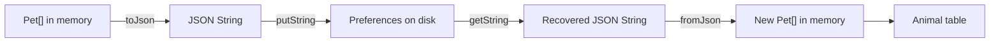

<style>
main {
  direction: ltr !important;
  text-align: left !important;
}
</style>

[Lesson map]({{ '/android/topics/petstore-json/' | relative_url }}) · [Swagger Petstore](https://petstore3.swagger.io/) · [עברית]({{ '/android/topics/petstore-json/he/05-preferences/' | relative_url }}?lang=he)

This optional exercise starts from checkpoint 4. The network lesson is complete. Now use preferences as another place to put JSON text, while keeping exactly the same `Pet` model and parser.



## Add save and restore

Insert two buttons immediately before the table heading, connect their listeners in `onCreate`, and add the methods below. This is a deliberate exercise in small JSON strings, not a recommendation to use preferences for a large animal database.

### app > res > layout > activity_main.xml

Apply these additions and removals; keep the surrounding template code. Lines beginning with `+` are added and lines beginning with `-` are removed. Do not type the markers.

```diff
                 android:layout_width="match_parent"
                 android:layout_height="wrap_content"
                 android:text="Rename first object to Pixel" />
+            <Button
+                android:id="@+id/savePets"
+                android:layout_width="match_parent"
+                android:layout_height="wrap_content"
+                android:text="Save objects as JSON" />
+            <Button
+                android:id="@+id/restorePets"
+                android:layout_width="match_parent"
+                android:layout_height="wrap_content"
+                android:text="Restore saved JSON and objects" />
             <TextView
                 android:layout_width="match_parent"
                 android:layout_height="wrap_content"
```

### app > kotlin+java > com.example.topic > MainActivity

Apply these additions and removals; keep the surrounding template code. Lines beginning with `+` are added and lines beginning with `-` are removed. Do not type the markers.

```diff
         binding.showAll.setOnClickListener(v -> renderPets(pets));
         binding.renameFirst.setOnClickListener(v -> renameFirst());
         binding.postPet.setOnClickListener(v -> postPet());
+        binding.savePets.setOnClickListener(v -> savePets());
+        binding.restorePets.setOnClickListener(v -> restorePets());
     }
 
     /** Fetches JSON as text; no Java Pet objects are created here. */
```

```diff
         queue.add(request);
     }
 
+    /** Persists a JSON representation of the current objects, including in-memory edits. */
+    private void savePets() {
+        String savedJson = gson.toJson(pets);
+        getPreferences(MODE_PRIVATE).edit().putString("pets", savedJson).apply();
+        binding.jsonInput.setText(savedJson);
+        binding.objectStatus.setText("Saved " + pets.length + " animals as JSON text");
+    }
+
+    /** Restores text first, then reconstructs objects through the existing parser. */
+    private void restorePets() {
+        String savedJson = getPreferences(MODE_PRIVATE).getString("pets", "[]");
+        binding.jsonInput.setText(savedJson);
+        parsePets();
+    }
+
     /** Keeps HTTP error bodies visible and distinguishes them from connection failures. */
     private void showError(VolleyError error) {
         NetworkResponse response = error.networkResponse;
```

## What is actually saved?

`putString` stores JSON text, not Java object references. `apply()` updates preferences and schedules the disk write. After restarting, `getString` recovers the text; `parsePets` creates new objects and rebuilds the table. The default `[]` makes Restore before Save produce a valid empty table.

Saving serializes the **current objects**. It therefore includes a rename even when the editable JSON area still contains the earlier text. The save action also displays that new serialized text in the editable area; it leaves the last HTTP response untouched. Restoring works offline and makes no HTTP request.

## Build and verify persistence

1. Load the demo, deserialize it, and rename the first animal to Pixel.
2. Tap Save. Check that the displayed serialized text now contains Pixel.
3. Wait briefly for the preference write. Force stop the app through Android settings, then launch it again. Ordinary Activity fields are recreated, so there is initially no object table.
4. Tap Restore. Expect three animals including Pixel, without GET.
5. Edit JSON in Notepad++, paste it, and deserialize. Save, restart and restore again. Explain each conversion and storage step.

Corrupt preference text is handled by the existing parser. This exercise does not introduce schema migration or automatic state restoration.

[Download checkpoint source]({{ "/android/topics/petstore-json/downloads/05-preferences.zip" | relative_url }})

[Return to lesson map](../)
