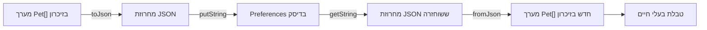

[מפת השיעור]({{ '/android/topics/petstore-json/he/' | relative_url }}) · [Swagger Petstore](https://petstore3.swagger.io/) · [English version]({{ '/android/topics/petstore-json/05-preferences/' | relative_url }}?lang=en)

תרגיל הרשות מתחיל מהמצב הרץ של שלב 4. כעת נשתמש ב־preferences כמקום נוסף לשמירת טקסט JSON, עם אותו מודל `Pet` ואותו קוד המרה.



## מוסיפים שמירה ושחזור

הוסיפו שני כפתורים מיד לפני כותרת הטבלה, חברו את המאזינים שלהם ב־`onCreate` והוסיפו את המתודות שלמטה. התרגיל מדגים שמירת מחרוזות JSON קטנות; מסד נתונים גדול של בעלי חיים יצריך פתרון אחסון מתאים יותר.

<div markdown="1" class="english">

### app > res > layout > activity_main.xml

</div>

בצעו את ההוספות וההסרות האלה והשאירו את קוד התבנית שסביבן. שורות שמתחילות ב־`+` מתווספות ושורות שמתחילות ב־`-` מוסרות. את סימני השינוי עצמם אין להקליד.

```diff
                 android:layout_width="match_parent"
                 android:layout_height="wrap_content"
                 android:text="Rename first object to Pixel" />
+            <Button
+                android:id="@+id/savePets"
+                android:layout_width="match_parent"
+                android:layout_height="wrap_content"
+                android:text="Save objects as JSON" />
+            <Button
+                android:id="@+id/restorePets"
+                android:layout_width="match_parent"
+                android:layout_height="wrap_content"
+                android:text="Restore saved JSON and objects" />
             <TextView
                 android:layout_width="match_parent"
                 android:layout_height="wrap_content"
```

<div markdown="1" class="english">

### app > kotlin+java > com.example.topic > MainActivity

</div>

בצעו את ההוספות וההסרות האלה והשאירו את קוד התבנית שסביבן. שורות שמתחילות ב־`+` מתווספות ושורות שמתחילות ב־`-` מוסרות. את סימני השינוי עצמם אין להקליד.

```diff
         binding.showAll.setOnClickListener(v -> renderPets(pets));
         binding.renameFirst.setOnClickListener(v -> renameFirst());
         binding.postPet.setOnClickListener(v -> postPet());
+        binding.savePets.setOnClickListener(v -> savePets());
+        binding.restorePets.setOnClickListener(v -> restorePets());
     }
 
     /** Fetches JSON as text; no Java Pet objects are created here. */
```

```diff
         queue.add(request);
     }
 
+    /** Persists a JSON representation of the current objects, including in-memory edits. */
+    private void savePets() {
+        String savedJson = gson.toJson(pets);
+        getPreferences(MODE_PRIVATE).edit().putString("pets", savedJson).apply();
+        binding.jsonInput.setText(savedJson);
+        binding.objectStatus.setText("Saved " + pets.length + " animals as JSON text");
+    }
+
+    /** Restores text first, then reconstructs objects through the existing parser. */
+    private void restorePets() {
+        String savedJson = getPreferences(MODE_PRIVATE).getString("pets", "[]");
+        binding.jsonInput.setText(savedJson);
+        parsePets();
+    }
+
     /** Keeps HTTP error bodies visible and distinguishes them from connection failures. */
     private void showError(VolleyError error) {
         NetworkResponse response = error.networkResponse;
```

## מה נשמר בפועל?

`putString` שומרת טקסט JSON. הפניות לאובייקטי Java אינן נשמרות. `apply()` מעדכנת את preferences ומתזמנת את הכתיבה לדיסק. אחרי הפעלה מחדש, `getString` מחזירה את הטקסט; `parsePets` יוצרת אובייקטים חדשים ובונה מחדש את הטבלה. ברירת המחדל `[]` מאפשרת ללחוץ Restore גם לפני Save ולקבל טבלה ריקה תקינה.

פעולת השמירה ממירה את **האובייקטים הנוכחיים** ל־JSON. לכן היא כוללת שינוי שם גם אם באזור העריכה עדיין מוצג הטקסט הישן. השמירה גם מציגה באזור העריכה את הטקסט החדש שנוצר; גוף תשובת HTTP האחרונה נשאר כפי שהיה. השחזור פועל גם בלי רשת ואינו שולח בקשת HTTP.

## בונים ובודקים שהמידע נשמר

1. טענו את הדוגמה, המירו לאובייקטים ושנו את שם בעל החיים הראשון ל־Pixel.
2. לחצו **Save objects as JSON**. ודאו שהטקסט שנוצר ומוצג כעת מכיל Pixel.
3. המתינו מעט לסיום הכתיבה. בצעו Force stop דרך הגדרות Android והפעילו שוב את האפליקציה. שדות ה־Activity נוצרים מחדש, ולכן בתחילה אין טבלת אובייקטים.
4. לחצו **Restore saved JSON and objects**. צפו לשלושה בעלי חיים ובהם Pixel, בלי לשלוח GET.
5. ערכו JSON ב־Notepad++, הדביקו והמירו. שמרו, הפעילו מחדש ושחזרו שוב. הסבירו כל שלב של המרה ואחסון.

טקסט פגום שנשמר ב־preferences מטופל באמצעות אותו קוד המרה. התרגיל אינו מוסיף שינויי גרסה של מבנה הנתונים או שחזור מצב אוטומטי.

[הורדת קוד השלב]({{ "/android/topics/petstore-json/downloads/05-preferences.zip" | relative_url }})

[חזרה למפת השיעור](../)
