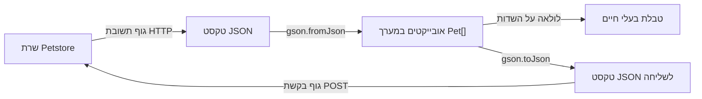

{: .box-note}
שמות הכפתורים, הקוד וקובצי ההורדה נשארו באנגלית וזהים לגרסה האנגלית. לאורך ההסבר נשתמש ב״סריאליזציה״ להמרה מאובייקטים ל־JSON, וב״דה־סריאליזציה״ לשחזור אובייקטים מטקסט JSON.

[מפת השיעור]({{ '/android/topics/petstore-json/he/' | relative_url }}) · [Swagger Petstore](https://petstore3.swagger.io/) · [English version]({{ '/android/topics/petstore-json/' | relative_url }}?lang=en)

הרעיון המרכזי אינו תלוי באנדרואיד: **שרת שולח טקסט; התוכנית משחזרת ממנו אובייקטים; קוד רגיל יכול לעבוד עם האובייקטים האלה.** באנדרואיד נבנה מסך קטן שאפשר להריץ. במעבדה הזאת אין צורך במפתח API, בחשבון לשירות LLM או במידע על בעלי חיים אמיתיים.

נשאיר שלושה ייצוגים גלויים: גוף תשובת HTTP כפי שהתקבל, טקסט JSON שאפשר לערוך, וטבלה שנבנית מאובייקטי Java. ההמרות בין טקסט לאובייקטים יופיעו בשורות קוד מפורשות, כדי שנוכל לעקוב אחריהן.

תצוגה מקדימה: ב־JSON עדיין כתוב Dog 1, ובאובייקט ששינינו כבר כתוב Pixel

בתמונה מהאמולטור גללנו אל התשובה, טקסט ה־JSON לעריכה והטבלה. אחרי GET והמרה לאובייקטים, הכפתור Rename first משנה את שם האובייקט ל־Pixel. שני אזורי הטקסט שומרים על השם המקורי. בעלי החיים ומספרם בשרת הציבורי עשויים להשתנות.

## מסלול הלמידה ונקודת ההתחלה

| שלב | מה נראה בסיומו? |
|---:|---:|
| [1. בקשה ותשובה](01-get/) | נשלח GET ב־Swagger ובאנדרואיד ונראה את טקסט התשובה. |
| [2. מ־JSON לאובייקטים](02-objects/) | נערוך JSON ב־Notepad++, נשחזר אובייקטים ונציג טבלת בעלי חיים. |
| [3. עובדים עם האובייקטים](03-use-objects/) | נסנן בעלי חיים ונשנה שם בלי לעבד שוב את ה־JSON. |
| [4. מאובייקט לגוף בקשת POST](04-post/) | נראה את ה־JSON היוצא ונשווה אותו לתשובת השרת. |
| [רשות: שמירה ושחזור](05-preferences/) | נשמור טקסט JSON ונשחזר את הטבלה אחרי הפעלה מחדש. |

מתחילים מפרויקט **Empty Views Activity**, בשפת **Java**, בחבילה `com.example.topic`. תבנית הבסיס שבה השתמשנו היא Topic3; ה־commit שלה הוא `bf0b0bd`. [הורדת קוד נקודת ההתחלה]({{ "/android/topics/petstore-json/downloads/baseline.zip" | relative_url }}). לעותק עצמאי, חלצו לתיקייה חדשה, פתחו את תיקיית `Topic3` ב־Android Studio והמתינו לסנכרון Gradle. קובצי השלבים להורדה מיועדים להשוואה או להתאוששות; במהלך הלמידה מבצעים את השינויים בעצמנו.

כל פרק ממשיך מהמצב הרץ של הפרק הקודם. משאירים את התלויות, ערכות הנושא, כללי הגיבוי וקובצי הבדיקות שלא נדרש לשנות. גם קוד התבנית לטיפול בשולי המסך — edge-to-edge ו־insets — נשאר. ייתכן שלפרויקטים בתיקיית TopicProjects יש אותו מזהה אפליקציה; השתמשו באמולטור ייעודי כדי לשמור על תרגילים אחרים בטלפון שלכם.

דוגמאות ההמרה עצמן קצרות. המסך הרץ דורש גם XML, פקודות import, פונקציות תגובה, הצגת מצב ושגיאות וביטול בקשות. בטבלה נספרות **כל שורות Java שנוספו, כולל imports, הערות ושורות ריקות**. שינויי XML ו־Gradle נוספים לספירה הזאת.

| מעבר | שורות Java שנוספו | שורות Java שהוסרו |
|---:|---:|---:|
| 01-get | 66 | 2 |
| 02-objects | 67 | 0 |
| 03-use-objects | 23 | 0 |
| 04-post | 47 | 0 |
| 05-preferences | 17 | 0 |

שני השלבים הראשונים מכילים את רוב תשתית המסך והרשת. עברו על העריכות בכל קובץ, ואז בצעו Build בנקודת הבדיקה. לאחר ההכנה הזאת, הסינון ושינוי השם מדגימים בכמה שורות מה אפשר לעשות עם האובייקטים.

## ארבעה מושגים שונים

| מושג | משמעותו בשיעור |
|---:|---:|
| HTTP | פרוטוקול בקשה ותשובה, ובו method, כתובת URL, כותרות וקוד מצב. |
| JSON | צורת כתיבה טקסטואלית לערכים: אובייקטים, מערכים, מחרוזות, מספרים, ערכים בוליאניים ו־null. |
| אובייקט Java | מופע בזיכרון, בעל שדות מטיפוסים מוגדרים, שקוד Java יכול לקרוא ולשנות. |
| Swagger UI | תיעוד API אינטראקטיבי שבו ננסה בקשות לפני שנכתוב קוד. |

אובייקט JSON כמו `{"name":"Milo"}` מגיע כטקסט. הוא אינו הופך מעצמו ל־`Pet`. בכיוון השני, שינוי של `pet.name` משנה אובייקט בזיכרון; המחרוזת שכבר התקבלה והמידע בשרת נשארים כפי שהיו.

## בהמשך: בקשות לשירותי LLM

אותו מסלול ישמש אותנו בהמשך: נבנה נתונים, נמיר אותם ל־JSON, נשלח בקשת HTTP, נקבל טקסט JSON ונשחזר את השדות הדרושים. בשירותי LLM נוספים מבני נתונים ייעודיים, אימות, עלויות ולעיתים תשובה בהזרמה. כאן נבסס תחילה את ההבחנה בין טקסט לאובייקטים.

מקורות: [הגדרת ה־API של Petstore](https://petstore3.swagger.io/api/v3/openapi.json), [בקשות ב־Volley](https://google.github.io/volley/simple.html), [מדריך Gson](https://google.github.io/gson/UserGuide.html).
