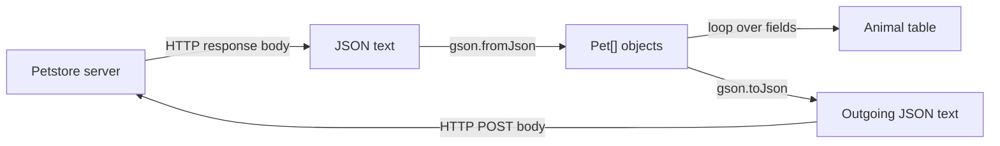

[Lesson map]({{ '/android/topics/petstore-json/' | relative_url }}) · [Swagger Petstore](https://petstore3.swagger.io/) · [עברית]({{ '/android/topics/petstore-json/he/' | relative_url }}?lang=he)

{: .box-note}
For a more advanced alternative, see [Topic 08 — HTTP with Retrofit (in Hebrew)]({{ '/android/topics/08-http-client/' | relative_url }}).
It covers typed JSON conversion, HTTP/network/data errors, timeouts, cancellation, retry, and controlled tests with MockWebServer.
Start here for visible JSON-to-object experiments; choose topic 08 once those foundations are familiar.

The central idea is independent of Android: **a server sends text; your program reconstructs objects from that text; ordinary code can then use those objects.** Android supplies our small runnable screen. No API key, LLM account, or real animal data is needed for this lab.

You will keep three representations visible: the unchanged HTTP response body, editable JSON text, and a table populated from Java objects. Serialization and deserialization will be explicit lines of code, not hidden inside a networking converter.

Screen preview: the JSON still says Dog 1, but the renamed Java object says Pixel

This emulator view is scrolled to the response, editable JSON, and table. After GET and Deserialize, Rename first changes the object to Pixel. The two text areas keep the original name. Public-server animals and counts will vary.

## Route and starting point

| Checkpoint | Observable result |
|:---|:---|
| [1. Request and response](01-get/) | Send GET in Swagger and Android; see the response text. |
| [2. JSON becomes objects](02-objects/) | Edit JSON in Notepad++, deserialize it, and see an animal table. |
| [3. Objects do useful work](03-use-objects/) | Filter and rename animals without processing JSON again. |
| [4. Objects become a POST body](04-post/) | See outgoing JSON and compare it with the server response. |
| [Optional: save and restore](05-preferences/) | Persist JSON text and reconstruct the table after restarting. |

Start with **Empty Views Activity**, **Java**, package `com.example.topic`. The exact template used here is Topic3; its baseline commit is `bf0b0bd`. [Download checkpoint source]({{ "/android/topics/petstore-json/downloads/baseline.zip" | relative_url }}). Unzip into a new folder if you want an independent copy; open its `Topic3` folder in Android Studio and let Gradle sync. Checkpoint downloads are recovery/reference copies, not instructions to overwrite your work.

Each chapter transforms the preceding runnable state. Keep all untouched dependencies, themes, backup rules, test files, and test dependencies. The template's edge-to-edge/insets code stays in place. TopicProjects apps may share an application ID; use a dedicated emulator rather than overwriting another exercise on your phone.

The JSON/conversion examples are small. The complete runnable screen also needs XML, imports, callbacks, status/error display, and cancellation. The table below counts **all added Java lines, including imports, comments, and blanks**; XML and Gradle are additional. These counts separate the Java changes from XML and Gradle setup.

| Transition | Java lines added | Java lines removed |
|:---|---:|---:|
| 01-get | 66 | 2 |
| 02-objects | 67 | 0 |
| 03-use-objects | 23 | 0 |
| 04-post | 47 | 0 |
| 05-preferences | 17 | 0 |

The first two checkpoints carry most of the screen/network scaffolding. Work through each file edit, then build at the named checkpoint. Filtering and renaming provide the small payoff after that setup.

## Four different things

| Term | Meaning in this lesson |
|:---|:---|
| HTTP | The request/response protocol, including method, URL, headers and status. |
| JSON | Text notation for values: objects, arrays, strings, numbers, booleans and null. |
| Java object | An in-memory instance with typed fields that Java code can read and change. |
| Swagger UI | The interactive API documentation where we explore requests before coding. |

A JSON object such as `{"name":"Milo"}` is still text when it arrives. It does not automatically become a `Pet`. Conversely, changing `pet.name` changes an object, not a previously received string or the server.

## Later connection to LLM APIs

The same journey applies: construct data, serialize it, send an HTTP request, receive JSON text, and deserialize the relevant fields. Actual LLM APIs add their own schemas, authentication, costs, and sometimes streaming. Those are later lessons; we establish the text/object boundary here first.

References: [Petstore API definition](https://petstore3.swagger.io/api/v3/openapi.json), [Volley requests](https://google.github.io/volley/simple.html), [Gson guide](https://google.github.io/gson/UserGuide.html).
