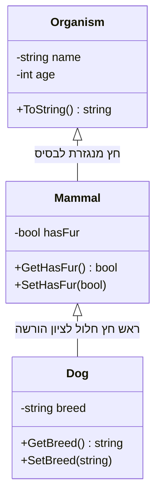

{: .box-note}
**הורשה** היא מנגנון המאפשר לנו להגדיר מחלקה חדשה (יורשת) על בסיס מחלקה קיימת (בסיס). זוהי **אבן יסוד** בתכנות מונחה עצמים. במחלקה היורשת יהיו באופן אוטומטי כל התכונות והפעולות של מחלקת הבסיס. המחלקה היורשת יכולה להוסיף תכונות ופעולות, ואף להחליף פעולות מסויימות ממחלקת הבסיס. מומלץ לצפות ,תחילה ב- [youtube playlist](https://www.youtube.com/playlist?list=PLnVUJu2KuoA0CpYg4ga45Q0C5dGaSEYPH)


<details markdown="1"><summary>מטרות הלמידה</summary>

## מטרות הלמידה

בסיום פרק זה תוכלו:
- להבין את המושג "הורשה" בתכנות מונחה עצמים
- לסרטט היררכיות של הורשה והכלה בין מחלקות
- להבין ולממש את עקרון "הוא סוג של" (IS-A)
- לקרוא, לממש, ולצייר דיאגרמות UML

</details>
---


## כתיבה של הורשה ב-C#

```csharp
public class Animal { }
public class Dog : Animal   // Dog inherits Animal
{

}
```


## תרשים UML של שרשרת הורשה

לעיתים נציג מחלקות בתרשים UML. החץ כלפי מעלה - מהיורשת אל מחלקת הבסיס. על צורת הכתיבה של UML יוסבר בהמשך

<div markdown="1" class="mermaid-class-diagram">



</div>


---

## מימוש בקוד

<details markdown=1><summary>למימוש פשוט</summary>




<div class="box-success" markdown=1>

**סדר פעולות ביצירת עצם ממחלקה יורשת:**
- אם לא מצוין `(...)base` בבנאי של מחלקה יורשת, ייקרא אוטומטית **בנאי ברירת מחדל** של מחלקת הבסיס (**אם קיים**).  
- סדר היצירה של אובייקט יורש הוא: קודם בנאי הבסיס, אחריו בנאי המחלקה הנגזרת.
</div>

---

## שימוש: הדגמה עם מערך עצמים



</details>


---


<details markdown=1><summary>למימוש מעט יותר משוכלל</summary>

<div class="mermaid-class-diagram">
<div class="mermaid" style="direction:ltr;">
classDiagram
    direction TB
    class Organism {
      -static int counter
      -readonly int id
      -string name
      -int age
      +GetId() int
      +ToString() string
    }
    class Mammal {
      -bool hasFur
      +GetHasFur() bool
      +SetHasFur(bool)
      +ToString() string
    }
    class Dog {
      -string breed
      +GetBreed() string
      +SetBreed(string)
      +ToString() string
    }

    Organism <|-- Mammal
    Mammal <|-- Dog
</div>
</div>

בגרסה זו השינויים הבאים:
1. שימוש במשתנה סטטי ליצירת מונה של מופעים והקצאת id לכל עצם
1. למחלקות השונות הוגדר `()override string ToString` שמחזיר יצוג של העצם
1. בכל `ToString` נוספה קריאה לאותה הפעולה במחלקת הבסיס. כך שכל מחלקה מטפלת ומוסיפה רק את **המידע שלה**




פלט
```
0: Rex, age 5, breed Labrador
1: Luna, age 2, breed Husky
2: Milo, age 3, breed Beagle
```
</details>


## רמות גישה (Access Modifiers)
ניתן לקבוע רמות גישה שונות לשדות, תכונות, פעולות ובנאים

**טבלה מסכמת:**

| נגישות       | access modifier                                                      |
|-------------|------------------------------------------------------------------------|
|נגיש מכל מקום בפרויקט.                                                 | `public`    | 
| נגיש רק מתוך המחלקה עצמה.                                              |`private`   | 
|  נגיש מתוך המחלקה עצמה ומתוך **מחלקות שיורשות** ממנה.                       |**`protected`** |
|  נגיש לכל הקבצים באותו Assembly (בבחינת בגרות נרשום **public**). |`internal`  |
{: .table-rl}

---


## "הוא סוג של" – עקרון ה־IS A  

{: .box-note}  
ב-OOP אנו משתמשים בהורשה ליצירת יחס של **"הוא סוג של" (IS A)**.  
מחלקת בן יורשת ממחלקת אב ולכן **היא סוג של** המחלקה שמעליה.  
**ניתן לבדוק זאת בזמן ריצה** בעזרת המילה השמורה `is`.

---

<details markdown=1><summary>דוגמת קוד</summary>

```csharp
public class Animal { }
public class Dog : Animal 
{
    public void Bark() => Console.WriteLine("Woof!");
}

class Program
{
    static void Main()
    {
        Animal a1 = new Dog();
        Animal a2 = new Animal();

        if (a1 is Dog d)  // pattern matching
            d.Bark();   // a1 הוא סוג של Dog → Woof!
        if (a2 is Dog) 
            Console.WriteLine("a2 הוא כלב"); 
        else 
            Console.WriteLine("a2 אינו כלב");
    }
}
```
</details>

---

### סיכום is:

* **IS A** מייצג הורשה – כלב **הוא סוג של** בעל־חיים.
* `is` בודק אם אובייקט שייך לטיפוס מסוים.
* עם **pattern matching** (`obj is Dog d`) אפשר גם לבצע המרה בטוחה לאותו טיפוס.


---

## סיכום

* הורשה יוצרת יחס "הוא סוג של".
* סדר בנאים: מהבסיס אל הנגזר.
* שימוש ב-`private`, `protected`, `public`, `internal` חשוב כדי לשלוט בגישה.
* בבגרות נרשום `public` ולא `internal`.

{: .box-note}
**תרגיל:** הוסיפו מחלקה נוספת `WorkingDog` עם שדה `Task` ובנאי מתאים, והדגימו קריאות ל-Getters/Setters.


---

[Campus playlist - הורשה בלבד](https://www.youtube.com/playlist?list=PLnVUJu2KuoA0CpYg4ga45Q0C5dGaSEYPH)

[המשך - הרחבת נושא הורשה](/oop/01inheritc)

[המשך - הרחבה בנושא בנאים](/oop/01inheritdconstructors)

[קמפוס - מצגת הורשה](https://lomdot.education.gov.il/Qualitest/CSA11B-inherit/index.html)

[קמפוס - מצגת מחלקות אבסטרקטיות](https://lomdot.education.gov.il/Qualitest/CSA11C-abstract/index.html)
