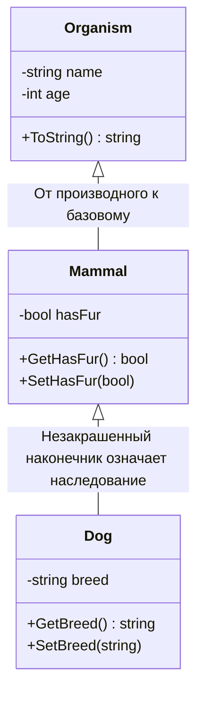

{: .box-note}
**Наследование** позволяет определить новый класс (производный) на основе существующего (базового). Это **один из основных механизмов** объектно-ориентированного программирования. Производный класс наследует данные и методы базового класса с учётом правил доступа. Он может добавлять собственные данные и методы, а также переопределять некоторые методы базового класса. Сначала рекомендуется посмотреть [плейлист YouTube на иврите](https://www.youtube.com/playlist?list=PLnVUJu2KuoA0CpYg4ga45Q0C5dGaSEYPH).

<details markdown="1"><summary>Цели обучения</summary>

## Цели обучения

После этого урока вы сможете:

- Объяснить понятие наследования в ООП.
- Изображать отношения наследования и включения между классами.
- Понимать и применять принцип «является разновидностью» (IS-A).
- Читать, создавать и рисовать диаграммы UML.

</details>

---

## Запись наследования в C#

```csharp
public class Animal { }
public class Dog : Animal   // Dog inherits Animal
{

}
```

## UML-диаграмма цепочки наследования

Иногда мы представляем классы на диаграмме UML. Стрелка направлена вверх: от производного класса к базовому. Правила записи UML рассматриваются далее.

<div markdown="1" class="mermaid-class-diagram">



</div>

---

## Реализация в коде

<details markdown="1"><summary>Простая реализация</summary>



<div class="box-success" markdown="1">

**Порядок вызова конструкторов при создании объекта производного класса:**

- Если в конструкторе производного класса не указано `base(...)`, автоматически вызывается **конструктор без параметров** базового класса, **если он существует и доступен**.
- Сначала выполняется конструктор базового класса, затем — конструктор производного класса.

</div>

---

## Пример использования: массив объектов



</details>

---

<details markdown="1"><summary>Немного более сложная реализация</summary>

<div class="mermaid-class-diagram">
<div class="mermaid" style="direction:ltr;">
classDiagram
    direction TB
    class Organism {
      -static int counter
      -readonly int id
      -string name
      -int age
      +GetId() int
      +ToString() string
    }
    class Mammal {
      -bool hasFur
      +GetHasFur() bool
      +SetHasFur(bool)
      +ToString() string
    }
    class Dog {
      -string breed
      +GetBreed() string
      +SetBreed(string)
      +ToString() string
    }

    Organism <|-- Mammal
    Mammal <|-- Dog
</div>
</div>

В этой версии внесены следующие изменения:

1. Статическая переменная используется как счётчик экземпляров, а каждому объекту присваивается `id`.
2. Метод `override string ToString()` возвращает строковое представление объекта. В показанном коде он определён в `Organism` и переопределён в `Dog`.
3. `Dog.ToString()` вызывает `base.ToString()`: базовый класс формирует свою часть строки, а производный добавляет только **собственные данные**.



Вывод:

```
0: Rex, age 5, breed Labrador
1: Luna, age 2, breed Husky
2: Milo, age 3, breed Beagle
```

</details>

## Уровни доступа (Access Modifiers)

Для полей, свойств, методов и конструкторов можно задавать разные уровни доступа.

**Сводная таблица:**

| Доступность | Модификатор доступа |
|:---|:---|
| Доступен из любого места программы, где доступен сам тип. | `public` |
| Доступен только внутри самого класса. | `private` |
| Доступен внутри самого класса и **классов, наследующих от него**. | **`protected`** |
| Доступен в пределах одной сборки (Assembly). На экзамене багрут используем **`public`**. | `internal` |

---

## Принцип IS-A — «является разновидностью»

{: .box-note}
В ООП наследование выражает отношение **«является разновидностью» (IS-A)**. Производный класс является разновидностью своего базового класса. **Во время выполнения это можно проверить** с помощью ключевого слова `is`.

---

<details markdown="1"><summary>Пример кода</summary>

```csharp
public class Animal { }
public class Dog : Animal
{
    public void Bark() => Console.WriteLine("Woof!");
}

class Program
{
    static void Main()
    {
        Animal a1 = new Dog();
        Animal a2 = new Animal();

        if (a1 is Dog d)  // pattern matching
            d.Bark();   // a1 refers to a Dog -> Woof!
        if (a2 is Dog)
            Console.WriteLine("a2 — собака");
        else
            Console.WriteLine("a2 — не собака");
    }
}
```

</details>

---

### Кратко об `is`

- **IS-A** выражает наследование: собака **является разновидностью** животного.
- `is` проверяет совместимость объекта с указанным типом.
- Сопоставление с образцом (**pattern matching**, `obj is Dog d`) позволяет также получить ссылку на объект нужного типа после успешной проверки.

---

## Итоги

- Наследование создаёт отношение «является разновидностью».
- Конструкторы выполняются от базового класса к производному.
- `private`, `protected`, `public` и `internal` позволяют управлять доступом.
- На экзамене багрут используем `public`, а не `internal`.

{: .box-note}
**Упражнение:** добавьте класс `WorkingDog`, наследующий от `Dog`, с полем `Task` и подходящим конструктором. Покажите вызовы методов чтения и изменения данных (Getters/Setters).

---

Дополнительные материалы и следующие уроки пока доступны на иврите. Сохранённое предпочтение языка будет применено, когда появится перевод.

[Плейлист Campus — только наследование (иврит)](https://www.youtube.com/playlist?list=PLnVUJu2KuoA0CpYg4ga45Q0C5dGaSEYPH)

[Продолжение — подробнее о наследовании]({{ '/oop/01inheritc' | relative_url }})

[Продолжение — подробнее о конструкторах]({{ '/oop/01inheritdconstructors' | relative_url }})

[Campus — презентация о наследовании (иврит)](https://lomdot.education.gov.il/Qualitest/CSA11B-inherit/index.html)

[Campus — презентация об абстрактных классах (иврит)](https://lomdot.education.gov.il/Qualitest/CSA11C-abstract/index.html)
